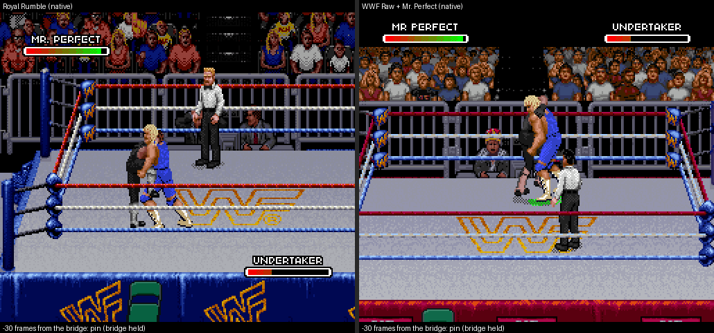

# Perfect-Plex exit: pin, release and both wrestlers' recovery

Branch `claude/charming-allen-njttcx`, draft PR #1. Your note on the previous build: after the bridge, the
opponent went back toward the starting side and Mr. Perfect popped upright. This page records what Royal
Rumble does after the bridge, what Raw now does, how it was planned and verified, and where Raw still
differs. **Status: works in native gameplay and is verified below, but it is not marked done until you review
it** (the GIFs and the differences listed at the end).

Everything native here is controller input from a cold boot. No emulator memory is written. ROMs, captures,
states and memory dumps stay local. Recipes, plans (numbers and addresses only) and GIFs are committed.

## What Royal Rumble does

Captured with `tools/capture_royal_perfect_plex.py`. It replays the verified source match from cold boot
(`data/royal-perfect-source-capture.json`), then the recipe
[`recipes/royal.json`](../evidence/perfect-plex-exit/recipes/royal.json): Mr. Perfect (P1) performs the
Perfect-Plex on the Undertaker (P2). Frames below count from the release.

| | Royal Rumble |
|---|---|
| Pin | The bridge lands with a bounce (8, 4, then 1 px) and is held still: 56 frames from the first bridge frame to the release. The referee does not count. |
| Mr. Perfect | Gets up through six drawings (Royal frames 70/71, 72/73, 74, 76/77, 78/79, 80/81) for 6, 6, 5, 6, 6 and 6 frames. He stands at +35, turned to face the receiver. |
| Receiver | Rolls off over Perfect's head in two drawings (6 + 6 frames), then lies on Perfect's far side from +12, 33 px away. |
| Afterwards | The receiver stays down until P2 presses buttons. The camera does not move. |

**Royal's Perfect-Plex never pins, even when it ends the opponent's health.** A probe continued the match
after the recovery ([`recipes/royal-finishing-plex.json`](../evidence/perfect-plex-exit/recipes/royal-finishing-plex.json)):
P1 kept tying up and pressing R, and P2 mashed B while down. On the third try Royal performed the Perfect-Plex
again; it was identified by the Undertaker's receiving frames 637–654 in the tile-decode probe, and by
Perfect's 12 steps matching the imported drawings. This time it took the Undertaker to 0 health.
- The bridge was again held for exactly 56 frames and released.
- The referee never counted. Perfect got up and the match went on
  ([GIF](../evidence/perfect-plex-exit/royal-finishing-plex-no-count.gif)).
- A pinfall in Royal is a separate player action. So the "pin and release" here is the held bridge and its
  release, and Raw now does the same.
- An earlier probe throw that took him from 7 to 2 health was a different move (none of its frames are
  Perfect-Plex steps), so it is not counted here.

## What Raw does now

| | Before (v4) | Now (v5) |
|---|---|---|
| Pin | Bridge held for 63 frames. | Bridge held for **56 frames** (8 stream entries), as in Royal. Raw's steps vary by a frame, so 56–59 were measured. It has the same landing bounce, which in Raw is a camera shake. |
| Mr. Perfect | Pops straight from the bridge to standing. | Gets up through **Royal's six drawings**, each placed exactly where Royal draws it relative to the bridge. Raw shows each for 7 frames (its step rate), so he stands at +42 instead of +35. Raw's standing action then turns him to face the receiver, as in Royal. |
| Receiver | Raw's downed pose on the side he started from. | Rolls off with Raw's own roll-off drawing, then lies on **Perfect's far side**, 41 px away, using Raw's own lying drawing in his own art. |
| Depth | Unchanged. | Unchanged for both wrestlers (no 7 px push; see below). |

How the six get-up drawings are made:
- Four are Raw's own get-up profiles (`$C8:47BE`, `47D6`, `47E4`, `47F2`). In Mr. Perfect's slot their pieces
  are already Royal frames 70/71, 72/73, 74 and 78/79, so they show Royal's drawing exactly. Edits to those
  pieces carry over.
- Royal frames 76/77 and 80/81 have no Raw drawing. They are imported from Royal like the Perfect-Plex frames
  (tile addresses only; pixels are read from your Royal ROM). They become IDs 1012 and 1013 in the slot and are
  editable in the sprite editor as "Perfect-Plex get-up · 1" and "· 2".

The receiver uses Raw's stock profiles for every wrestler: the roll-off (`$C8:489E`, the drawing Raw's suplexes
end with) and lying (`$C8:477C`). They draw from each wrestler's own art, so gear and edits carry over. Raw has
no drawing for Royal's first roll-off frame, so its roll-off drawing is shown for both (14 frames).

## How it was planned

`tools/plan_perfect_plex_exit.py` derives every number from Royal's capture and writes
[`data/perfect-plex-exit.json`](../data/perfect-plex-exit.json), plus the `exit` section of the importer's
manifest:
1. It finds the bridge in Royal's capture: Royal's Perfect, mirrored into Raw's facing, equals the imported
   step-11 drawing pixel for pixel. That fixes the transform from Royal's screen to the attacker's actor
   coordinates.
2. It splits the frames after the release into Royal's drawings for each wrestler.
3. It fits each of Perfect's drawings against Raw's get-up profiles. The four above fit exactly (IoU 1.0); the
   other two become imported frames.
4. It fits Raw's standing idle drawing to Royal's standing Perfect (lower body; IoU 0.91). That sets how far
   Perfect's actor moves: 1 px.
5. It fits Raw's roll-off (0.991) and lying (0.998) drawings to Royal's Undertaker. That sets how far the
   receiver's actor moves.

What the streams do. A Raw stream entry is `[bank, profile, x move, y move, draw x, draw y]`. The x move and
draw x count along the actor's facing; the draw offsets only shift the drawing (`$80:F0C1`, `$80:F123`).
- **Attacker:** 12 move steps, then 7 held bridge entries. The first release entry moves the actor 1 px, and the
  six get-up entries carry the planned draw offsets. When the stream ends, Raw's standing action takes over.
- **Receiver:** 12 move steps, then 7 held entries. The first release entry moves the actor 80 px past
  Perfect. Two roll-off entries follow, then four lying entries at Raw's own downed-action offsets (9, 8), so
  the downed action continues the drawing without a jump.
- Both streams have 25 entries.
- Receivers without receiving drawings use the same exit through the generic receiving stream.

Two Raw rules shaped this:
- **Spacing 41 px instead of Royal's 33.** A downed actor collides with a standing one at the same depth when
  their x differ by 40 px or less (`$80:E080` for the standing one, `$80:E0D3` for the downed one). Raw then pushes one of them 7 px in depth
  (`$80:DF2E`). The first native run used Royal's 33 px, and the receiver was pushed 7 px toward the camera. At
  41 px both stay on Royal's depth line; Perfect stays exactly where Royal puts him.
- **The actors move at the release, not during the hold.** Raw's camera follows the pair (WRAM `$2E`, `$30`).
  Moving both actors when the hold starts made the camera pan 13 px under the still bridge. Now the 13 px pan
  happens while Perfect gets up. Royal's camera does not move.

## Verification

### Every scenario

`tools/verify_perfect_receivers_native.py` adds PP-5 assertions to every cold-boot scenario:
- The bridge (step 11) stays on screen for Royal's 56 frames.
- Every later step equals the editor preview on at least 97% of pixels, for every receiver. That covers the 7
  held entries, the 6 release entries and Perfect standing with the receiver down. Native pixels are rebuilt
  from OAM/VRAM, following the camera.
- The receiver ends on Perfect's far side at the planned 41 px.
- Neither wrestler's depth changed.

All 20 scenarios pass on both v5 builds: stock import `281bcd36…` and gear reference mod `a3316c5a…`.
Data: [`verification-stock-v5.json`](../evidence/complete-wrestler-art/verification-stock-v5.json) and
[`verification-gear-mod-v5.json`](../evidence/complete-wrestler-art/verification-gear-mod-v5.json); the
recorded values are in each recipe's `expected.exit`. A clean check-mode re-run of all 20 from cold boot
reproduces every recorded value exactly.

| | Result |
|---|---|
| Pin (step 11 on screen) | 56 frames in 15 scenarios; 57 (Luna, left), 58 (Luna, right; Undertaker, right) and 59 (Syxx). The match clock agrees each time. |
| Exit steps vs editor preview | 100% of actor pixels at every step, in all 20 (14 steps each: 7 held, 6 release, standing). |
| Receiver's side and spacing | Perfect's far side in all 20; 41 px in 19. |
| Depth | Unchanged in 19. |
| Ring edge | `doink-attacker-left`: Perfect starts near the left ropes. The ring edge stops the Undertaker 6 px short (35 px), and Raw's collision rule moves Perfect 7 px in depth. Reported as `ring_stop: 6`. |

What the first pass taught the checks:
- **Pin length.** Raw's stream steps last 6 to 8 frames each, in the move itself too. So the pin is 8 entries
  of 55–59 frames, measured by the match clock (WRAM `$0F70`) when it runs. In six matches the clock stands
  still, and the screen count is used instead.
- **Camera.** A frame's OAM is built with the previous frame's camera. While the camera pans, the sprites'
  scroll can trail WRAM by a pixel; one frame in `sting-gear-attacker-left-2` needed that pixel.
- **Release drawings.** These are found where Perfect's drawing changes on screen, not at fixed offsets, so
  frames the game drops do not shift them.
- **Perfect standing.** Checked on the first frames of standing: after a collision push Raw switches to its
  idle drawing at once.
- **Ring edge.** Each wrestler is compared at his actual position. A ring stop and the push it causes are
  reported, not hidden.

### Both wrestlers regaining control

`tools/recovery_bot.py` extends a recipe with one rule, applied the same way in both games:
1. P2 mashes B while the receiver is down, once Perfect stands.
2. Once both stand, P1 walks up and P2 walks down.

It reads only OAM. `tools/check_plex_recovery.py` then confirms from WRAM that each wrestler moved the way his
stick pointed.

Raw used `undertaker-attacker-right`, the Undertaker with Perfect on the right as in Royal's capture, on stock
import v5. Frames count from the first bridge frame.

| | Royal Rumble | Raw (stock import v5) |
|---|---|---|
| Release | +56 | +56 |
| Perfect at full height (the bot's rule) | +84 | +90 |
| Perfect standing (Raw: standing action) | +91 | +97 |
| Receiver back up (P2 mashing from Perfect at full height) | +272 | +171 |
| Walk, 24 frames: P1 up, P2 down (depth y) | 256→242, 254→268 | 219→208, 219→233 |

Reports: [`recovery-royal.json`](../evidence/perfect-plex-exit/recovery-royal.json) and
[`recovery-raw-undertaker-right.json`](../evidence/perfect-plex-exit/recovery-raw-undertaker-right.json).
- In Raw, Perfect never returns to a downed action after the move.
- The receiver goes down (70), gets up (76), stands (0) and walks (12, 10).
- Recipes: [`royal-recovery.json`](../evidence/perfect-plex-exit/recipes/royal-recovery.json) and
  [`undertaker-attacker-right-recovery.json`](../evidence/perfect-plex-exit/recipes/undertaker-attacker-right-recovery.json).

One bot fix along the way: P2 now stops mashing as soon as the receiver starts to rise. B pressed during Raw's
get-up made him strike a pose (action 120) once up, so the first walk did not register.

### Royal and Raw side by side

[`royal-vs-raw-undertaker.gif`](../evidence/perfect-plex-exit/royal-vs-raw-undertaker.gif) shows both games'
native screens:
- They are aligned on the first bridge frame and run until both wrestlers have walked.
- The caption under each panel names the phase from that game's own events.
- Raw's referee stands in front of the pair for part of it; that is Raw's own referee logic.

`tools/make_exit_comparison_gif.py` makes it from the two captures.

## Editor

- The paired preview plays the whole exit: the 12 steps, the held pin, the release, and Perfect standing with
  the receiver down. [Screenshot](../evidence/perfect-plex-exit/editor-preview-exit.png). Positions follow each entry's moves and draw offsets. The preview treats single-colour
  pieces as shadows, as the game does, so Raw's get-up shadows are not painted in Perfect's colours.
- Imports made before this change get the exit through **Update Perfect-Plex**. The marker is `PLEX-CANON2`,
  and receivers are `ROYAL-RX4`.
  - On the v4 stock build, the browser's update gives exactly the bytes of the command-line update
    (`node tools/receivers_cli.js update`).
  - A fresh import and an updated v4 agree on all 1,734 of Mr. Perfect's pieces and on every stream.
- `tools/check_preview_native.py` compares every step, move and exit, with native frames.

## Where Raw still differs from Royal

- **Timing.** Raw steps a stream about every 7 frames (6 to 8). Perfect's get-up takes 42 frames (Royal: 35),
  the receiver's roll-off 14 (Royal: 12), and the pin 56 to 59 (Royal: 56).
- **Spacing.** The receiver lies 41 px from Perfect (Royal: 33), so Raw's collision rule does not push anyone
  (above).
- **Near the ropes** the ring edge can stop the receiver short. In `doink-attacker-left` he stops 6 px short,
  and Raw's collision rule then moves Perfect 7 px in depth. A fixed stream cannot adapt to where the ropes are.
- **Camera.** Raw's camera pans 13 px while Perfect gets up; Royal's stays put.
- **Roll-off.** One Raw drawing stands in for Royal's two.
- **Standing stance.** Raw's standing action shows its own stance drawing (Royal art in Perfect's slot, but not
  Royal's frame 40/41), 3 px higher than Royal's.
- **Receiver recovery time** follows Raw's own downed rules. With the same mashing, Raw's Undertaker got up 81
  frames after Perfect stood; Royal's took 188.
- **The referee** walks where each game's own referee logic puts him.
- **Mirror match** (Perfect receiving): still not reachable in one-on-one, so untested.
