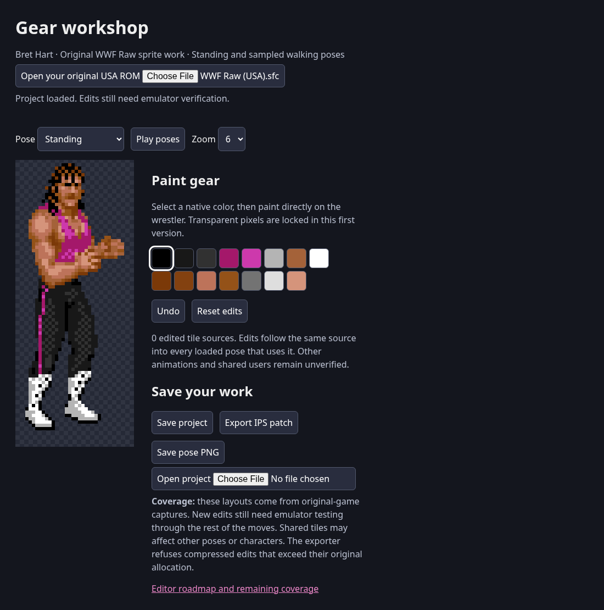

# First gear editor: Bret



## Try it

1. Open [gear-workshop.html](gear-workshop.html) on GitHub and click **Download raw file**.
2. Open that downloaded file in Chrome, Edge or Firefox.
3. Click **Open your original USA ROM** and choose your unmodified WWF Raw ROM.
4. Choose a color and paint on Bret. Use **Save project** to keep editable work,
   or **Export IPS patch** to apply your changes to a copy of the ROM.

The ROM stays on your computer. This repository contains layout addresses and
original-game capture evidence, not a ROM or extracted tile library.

## What works

- 15 original standing and sampled walking layouts, assembled from native OAM
  positions, palettes and flips. Play poses cycles captured samples at a fixed
  preview speed; it does not reproduce the game's animation timing.
- Paint with 15 visible palette slots, or select a slot and use **Change color**
  to choose a new color. Colors snap to the SNES’s 5-bit RGB precision.
  The usage count reports visible pixels in the current pose; changes apply
  wherever the palette slot is used. Transparency is locked.
- Edits change ROM tile sources and appear in every loaded pose using that source.
- Undo, reset, save/load project, native-resolution PNG and IPS export.
- Exact original USA ROM hash validation, optional copier-header removal,
  native sparse-tile compression, allocation checks and HiROM checksum updates.
  Apply patches to an unheadered copy of the original ROM.

Bret is the first editable character. This prototype does not include all twelve
characters, every animation, tile relocation, automatic shared
asset isolation or an emulator inside the editor. A source may also be used in
unloaded actions or by another wrestler. Check edited patches in actual gameplay.
Compressed edits that exceed their original allocations are refused.

## Developer validation

The editor itself needs only a browser. Optional automated verification needs
Python, Pillow, Playwright and Chromium, plus your local original ROM and the
original capture directories described in the repository's evidence reports:

```sh
python3 tools/verify_editor.py '/path/to/WWF Raw (USA).sfc' \
  --capture-root /path/to/raw-analysis --chromium /usr/bin/chromium
```

This serves the editor for local testing, compares 15 assembled sprites against
native OAM extraction, verifies all 215 tile sources re-encode byte for byte,
and exercises painting, palette recoloring/restore/undo, current and legacy
project reload, invalid palette rejection, IPS output/checksum and overflow
refusal. It writes a private test ROM and screenshot under ignored `outputs/`.
See [evidence and limits](../evidence/gear-editor/README.md).

To rebuild the single-file download after changes:

```sh
python3 tools/bundle_editor.py
```

`tools/build_editor_manifest.py` derives address-only layouts from original
capture prefixes (`--snapshot LABEL=PREFIX`); standing should come first so its
compressed sources are available for subsequent walking snapshots. The shipped
walking samples are the first 15 captures from `gear-walk-original`, after the
verified `emulator-coldboot/frame-002940` standing capture.

[Palette editing emulator proof](../evidence/gear-editor/palette-gameplay.png):
an exported patch changes Bret’s pink palette slot to green in the actual game.
