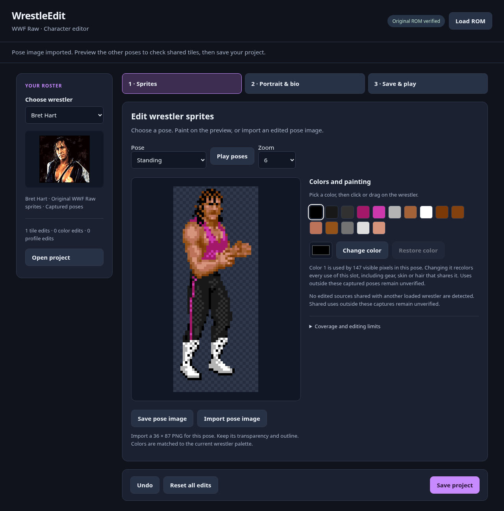

# WrestleEdit — WWF Raw browser app



## Easy download

[**Download WrestleEdit ZIP**](https://github.com/yourpalbones/WWF-Raw-Mod/raw/refs/heads/main/downloads/WrestleEdit-v0.2.zip)

1. Click the download link above.
2. Right-click the downloaded ZIP → **Extract All**.
3. Open the extracted **WrestleEdit** folder and double-click **WrestleEdit.html**. The app opens in your browser.
4. Click **Load ROM** and choose your original WWF Raw USA ROM.
5. Choose a wrestler. Edit **Sprites** or **Portrait & bio**.
6. Under **Save & play**, click **Save playable ROM** and open the saved file in your emulator.

This is the browser editor, not an EXE. Once downloaded, it works offline. Use **Save project** to keep work editable; **Open project** restores it after loading the original ROM. Your original ROM stays unchanged, and no ROM is bundled or uploaded. If you only have an edited ROM, load the original first, then use **Open edited ROM** to recover supported changes. This checks the ROM checksum and refuses changes outside the editor’s supported areas.

A Windows EXE preview was built, but GitHub release uploads are blocked by the cloud integration. Its local task-output link also failed in the chat client. The ZIP above is committed to the repository so it has a normal public download URL. [Desktop build details](../desktop/README.md).

To edit a sprite image externally, use **Save pose image**, edit that PNG, and import it back. Keep its dimensions, transparent outline and opaque visible pixels. Colors are matched to the wrestler's current palette. Import changes the selected pose's underlying tiles; it does not generate a full set of animations. Shared tiles can change other poses too, so preview them and test in an emulator.

## Available previews

| Wrestler | Captured poses |
| --- | ---: |
| Bret Hart | 15 |
| Undertaker | 10 |
| Yokozuna | 7 |
| Bam Bam Bigelow | 4 |
| Razor Ramon | 3 |
| Lex Luger | 11 |
| Doink | 8 |
| Shawn Michaels | 10 |
| 1-2-3 Kid | 10 |
| Diesel | 10 |
| Owen Hart | 8 |
| Luna Vachon | 6 |

These 102 sampled layouts use native positions, palettes and flips. Bret retains
his previous standing/walking set; the other characters use captured movement
sequences that may include opponent interactions. Counts describe sampled poses,
not every animation. **Play poses** cycles samples at a fixed preview speed,
rather than reproducing native animation timing.

## Editing behavior

- Paint with 15 visible palette slots, or select a slot and choose a new color.
  Colors snap to SNES 5-bit RGB. Transparency remains locked.
- The usage count reports visible pixels in the current pose. Palette changes
  recolor all uses of that slot, including skin or hair sharing it.
- Tile edits follow the same ROM source across loaded poses and wrestlers.
  The editor names other loaded wrestlers using an edited shared source.
  Shared users outside these captures remain unverified.
- Switching wrestlers retains your edits. Export includes all edited wrestlers.
- Undo covers tile and palette edits across the roster. **Reset all edits** clears
  the entire project. Save/load projects and native-resolution PNGs are supported.
- Version 5 projects include sprites, palettes, main portraits, monitor photos, name artwork, bios and theme assignments. Versions 1–4 remain supported. Versions 1/2 attach their palette edits to Bret; version 4 renamed characters receive generated name artwork.
- Export validates the original USA ROM hash, accepts an optional copier header,
  uses native sparse compression and updates the HiROM checksum. Compressed
  edits exceeding their original allocations are refused.

Full action coverage, palette ownership outside the verified captures, in-ring tile
relocation, automatic shared-asset isolation and an embedded emulator remain
future work. Test edited patches through the rest of the moves in an emulator.
Original sprite work is retained, including Shawn's original look.

## Selection portraits and bios

Choose a wrestler, then open **Portrait & bio**.

- **Choose portrait image** accepts PNG, JPEG or WebP. Images are centered and cropped
  to 128 × 120, reduced to 64 colors, and snapped to SNES color precision.
  Portrait colors are independent of the in-ring palette.
- Edit name, hometown (**From**), weight, height and the special move label, then
  click **Save bio**. The move label changes the displayed text, not move behavior.
- New names use uppercase letters and spaces, up to 14 characters. Original
  names such as `1-2-3 KID` and the 15-character `BAM BAM BIGELOW` can remain unchanged. Other fields accept supported
  uppercase text and punctuation; line limits are shown beside each field.
- Names are reused elsewhere in the game. Original shared bio strings are kept;
  edited text receives separate storage. The editor shows text-space usage and
  blocks export if the combined edited text will not fit (183 bytes).
- Undo, roster switching, project saving/loading and IPS export include these
  edits. **Restore portrait and bio** restores only the selected wrestler's
  selection assets. **Reset all edits** clears gear and selection edits together.
- An imported portrait, monitor photo or replacement name graphic expands the exported patch target to 4 MiB and relocates
  the new graphics. Your original ROM remains unchanged.

### Small photos, name artwork and themes

- Main portrait uploads also update the **Small monitor photo** by default. Uncheck that option to keep the two images separate. You can import another small photo, click **Use main portrait**, or restore it independently. These images are 48 × 48 with 31 visible colors; export updates the announcer and other verified picture directories.
- The typed name updates the main selection title and shared text. Separate name artwork is used by the Royal Rumble name card and other logo routines. **Save bio** generates new artwork by default when the name changes. You can turn that option off, enter a separate graphic name, upload a transparent logo, or restore the original. Generated names use lettering decoded from your ROM. Imports fit 256 × 224 and 15 visible colors; excessive tile counts are refused.
- **Theme song** lets you choose one of the 12 existing wrestler themes, then click **Save theme**. Undo and projects retain the assignment. This does not import or compose new music.
- **Open edited ROM** recovers editor-supported changes after loading the original ROM. The uploaded test ROM retained its seven replaced portraits and Scott Hall, Syxx and Kevin Nash names; unchanged old logos for renamed wrestlers receive generated replacements. Save a project after recovery.

[See native monitor-photo and name-card proof](../evidence/profile-assets/game-comparison.png).

[See all 12 selection screens with editor-created changes](../evidence/selection-editor/selection-comparison.png).

## Developer validation

The editor needs only a browser. Optional automated verification needs Python,
Pillow, Playwright and Chromium, a local original ROM, the earlier research
captures and the new movement captures:

```sh
python3 tools/verify_editor.py '/path/to/WWF Raw (USA).sfc' \
  --capture-root /path/to/raw-analysis \
  --movement-root outputs/editor-roster-live \
  --chromium /usr/bin/chromium --page gear-workshop.html
```

This compares all 102 browser previews against native OAM extraction, checks
2,174 source tiles re-encode byte for byte, exercises editing and export for all
12 wrestlers, validates roster/legacy projects and shared-source warnings, and
checks invalid palette and compression overflow refusal. Private test ROMs and
screenshots are written under ignored `outputs/`.

See [roster evidence and reproduction](../evidence/roster-editor/README.md).
Regenerate the address-only manifest using `tools/build_roster_editor.py`, then
rebuild the standalone download with `python3 tools/bundle_editor.py`.

To verify portrait decoding/imports, bios, version 4 projects and expanded patch
output (no prior gameplay captures needed for these browser checks):

```sh
python3 tools/verify_selection_editor.py '/path/to/WWF Raw (USA).sfc'
```

Rebuild selection metadata with `tools/build_selection_manifest.py`, then run
`tools/bundle_editor.py`. [Selection evidence and emulator reproduction](../evidence/selection-editor/README.md).

Verify the app workflow, pose PNG imports, local playable-ROM download and mobile layout with:

```sh
python3 tools/verify_app.py '/path/to/WWF Raw (USA).sfc'
```

To verify monitor and logo imports, themes, version 5 projects and edited-ROM recovery:

```sh
python3 tools/verify_profile_assets.py '/path/to/WWF Raw (USA).sfc'
# Optional recovery check for a previous edited ROM:
python3 tools/verify_profile_assets.py '/path/to/WWF Raw (USA).sfc' --edited-rom '/path/to/WWF-Raw-edited.sfc'
```

[Profile asset formats and emulator evidence](../evidence/profile-assets/README.md).
