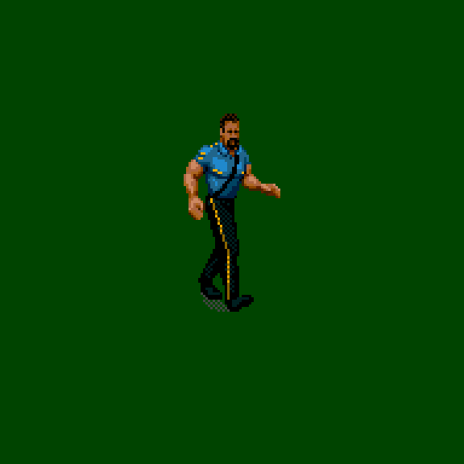

# Big Boss Man — Sega CD source study

Extracted from the supplied WWF Rage in the Cage (USA) CHD. This is a static decoder study, not a Raw import or a native gameplay verification.

## View the artwork



The GIF cycles directory poses 12–17 at illustrative timing. Its palette is temporary grayscale; it does not establish the original animation order or timing.

[Standing/walking sheet](poses-1.png) · [Sheet 2](poses-2.png) · [Sheet 3](poses-3.png) · [Sheet 4](poses-4.png) · [Sheet 5](poses-5.png) · [Sheet 6](poses-6.png) · [Sheet 7](poses-7.png)

## Findings

- Split ZIP reassembled and its CRC check passed.
- CHD SHA-256: `d72b7d09ab07378f6e9bc6d9e12fe82a21c7377ddb00aa4f551e84b130a69b29`.
- Disc ISO label: `WWF_RAGE_IN_THE_CAGE`.
- Separate source files: `MAIN/BOSS.CHR;1` (212,480 bytes) and `MAIN/BOSS.TAB;1` (47,370 bytes).
- 415 composite directory entries parsed without exceptions. This counts directory entries, not distinct complete animations.
- CHR has 28 tile groups: byte-mask compression groups 0–26 and raw 32-byte tiles in group 27. Every mask in groups 1–26 has the expected literal count.
- TAB separates composite references, component packets, component references and a further table whose semantics remain unverified.

Some entries are partial body drawings used in paired/contextual sequences. They must be checked in the running source game before we classify missing artwork or build replacement frames.

Still needed: native Sega CD palette and pixel comparisons, actual sequence order/timing, identification of the Boss Man Slam and receiving sequences, then SNES mapping. A user-supplied USA Sega CD BIOS is needed for native emulator verification. No ROM hooks or existing wrestler graphics were changed.

Reproduce the sheets from privately extracted files:

```sh
python tools/rage_cage_boss_source.py BOSS.CHR BOSS.TAB --output /tmp/boss-source-study
```

Disc images and extracted binary files remain private and are not included here.
