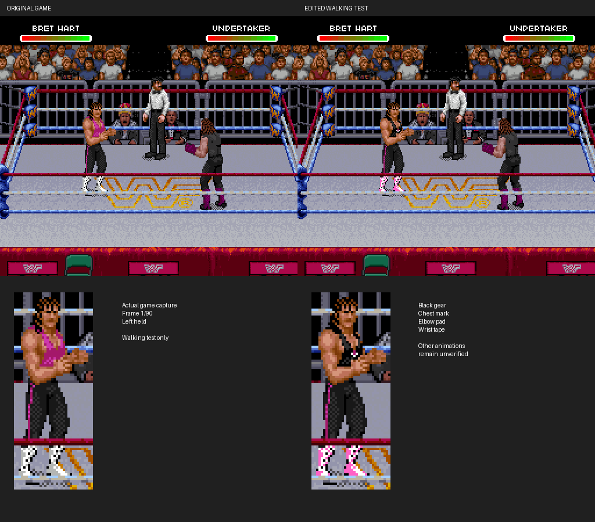

# Black-gear prototype with bare arms

The [movement revision](../bret-movement/README.md) adds observed running poses.
To reproduce this older walking-only patch exactly, use commit `2c4d75f`.

[**Watch the updated walk**](walking-comparison.gif) ·
[Previous pads/tape versus current bare arms](standing-comparison.png)



At the user's request, this revision removes the added elbow pads and wrist
tape. The black singlet, miniature chest logo, tights stripe and pink boot trim
remain. The original skin pixels are restored by rebuilding from the unmodified
ROM, rather than painting over the pads. Earlier padded artwork remains in
Git history if it is wanted again later.

One walking pose's miniature chest mark moves down one pixel to fit its original
compressed allocation with the restored arm pixels. Its five-pixel symbol and
other poses' chest marks remain. No packet relocation or game-code change is
used in this revision.

## Verification

All 90 paired walking frames retain the original object positions and attributes.
**39,255 visible skin-pixel checks** match the original color indices exactly,
and all 450 chest-mark pixel checks pass across the seven observed poses.
The previous padded capture fails the restored-skin check.

There are zero screenshot changes outside Bret's original sprite mask, zero
VRAM changes outside his buffer, and no unexpected palette changes. All 965
compressed tile events match and re-encode exactly. The standing capture has
152 changed screen pixels, all within Bret. Every original skin pixel in the
85 authored source tiles is also preserved. The IPS reproduces the natively
tested ROM exactly, and the original ROM hash remains unchanged.

The GIF uses actual emulator screenshots, sampled every third frame from a
90-frame left walk; it is not synthesized movement. The standing comparison
uses actual game captures and enlarged crops. No ROM or raw memory is published.

**Coverage remains standing and this left walk.** Other moves, attacks, damage,
grapples, rope transitions and opposite-facing movement remain unverified.
We have not established why the original developers chose their gear details.

## Reproduce

Use the current builder and the cold-boot/walking recipe in the
[pose-authored walking notes](../bret-gear-anatomy/README.md). The current
landmark file leaves elbows and wrists empty; the verifier additionally checks
that every original skin pixel stays unchanged.

```sh
python3 tools/build_bret_gear.py "$WWF_RAW_ROM" --output outputs/my-bare-arms
python3 tools/verify_bret_walk.py --before outputs/walk-before \
  --after outputs/walk-after --output outputs/walk-proof
```

Apply the IPS to the verified original USA ROM, not an older gear prototype.
