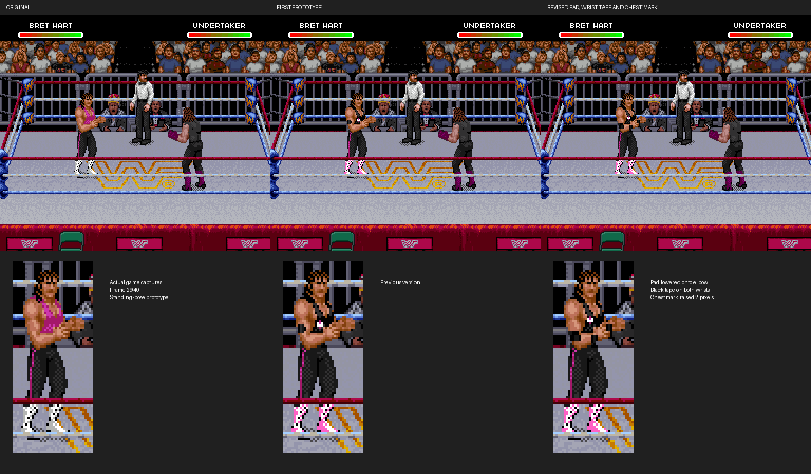

# Bret's black gear: first in-game prototype



This is an actual ROM edit, captured from the running game. The original is on
the left, the first prototype is in the middle, and the revised version is on
the right. The enlarged crops are at the bottom.
The design follows the supplied reference's black singlet and tights, pink
accents, black elbow pad, black wrist tape and light boots with pink trim.
The revision lowers the pad onto the elbow bend and raises the chest mark
two pixels toward the middle of the chest. The chest mark is a
small pink-and-white approximation; detailed lettering, hearts and the skull
logo are not reproduced at this resolution.

**Scope:** ten mapped tiles in the tested standing pose and one palette color.
This is not a finished all-animation outfit replacement. Unmapped poses may
still show original gear. Reused tile effects on other poses or wrestlers are
not yet surveyed. The boot palette change can affect other Bret animations.

## Verification

Two cold boots use the same input sequence and capture frame 2940. The ten
edited tiles match the expected decoded bytes exactly. All other VRAM bytes
are unchanged. Object positions and attributes (OAM) are identical. Only color
6 in Bret's palette differs. The final rendered frame changes 198 pixels, all
within Bret's body: x=70–93, y=86–150. Undertaker, the referee, ring, crowd and
interface are pixel-identical at this frame.

`before.png` and `after.png` are native framebuffer captures. `comparison.png`
uses nearest-neighbor enlargement, without painting over the captures. The
reports record ROM edits and live memory/pixel checks. `sha256.json` checks file
integrity; independent reproduction is the stronger check.

## Reproduce with your own ROM

From the repository root, with Python, Pillow, Git, Make and a C++ compiler:

```sh
python3 -m pip install -r requirements.txt
python3 tools/build_bret_gear.py '/path/to/WWF Raw (USA).sfc' --output outputs/my-black-gear
bash tools/build_snes9x_trace.sh /tmp/wwf-proof-core
```

The builder requires the verified unmodified USA ROM and an empty output
directory. It writes a separate edited ROM, IPS patch and edit report. It
preserves the original file, tile allocation sizes and pointers. No full ROM
is included here; `bret-black-gear.ips` can also be applied with an IPS patcher.

Run both cold boots (each capture output directory must be empty):

```sh
python3 tools/run_headless.py /tmp/wwf-proof-core/libretro/snes9x_libretro.so '/path/to/WWF Raw (USA).sfc' \
  --output outputs/gear-before --frames 2940 --interval 2940 \
  --press 600:3 --press 900:3 --press 1100:8 --press 1300:8 \
  --press 1500:8 --press 1650:3 --press 1830:8 --press 1980:8 \
  --press 2200:3 --press 2400:8 --press 2600:3 --press 2730:3
python3 tools/run_headless.py /tmp/wwf-proof-core/libretro/snes9x_libretro.so outputs/my-black-gear/WWF-Raw-black-gear-prototype.sfc \
  --output outputs/gear-after --frames 2940 --interval 2940 \
  --press 600:3 --press 900:3 --press 1100:8 --press 1300:8 \
  --press 1500:8 --press 1650:3 --press 1830:8 --press 1980:8 \
  --press 2200:3 --press 2400:8 --press 2600:3 --press 2730:3
python3 tools/verify_bret_gear.py '/path/to/WWF Raw (USA).sfc' \
  --before outputs/gear-before --after outputs/gear-after
```

Do not set `WWF_TRACE_DIR` for these runs unless it resolves to the same output
directory. The verifier exits unsuccessfully on unexpected tile, palette,
object, or outside-body pixel changes. Unedited captures fail verification.

## Asset changes

Raw source tiles are unique exact matches to the original pose's VRAM tiles.
Compressed sources were established by the live tile traces. Packets stay
within their original allocation; no ROM expansion or pointer edits are used.
The HiROM checksum and complement are updated. The original uploaded ROM hash
is checked by the builder and verifier before doing any work.
