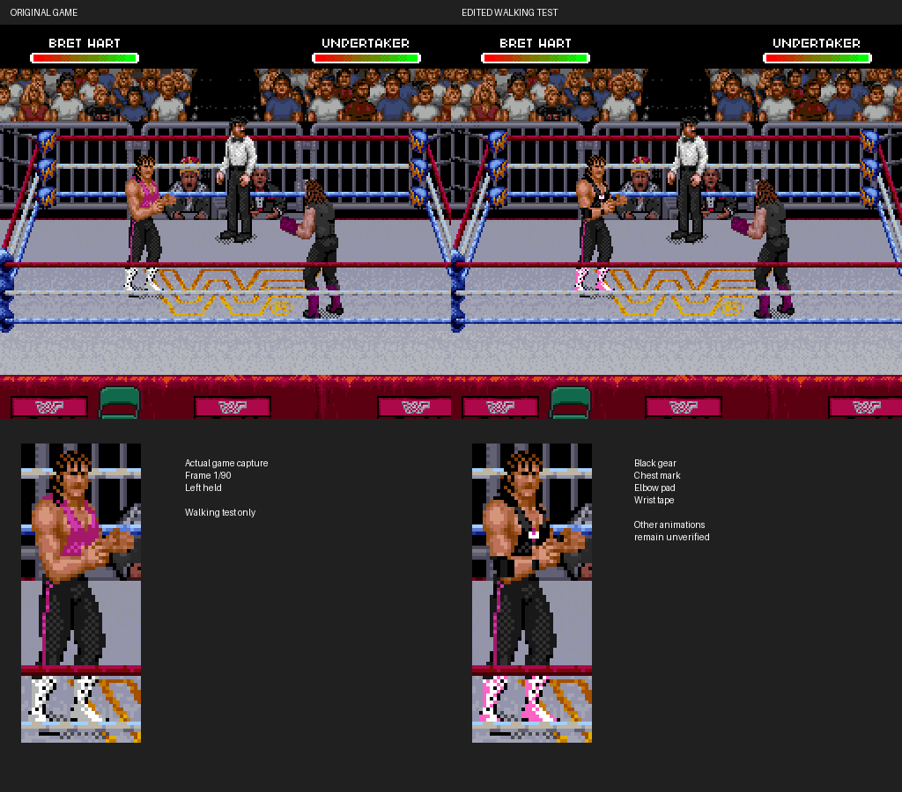

# Bret's black gear: revised placement and walking proof



**[Open the animated walking comparison](walking-comparison.gif)** ·
[Standing comparison](comparison.png) · [Six captured walking poses](walking-poses.png)

The GIF is recorded emulator output: original game on the left, edited game on
the right, with tracked enlarged crops below. Bret moves under a held Left input;
the camera also scrolls. It samples every third frame from a 90-frame, 1.5-second
gameplay run, with a short hold at the loop's ends. It is not an animation built
from disconnected sprite images. GIF colors are quantized; the standing PNGs
are native captures, and verification compares the original capture pixels.

## This revision

The standing chest mark moves two pixels across toward the front-center of the
singlet. The pad extends around the lowest pixels of the elbow bend. Both wrist
bands are narrower and closer to the hands. The black singlet, pink tights stripe
and light boots with pink trim remain inspired by the supplied reference.
Detailed lettering and the skull/wing artwork are still simplified.

The earlier standing-only edit did not cover walking assets. This revision maps
the observed upright left walk, including draft per-pose chest marks, pads and
wrist tape. **These details are for visual review; this is not a finished outfit
replacement across every animation.** Attacks, grapples, knockdowns, facing changes
and other wrestlers have not been surveyed. One shared detail source is excluded
and one detail tile cannot fit without relocation; both are reported explicitly.

## Verified behavior

Two cold boots reach frame 2940. The ten standing-detail tiles match expected
ROM edits exactly; other VRAM, object positions and palettes remain unchanged
except Bret palette color 6 (pink boot trim). The standing capture changes 195
pixels, all within Bret's body.

Both runs then hold Left for 90 frames, capturing every frame. All 90 pairs have
identical object positions and attributes. Every changed screenshot pixel is
inside the original Bret sprite mask. There are zero VRAM differences outside
Bret's tile buffer, and zero palette changes beyond the intended boot color.
965 compressed tile events from 347 sources match the edited ROM byte for byte
and re-encode identically. The original uploaded ROM remains unchanged.

`walk-verification.json` records every frame; `walk-codec-validation.json`
records the codec checks. `patch-report.json` reports source offsets, checksum,
space limitations and ROM hashes. `sha256.json` checks package integrity;
independent reproduction provides the stronger check.

## Reproduce with your own ROM

Requires Python, Pillow, Git, Make and a C++ compiler. From the repository root:

```sh
python3 -m pip install -r requirements.txt
python3 tools/build_bret_gear.py '/path/to/WWF Raw (USA).sfc' --output outputs/my-black-gear
bash tools/build_snes9x_trace.sh /tmp/wwf-proof-core
```

The builder requires the exact verified unmodified USA ROM and an empty output
directory. It writes a separate ROM and IPS patch. It preserves the original,
tile allocations and pointers, and updates the HiROM checksum/complement.
No full ROM is included here. Apply this patch to the original ROM, not to an
older prototype.

First reproduce both cold boots (each output directory must be empty):

```sh
WWF_TRACE_DIR=outputs/gear-before python3 tools/run_headless.py /tmp/wwf-proof-core/libretro/snes9x_libretro.so '/path/to/WWF Raw (USA).sfc' \
  --output outputs/gear-before --frames 2940 --interval 2940 \
  --press 600:3 --press 900:3 --press 1100:8 --press 1300:8 \
  --press 1500:8 --press 1650:3 --press 1830:8 --press 1980:8 \
  --press 2200:3 --press 2400:8 --press 2600:3 --press 2730:3
WWF_TRACE_DIR=outputs/gear-after python3 tools/run_headless.py /tmp/wwf-proof-core/libretro/snes9x_libretro.so outputs/my-black-gear/WWF-Raw-black-gear-prototype.sfc \
  --output outputs/gear-after --frames 2940 --interval 2940 \
  --press 600:3 --press 900:3 --press 1100:8 --press 1300:8 \
  --press 1500:8 --press 1650:3 --press 1830:8 --press 1980:8 \
  --press 2200:3 --press 2400:8 --press 2600:3 --press 2730:3
python3 tools/verify_bret_gear.py '/path/to/WWF Raw (USA).sfc' \
  --before outputs/gear-before --after outputs/gear-after
```

Then run both walks using the corresponding cold-boot states:

```sh
WWF_TRACE_DIR=outputs/walk-before python3 tools/run_headless.py /tmp/wwf-proof-core/libretro/snes9x_libretro.so '/path/to/WWF Raw (USA).sfc' \
  --load-state outputs/gear-before/frame-002940.state \
  --output outputs/walk-before --frames 90 --interval 1 --press 1:6:90
WWF_TRACE_DIR=outputs/walk-after python3 tools/run_headless.py /tmp/wwf-proof-core/libretro/snes9x_libretro.so outputs/my-black-gear/WWF-Raw-black-gear-prototype.sfc \
  --load-state outputs/gear-after/frame-002940.state \
  --output outputs/walk-after --frames 90 --interval 1 --press 1:6:90
python3 tools/verify_bret_walk.py --before outputs/walk-before --after outputs/walk-after --output outputs/walk-proof
python3 tools/validate_traces.py outputs/my-black-gear/WWF-Raw-black-gear-prototype.sfc outputs/walk-after
```

The walking verifier checks every frame and generates the comparison GIF and
pose sheet. It fails on changes outside Bret, object mismatches or unexpected
palette differences. Unedited captures fail verification.

The map is in `data/bret-left-walk.json`. To regenerate its garment pixels and
draft upright-walk details from the original trace:

```sh
python3 tools/map_bret_walk.py '/path/to/WWF Raw (USA).sfc' outputs/walk-before --initial-trace outputs/gear-before --output data/bret-left-walk.json
python3 tools/map_bret_walk_details.py '/path/to/WWF Raw (USA).sfc' outputs/walk-before --initial-trace outputs/gear-before --plan data/bret-left-walk.json
```

This mapping uses an upright-pose garment cutoff, original material masks and
draft landmarks. It is specific to this trace, not a general classifier for
arbitrary actions. New animation coverage requires separate mapping and checks.
