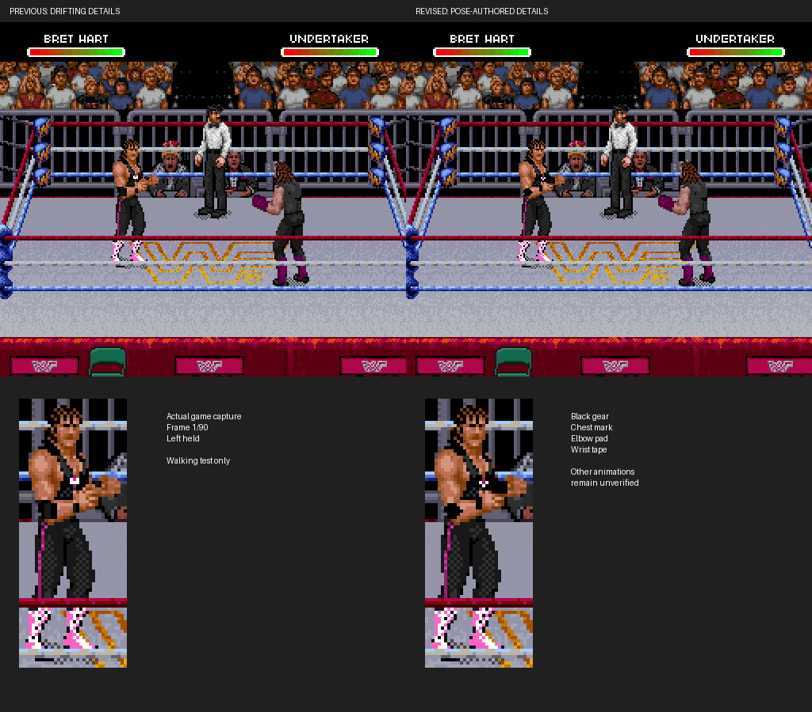

# Pose-authored walking gear revision

[**Watch previous versus revised gameplay**](previous-vs-revised.gif) ·
[Original versus revised gameplay](original-vs-revised.gif) ·
[All seven distinct poses](seven-pose-comparison.png)



The previous walking prototype failed visual review: elbow pads, wrist tape and
the chest mark drifted relative to Bret's anatomy. Its memory checks proved that
changes stayed within Bret, not that the details stayed on the right body parts.

This revision replaces bounding-box landmarks with hand-authored elbows,
wrists and chest positions for **each of the seven distinct observed poses**.
The mapper binds those annotations to exact original tile pixels. It rejects
conflicting source-pixel placements instead of merging them by majority vote.
Standing and walking now use the same source map, avoiding a second standing
edit overwriting the walking artwork. No authored detail is silently dropped to
fit an allocation; all current details fit their existing packets.

The miniature chest emblem is a five-pixel pink/white symbol. Skull and wings
remain simplified. Anatomical placement remains subject to visual review;
these numerical checks do not make artwork judgment automatic.

## Checks and limits

All 90 actual game frames match the authored detail placements: **4,321 pixel
checks**, across all seven poses, including repeated appearances. The earlier
incorrect artwork fails this new check. The input is Left held for 90 frames
following the documented cold-boot standing capture, about 1.5 seconds.

The same 90 pairs preserve OAM positions/attributes and have zero screen changes
outside Bret's original sprite mask, zero VRAM changes outside Bret's buffer,
and no unexpected palette changes. 965 compressed tile events match the ROM
and re-encode exactly. The standing capture changes 200 rendered pixels, all
inside Bret. The original uploaded ROM is unchanged.

**Scope: this observed left walk only.** Attacks, taking attacks, grapples,
throws, knockdowns, getting up, opposite-facing movement, running, ropes,
ringside transitions and other wrestlers are not yet verified. This is a
corrected walking prototype for review, not a finished all-moves outfit.

Both GIFs sample actual emulator screenshots every third frame. Foreground
ropes can occlude the body in full gameplay views. The seven-pose sheet assembles
actual OAM objects with their tiles, flips and palettes; it omits background
occlusion. GIF colors are quantized. No artistic image-generation tool is used.

## Reproduce

Use the cold-boot and 90-frame capture recipe in
[the earlier package](../bret-black-gear/README.md), with the current builder.
Apply the included IPS only to the verified original USA ROM, not a previous
prototype. No ROM, save state or raw memory is published.

```sh
python3 tools/build_bret_gear.py "$WWF_RAW_ROM" --output outputs/my-gear
python3 tools/verify_bret_walk.py --before outputs/walk-before \
  --after outputs/walk-after --output outputs/walk-proof
```

`data/bret-left-walk-landmarks.json` records the authored coordinates and expected
original pose hashes. To regenerate source detail bindings after the garment map:

```sh
python3 tools/map_bret_walk_details.py "$WWF_RAW_ROM" outputs/walk-before \
  --initial-trace outputs/gear-before --plan data/bret-left-walk.json \
  --conflicts outputs/detail-conflicts.json
```

Keep local extracted data in ignored outputs. The mapper fails if a captured
pose does not match its expected sprite hash. Extending to other animations
requires separate anatomical annotations and game recordings.
