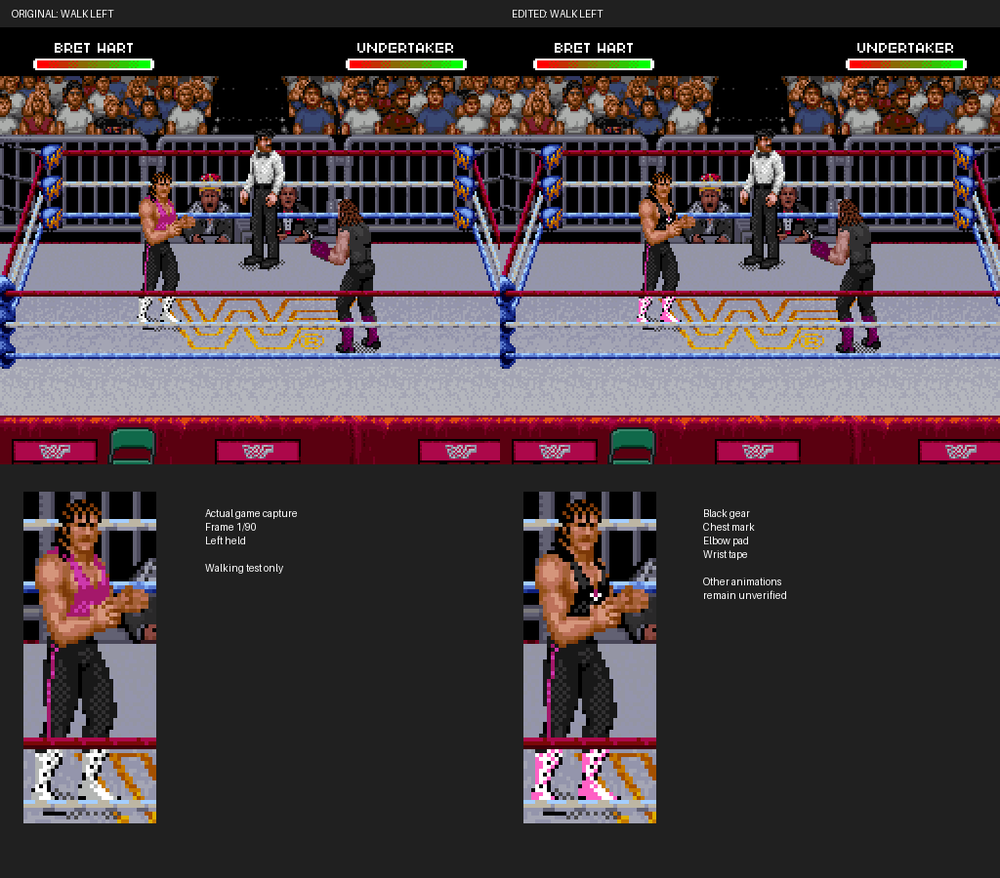

# Walking both directions and observed running poses

[**Watch all four actual-game tests**](movement-comparison.gif)



The black singlet now covers six additional running back/side poses. The front
chest emblem stays on the authored walking poses and is occluded in these
running views. Elbow pads and wrist tape remain removed. Bare skin and the
original tights stripe are preserved.

These are four separate input tests, each starting from the same standing
match state. They are not a continuous match or synthesized sprite animation.
The GIF labels each test, samples every third native screenshot and adds holds
at clip ends; GIF colors are quantized. Verification uses all native frames.

| Test | Paired frames | Separate recording | Limit |
|---|---:|---|---|
| Walk left | 90 | [GIF](walk-left.gif) | Observed facing-right backward walk |
| Walk right | 40 | [GIF](walk-right.gif) | Same seven authored walking poses |
| Run left | 25 | [GIF](run-left.gif) | Three new back/side poses; later rope/ringside animation excluded |
| Run right | 18 | [GIF](run-right.gif) | Three new back/side poses; opponent damage starts at frame 19 |

**This is a movement prototype, not complete match coverage.** The running
clips are short. Other facing directions, turns/stops, later rope transitions,
attacks, receiving damage, grapples, throws and getting up remain unverified.
Other wrestlers and shared-asset uses beyond this observed match also remain
unverified. A future controlled-opponent setup should let us record longer uninterrupted
runs and separately test combat. No claim is made about long-match timing.

## Verified result

All **173 paired frames** retain identical OAM positions/attributes and have
zero screenshot changes outside Bret's original sprite mask, zero VRAM changes
outside his buffer, and no unintended palette changes. **74,180 visible skin
checks** preserve original color indices. The running checks cover 4,316 black
singlet pixels and preserve 1,063 original non-torso pink accent pixels. All
1,852 compressed tile events match the edited ROM and re-encode exactly.

The original input ROM hash remains unchanged. Original skin is also preserved
in all 122 edited/mapped source assets (2,999 checks), including the relocated
packet. The published IPS reconstructs the exact natively tested ROM, with a
correct 4 MiB checksum and complement. Reports and package hashes are included.

## One packet relocation

One running tile grows from its 28-byte allocation to a 29-byte sparse packet.
The ROM expands from 3 MiB to its already-declared 4 MiB size. The new packet is
at file `0x301000`. A 35-byte routine at `0x300000` redirects the resolved source
pointer for `0x1693B0` at the compressed lookup return. It preserves the native
sparse decoder, raw lookup and other compressed pointers. One live lookup
fetched the relocated packet, which then remained in the sprite cache.

This differs from the earlier experimental full-frame raw-copy relocation,
which bypassed compression and failed longer trajectory comparison. That
experiment is not used here. The new pointer redirect and garment edits pass
these four observed input prefixes; longer gameplay remains unverified.

The IPS uses RLE for erased expansion space. It contains selected edits and
the small redirect, not a full ROM. Apply it to the verified original USA ROM,
not an older prototype. Keep ROMs, memory and save states local.

## Reproduce locally

Build the current gear and the pinned read-only trace core. Reproduce both cold
boots with the recipe in [the in-ring notes](../../docs/in-ring-sprites.md), using
the original and newly built ROMs in separate empty capture directories.

```sh
python3 tools/build_bret_gear.py "$WWF_RAW_ROM" --output outputs/my-gear
bash tools/build_snes9x_trace.sh /tmp/wwf-core
```

Then replay the corresponding states. For example, run left:

```sh
WWF_TRACE_DIR=outputs/run-before python3 tools/run_headless.py \
  /tmp/wwf-core/libretro/snes9x_libretro.so "$WWF_RAW_ROM" \
  --load-state outputs/gear-before/frame-002940.state \
  --output outputs/run-before --frames 25 --interval 1 --press 1:6:25 --press 1:1:25
WWF_TRACE_DIR=outputs/run-after python3 tools/run_headless.py \
  /tmp/wwf-core/libretro/snes9x_libretro.so outputs/my-gear/WWF-Raw-black-gear-prototype.sfc \
  --load-state outputs/gear-after/frame-002940.state \
  --output outputs/run-after --frames 25 --interval 1 --press 1:6:25 --press 1:1:25
python3 tools/verify_bret_walk.py --before outputs/run-before --after outputs/run-after \
  --frames 25 --input-description 'Left and Y held for first 25 frames' --output outputs/run-proof
python3 tools/validate_traces.py outputs/my-gear/WWF-Raw-black-gear-prototype.sfc outputs/run-after
```

Libretro direction IDs are Left=6, Right=7; Y=1. Walk tests hold direction only.
Use the frame counts in the table for each verified prefix. The movement verifier
rejects unknown pose hashes, missing frames, misplaced chest marks, changed skin,
non-black running torso pixels, changed tights accents or unrelated PPU changes.

The builder now reads `data/bret-gear.json`, combining the left-walk base map
and regions from `data/bret-running-poses.json`. To extend the base map, copy
`data/bret-left-walk.json` to `data/bret-gear.json` and run
`tools/map_bret_movement.py` on each original running trace with its matching
case and initial original cold-boot trace. This source binding rejects shared
pixels that would need conflicting torso/tights edits.
