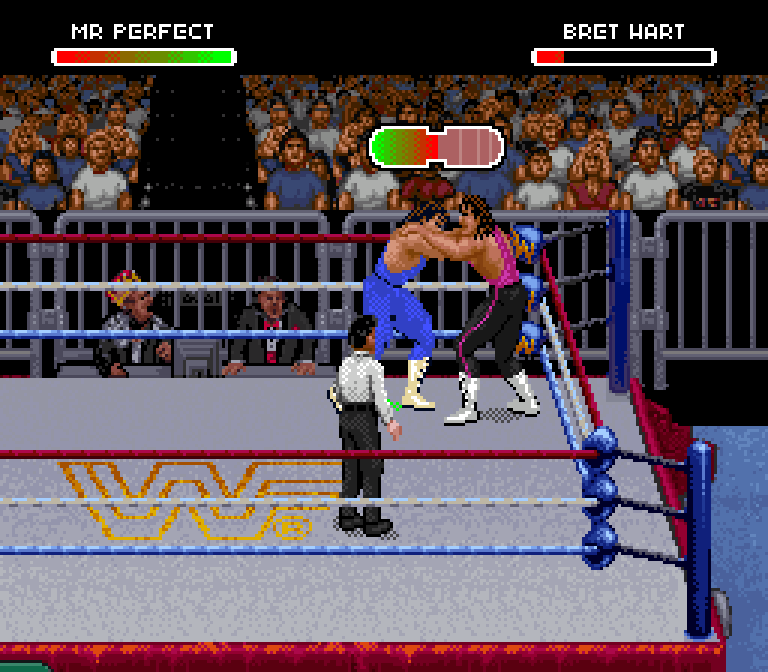
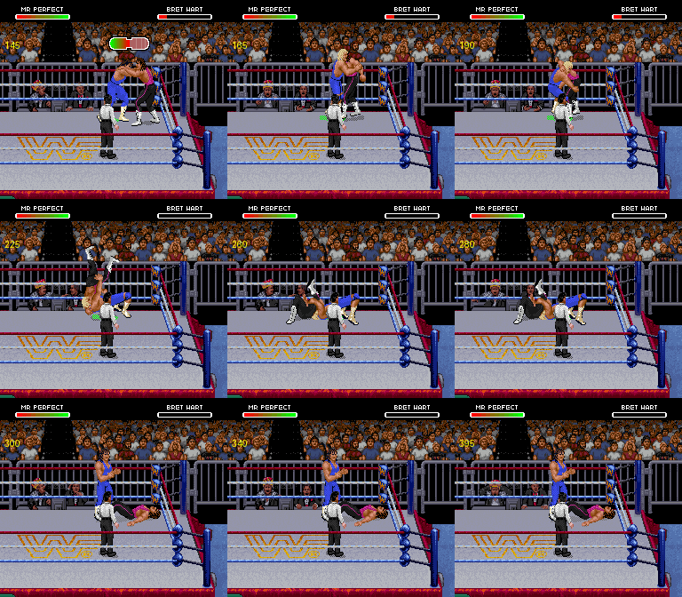

# Independent quick check: Bret receiving the Perfect-Plex in Raw



Codex independently tested Claude PR #1 at commit `93d8e16`, using the actual
browser editor's exported ROM from stock Raw and Royal inputs. The corrected
implementation is still on the draft PR; this evidence does not merge it or
publish a release. This is stock Bret, not a customized Bret gear test.

The cold-boot controller replay `bret-attacker-left-right-rope` passed the
existing defect assertions and reproduced Claude's recorded values exactly:

- 141 move frames measured; 138 fully matched to the expected receiving art.
- Zero registration error in those matched frames; 40-pixel actor spacing.
- All receiving artwork pixels matched in fully matched frames.
- No foreign palette-6 objects; health changed once, from 156 to 0.
- After the move, Perfect returned to standing and Bret displayed downed art;
  neither remained frozen in the lift drawing.



The referee remains visible. Perfect's green shadow remains a known issue.
The referee partly obscures the pair in this scenario. This short capture ends
with Bret downed; it does not independently test later get-up/movement,
bridge-to-pin, the opposite facing or all other receivers. Palette/gear fidelity
needs separate review. A passing coordinate test is not approval of all artwork.

The GIF uses every fourth native frame at approximately normal speed, enlarged
3x with nearest-neighbor sampling; the contact sheet uses native resolution.
Full source captures and ROMs remain private. [Machine-readable result](verification.json).

Reproduction from the PR checkout with locally supplied ROMs and core:

```sh
python tools/verify_royal_import.py RAW.sfc ROYAL.sfc --output EXPORT
python tools/verify_perfect_receivers_native.py CORE \
  EXPORT/perfect-imported.sfc ROYAL.sfc --output CHECK \
  --scenario bret-attacker-left-right-rope --keep
```

Export SHA-256: `f2a81a9118bb302f3572ddd767ff1c0279ec9b3918ad684b3e65061f266a70c6`.
The browser preservation checks also passed: original twelve profiles/assets,
project round trip, edited-ROM reopen, packet growth, portraits/monitors and
theme reassignment, with no browser page errors. No implementation files were
modified for this independent check.
