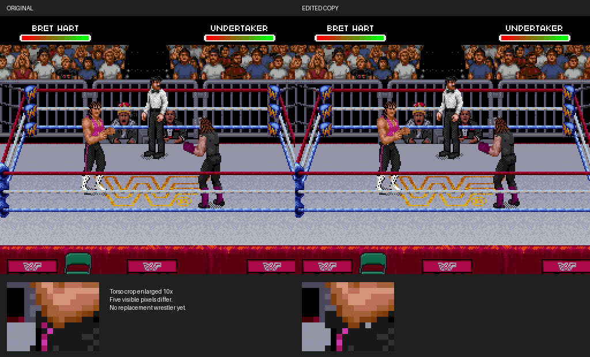

# Bret tile reinsertion: evidence and limits



These are actual emulator framebuffer captures from two cold boots at frame
2940. They are not artist-created reconstructions. `before.png` and `after.png`
are native-resolution captures. The comparison uses nearest-neighbor scaling.
Only five visible pixels differ, in Bret's torso at x=73–80, y=109–111.
This proves a small tile edit; it does not demonstrate a new wrestler or game.

The screenshots and report are outputs of our experiment. To independently
check the claim, use your local original ROM and the included patch with an
SNES emulator, or reproduce both captures using the headless procedure below.
The file hashes check package integrity, not independent authenticity.

## Reproduce

From the repository root, with Python and Pillow installed:

```sh
python3 tools/verify_edit_evidence.py '/path/to/WWF Raw (USA).sfc' --output outputs/proof-copy.sfc
bash tools/build_snes9x_trace.sh /tmp/wwf-proof-core
```

Run the following once with the original ROM and `--output outputs/proof-before`,
then with `outputs/proof-copy.sfc` and `--output outputs/proof-after`. Both output
directories must be absent or empty. Do not set WWF_TRACE_DIR for these runs.

```sh
python3 tools/run_headless.py /tmp/wwf-proof-core/libretro/snes9x_libretro.so '/path/to/WWF Raw (USA).sfc' \
  --output outputs/proof-before --frames 2940 --interval 2940 \
  --press 600:3 --press 900:3 --press 1100:8 --press 1300:8 \
  --press 1500:8 --press 1650:3 --press 1830:8 --press 1980:8 \
  --press 2200:3 --press 2400:8 --press 2600:3 --press 2730:3
python3 tools/verify_edit_evidence.py --before outputs/proof-before --after outputs/proof-after
```

The verifier checks the original ROM hash, applies only the packet and checksum
edits, refuses to overwrite files, checks the exact expected edited VRAM tile,
checks that all other VRAM bytes and the OAM/palette remain unchanged, and
compares all screenshot pixels. An error exits unsuccessfully.

No full ROM is included. Nothing here needs replacing your original ROM.
