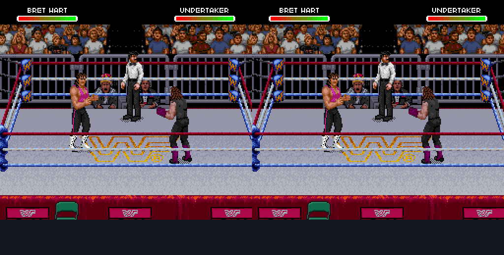

# First ROM-backed gear editor

The first editor supports 15 captured standing/walking layouts and 215 original
ROM tile sources. The browser loads the user's local original USA ROM, decodes
its graphics, assembles native objects, and edits source pixels. The published
layout manifest contains addresses and object metadata, not original tile bytes.

## Verification

- All 15 browser-rendered poses matched native OAM extraction pixel for pixel.
- All 215 sources re-encoded to their original ROM bytes.
- Painting, undo, project reload, IPS tile roundtrip and HiROM checksum passed.
- An oversized compressed edit was refused before patch download.
- The existing 21 decoder/sprite tests passed with the local ROM and live trace
  supplied; none skipped in that run.
- An editor-created patch changed one visible garment pixel at `(76, 86)` in an
  actual cold-boot emulator capture at frame 2940. OAM, CGRAM and PPU register
  snapshots matched the original capture. WRAM was not identical; this is not
  a claim of identical full machine state.

The emulator command used the existing `evidence/bret-tile-edit/README.md`
2940-frame cold-boot button schedule and the existing instrumented Snes9x core.
`tools/verify_editor.py` generates the private `outputs/editor-test.sfc` used in
that run. No ROM or memory snapshots are published here.

This proves a first editor-to-ROM roundtrip, not complete outfit or animation
coverage. Unknown shared users, unmapped ordinary actions and relocation remain
future work. The walking preview cycles samples rather than replaying native
animation timing. Original standing/walking sprite work is retained.
