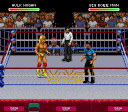

# Hogan and Big Boss Man: 15-slot Raw development build

[Boss Man selection screen](boss-selection.png)

Slots 14 and 15 are independent added entries; the original 12 and Mr. Perfect remain in the table. This private ROM was built from the real browser export of Claude PR #1 head `7b06f6e` and the local user gear mod. No Claude editor/importer files were changed. ROMs are not published.

## Verified in this build

- Cold boot into Hogan versus Boss Man, with the referee and both HUDs present.
- Original 13 profile records remain byte-for-byte unchanged. No populated bytes in the original gear banks were overwritten. Original HUD tiles 0–236 are unchanged.
- Boss Man: 50/50 gameplay snapshots match his Sega CD source pixels and converted palette, covering 18 distinct source poses (walking, punches, kicks and standing).
- Hogan: 48/49 frames match the profile-history checker, all 49 palettes match. Frame 12 was separately compared against every compiled source pose and exactly matches standing pose 0 carried from the same-build starting state; the short replay does not include that earlier request in its recent trace history. The strict trace check therefore remains a recorded failure, rather than being silently loosened.
- Fixed the previous HUD corruption: an 8,324-byte compressed atlas exceeded the old 8,192-byte protected interval. Hogan's packet allocator now skips to `55:B000`, protects 12 KiB and checks the atlas boundary. Both atlas blocks fully decompress; the displayed health bars stay intact during this basic replay.

## Prototype limits and coordination

These are **immutable native test builds, not editor-ready releases**. Boss Man's finisher and full receiving/grapple/recovery artwork are not implemented. Two standard basic roots remain unmapped. Unmapped actions deliberately show standing artwork. Hogan's throw/legdrop adapters retain their previous prototype limits; they were not fully reverified here.

Currently unused banks 4A/54/55 (Hogan) and 5D/5E/6D (Boss Man) overlap the existing gear builders' maximum reservations. Although all were checked empty before writing, reapplying gear could erase these slots. Do not load this prototype into the editor or rebuild gear on it. We must coordinate permanent allocation, added-slot detection and previews with Claude before integration.

The source, shape and palette checks cover the selected wrestlers and the displayed basic replay; they do not certify every match mode or all moves. The controller recipes and exact verification results are included for review.
