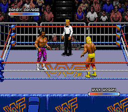
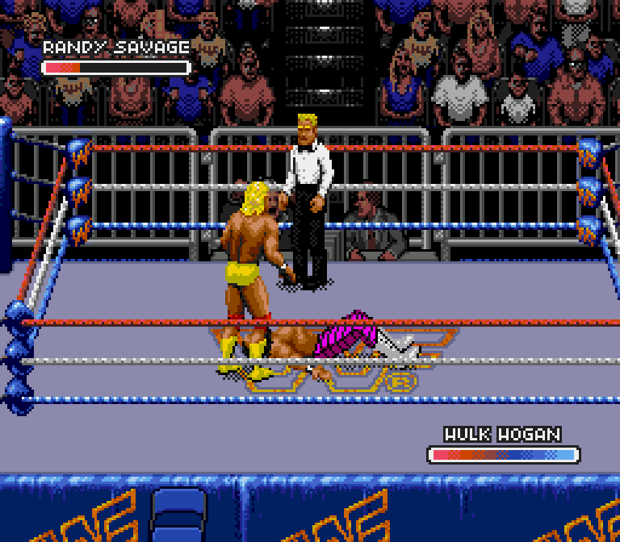

# Hogan source graphics recovered from Genesis Royal Rumble

These are **Genesis gameplay captures**, not Hogan running in Raw yet. The
supplied World ROM has been verified and its native graphic formats decoded.
No ROMs, tile packets or states are published here.

Hogan uses internal source worker 6 (native selector 12). This was established
from native renderer requests and the match identity, rather than his position
in the portrait menu. The source directory contains 835 component entries and
the common composite directory contains 647 pose entries. Counts are not proof
that every Raw action is covered.

Verification:

- 573 completed-object last tiles match the native decoder output byte for byte,
  covering raw, repeated-byte mask, repeated-row mask and solid tile families.
- 69 controlled walking/strike/running source snapshots reconstruct exactly,
  including palette indices, against native sprite memory.
- 62 of 63 checked finisher snapshots reconstruct exactly. The first transition
  at capture frame 12 remains unmatched; all five distinct landing poses
  (475–479) are matched in completed frames. Do not claim all transition frames
  verified. Detailed results are linked below.
- Five focused tests pass, including native decoder comparison, byte/row mask
  boundaries, palette-byte translation and column-major object flips.

In the controlled source match, A+B near a downed, low-health opponent triggers
the rope-run leg drop. Its native action is `0x170`, following the rope run,
with pose entries 115, 57, 58, 475, 476, 477, 478, 479, 479. The source's basic
running, punch and kick artwork was also observed. Raw control routing, a new
Raw slot, palette tuning and complete editable Raw pose coverage remain work.

The GIF uses every fourth native frame at approximately normal speed, enlarged
3x with nearest-neighbor sampling. Source controller actions were used; no
emulator RAM writes or screenshot-painted sprites were used to obtain it.

[Decoder results](source-decoder.json) · [Composite results](source-composites.json)
· [Finisher composite results](source-legdrop-composites.json)

Tools: `build_genesis_royal_trace.sh`, `genesis_royal_graphics.py`,
`genesis_royal_sprites.py`, `genesis_sprite_capture.py`,
`verify_hogan_genesis_capture.py`. Private inputs are required to reproduce.
