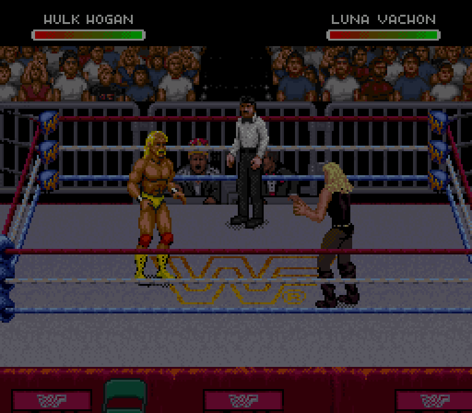
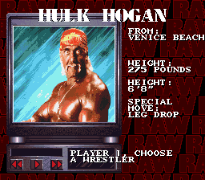
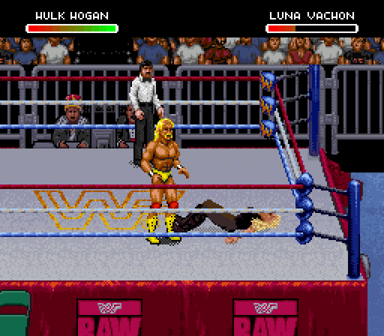

# Hogan in Raw: slot 14, basic motion and a leg-drop landing test

Actual SNES Raw gameplay, using the supplied Genesis Hogan artwork in an added
fourteenth slot. The original twelve and Mr. Perfect remain in their slots.
**This is a development probe, not a complete character or editor release.**

## Verified basic motion

A controller-only cold boot selects logical slot 13 (fourteenth entry). The
referee keeps his own striped artwork and palette: player roles distinguish
Hogan from the referee's otherwise matching selector.

Twenty-three converted source poses cover standing/walking in all directions,
punch, kick and run. Two native replay checks match **199/199** body snapshots
and **199/199** palettes. Body pixels are reconstructed independently from actual
Raw OAM/VRAM and compared with the supplied source ROM, including facing flips.
[Verification summary](native-motion-verification.json)

Raw controls: directions walk, **B** punch, **A** kick, **Y** run. Native traces
establish these routes; Raw punch/kick action numbers differ from Genesis.
Hogan's converted tiles are private to him. The proof uses the corrected
stock-based thirteen-slot browser export. Preservation of the user's customized
Hall/Nash/Syxx/Sting mod remains untested.

## Contextual R leg-drop landing test

The separate `build_hogan_legdrop_probe.py` experiment plays all nine source
records, including landing poses 475–479, through Raw's ground-finisher R route.
The opponent retains her own native downed/hurt graphics. This test is against
Luna; every other receiver still requires testing.

- A **13,764-frame controller-only cold run** reaches the finish without loading
  a save state or writing RAM.
- All **176/176** checked gameplay bodies and palettes match the source art across
  the landing and subsequent recovery/control checks. The selection and paused
  snapshots are excluded explicitly; pause alters the palette.
- Health falls **293 → 133**, once, at landing: 160 damage. Later health increases
  are regeneration.
- The attacker's paired link and marker clear. Hogan walks afterward; once Luna
  stands, normal punch and kick inputs produce their expected actions again.
- Hogan, Luna and referee selectors/roles remain unchanged throughout.
- **Automatic running to the ropes is not implemented.** This verifies landing,
  damage and recovery, rather than the complete source finisher sequence.

[Pixel checks](native-legdrop-pixels.json) ·
[Behavior checks](native-legdrop-behavior.json) ·
[Full cold controller recipe](legdrop-cold-controller-replay.json)

## Remaining work

Unmapped actions deliberately show standing artwork. This is not all-animation
coverage. Grapple/receiving/rope/weapon/other special poses, all receivers, AI and
match variants, custom-user-mod preservation and browser import/export remain
unfinished. **The editor must not treat this probe as a supported release.**

## Reproduce privately

Build `tools/build_snes9x_hogan_trace.sh BUILD_DIRECTORY` for the pinned read-only
observer. Supply the corrected thirteen-slot ROM, the user's Genesis ROM, stock
Raw and a private 128×120 native source portrait to
`tools/build_hogan_motion_probe.py ... --output PRIVATE.sfc`, or use the separate
`build_hogan_legdrop_probe.py` for the landing experiment. The builders reject an
unsupported source revision, occupied allocation banks and unsupported base.

[Basic controller recipes](controller-replay.json) record cold boot plus two
short motion checks. The landing recipe is a continuous cold replay on one ROM.
Run `tools/run_headless.py` using those inputs with `WWF_TRACE_DIR` and
`WWF_HOGAN_PROBE=1`. Then run `tools/verify_hogan_raw_motion.py GENESIS ROOT_TRACE
CAPTURES --output REPORT`; add `--legdrop --min-frame 12068` for the landing cold
run to exclude the earlier menu/pause screenshots. The observer only reads game
memory. No ROMs, states, tile bytes or memory dumps are published here.
