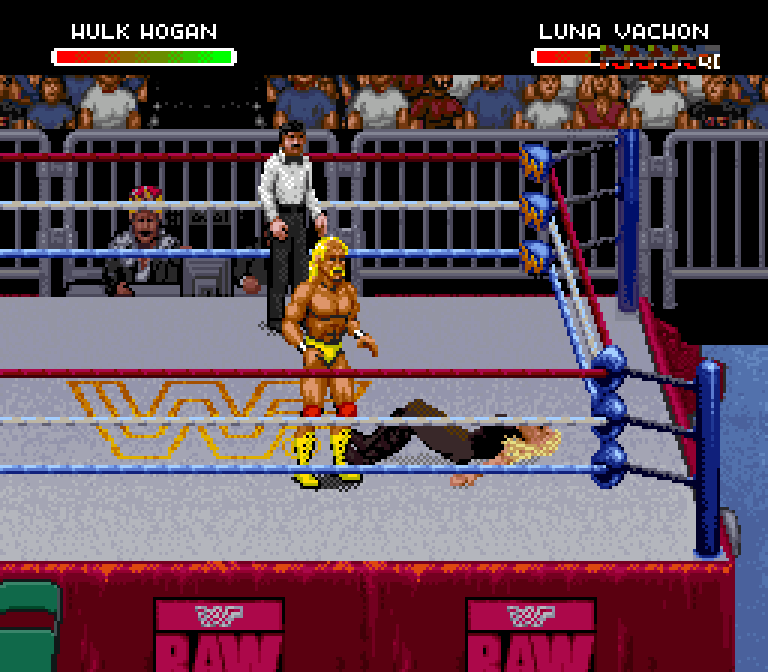

# Hogan alongside the current user gear mod

This repeats the slot-14 landing/recovery test using the local current
Hall/Nash/Syxx/Sting mod, rather than only the stock-based development ROM.
Mr. Perfect is imported through the actual browser editor from Claude PR #1 at
`ca8e647` (RX3), then the separate Hogan development builder is applied.

The 13,764-frame cold controller replay passes: 176/176 checked gameplay bodies
and palettes match source pixels, damage occurs once (160), the referee remains
present, and normal attacks resume after the receiver stands. Existing Scott,
Nash, Syxx and Sting graphics, thirteen profile records and gameplay palettes
remain byte-for-byte unchanged by adding Hogan in the named ranges.

[Pixel check](native-pixels.json) ·
[Preservation and behavior](preservation-and-behavior.json) ·
[Cold replay](controller-replay.json)

**Not an editor-ready release.** The test uses currently empty portions of
Scott/Nash's reserved maximum packet pools. The editor must reserve that space
or relocate Hogan before allowing those gear packs to be rebuilt. All-animation
coverage, source A throw, all receivers, full finisher rope running and editor
integration remain unfinished. This checks storage preservation; it does not
exercise every other wrestler's animation in live gameplay.
