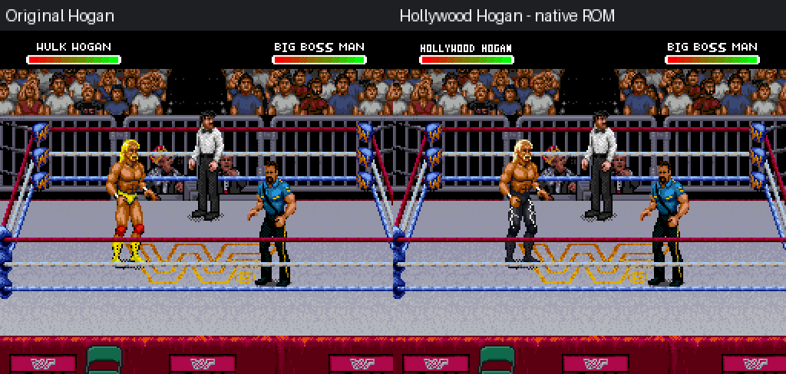
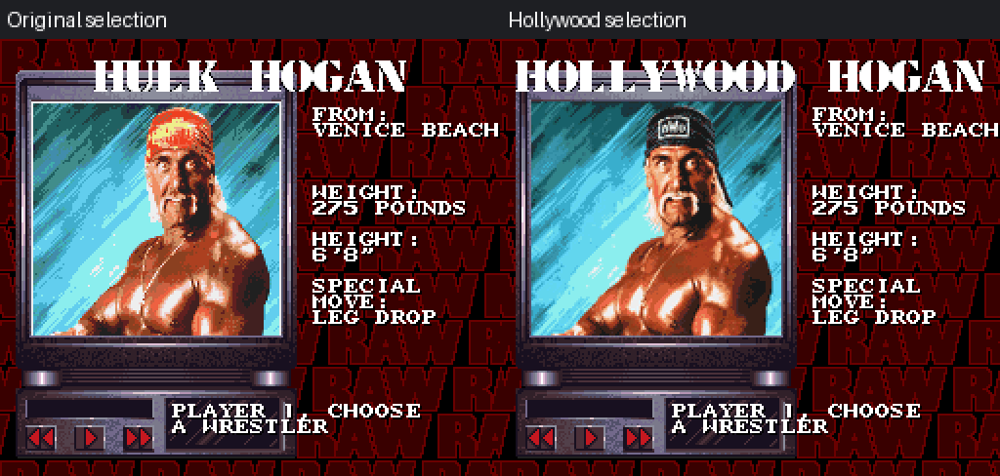
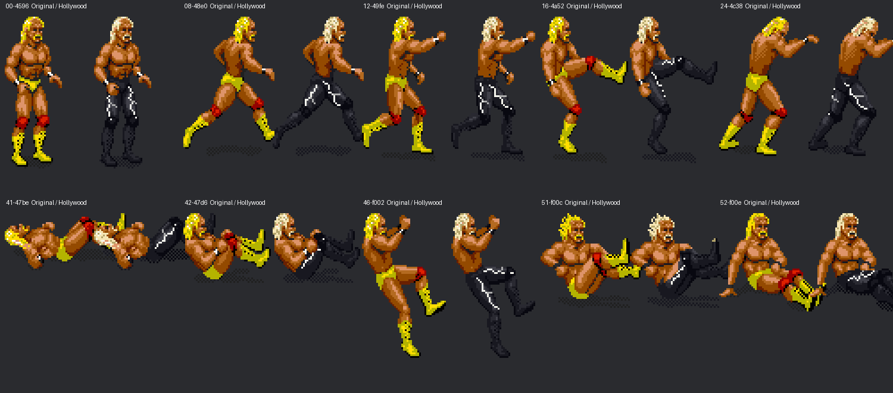

# Hollywood Hogan: converted artwork and native verification

**Left:** original Hogan. **Right:** exported Hollywood Hogan ROM. These are
native Snes9x captures, not generated animation mockups.

[Native gameplay frame](native-gameplay.png) · [Native selection frame](native-selection.png)

The sprite comparisons show actual decoded ROM artwork enlarged with nearest
neighbor. [All 53 mapped poses](contact-sheet.png) remain available in the editor.
The supplied in-ring photos guide the pale blond hair/mustache, black full-length
pants, white lightning and black boots. White wrist wraps follow the second
photo; gameplay stays bareheaded. The selection portrait uses a black bandana.

## Results

- All **53 mapped poses** retain their silhouettes and object geometry and pass
  actual compressed-ROM decode round trips.
- **170/170 native snapshots** match the editor's converted body pixels across
  23 distinct existing animation roots. This covers observed movement/strikes,
  not every animation.
- With identical controller inputs, player state and all other visible OBJ
  records/colors match the original at every snapshot.
- All **15 other workers** retain identical editor-visible sprite, palette and
  presentation hashes. Move tables, engine code, statistics and theme data are
  unchanged.
- Browser portrait, monitor, name and ROM export/reload pass without page errors.

The shorter displayed name is **HOLLYWOOD HOGAN**; native HUD capacity requires
compact letters. The original sixteen-slot editor opens and edits this ROM.

## What is not complete

This is a **tested appearance-conversion preview**, not full game-ready character
signoff. Hogan's inherited import has unmapped actions that use a standing
fallback and incomplete-looking body-slam study drawings. The conversion keeps
those mappings and their original silhouettes; it does not claim to repair
animation coverage. All paired grapples/receivers, rope transitions and the
complete finisher still require dedicated import/animation work.

[Implementation, addresses, visual choices, rollback and reproduction](../../docs/characters/HOLLYWOOD-HOGAN.md)

Numerical reports here contain no ROMs, decoded tile arrays or memory dumps.
The playable ROM and exact-base IPS patch are supplied privately in the task.
