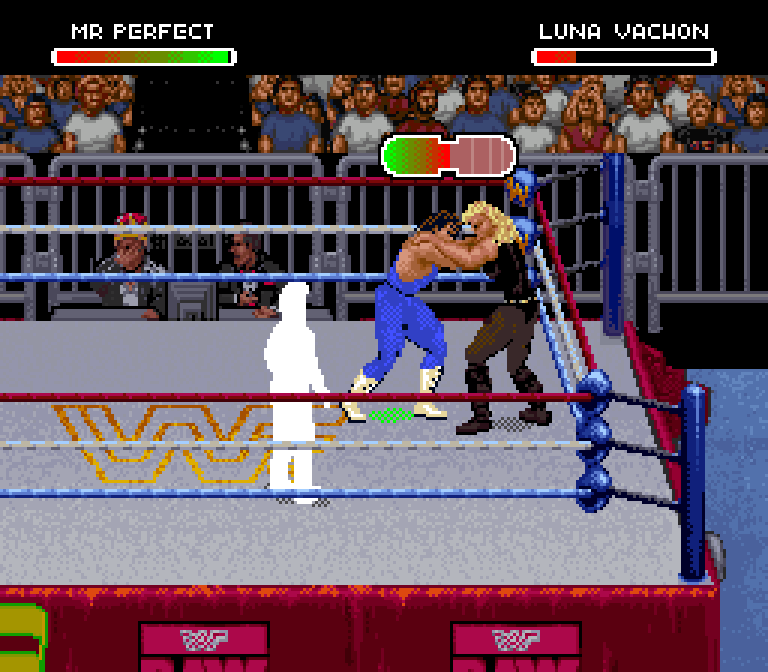
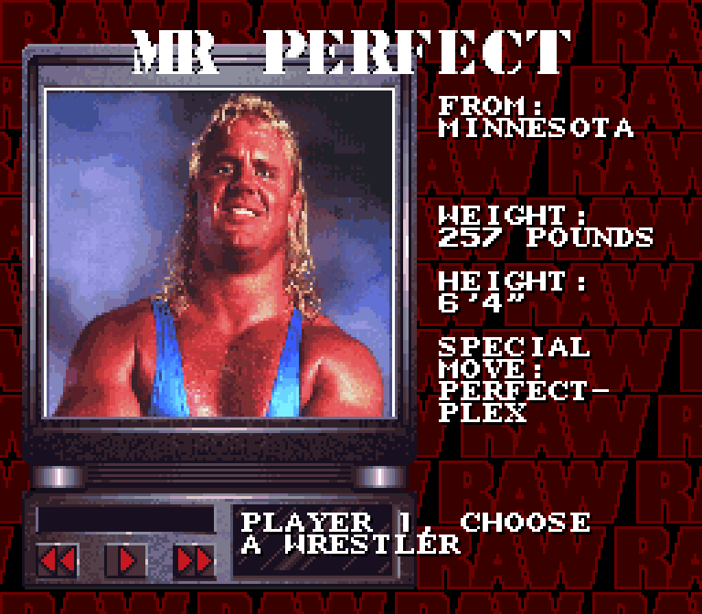
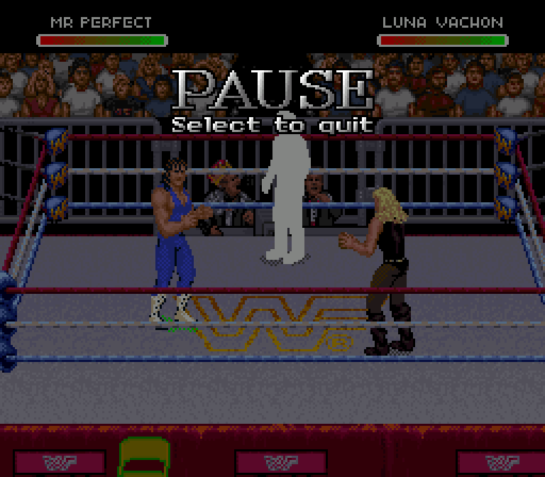
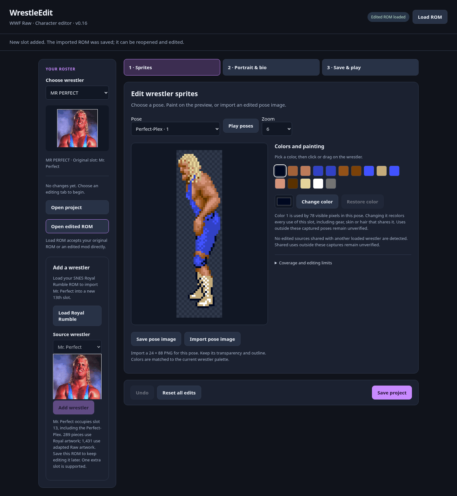

# Mr. Perfect in Raw's independent thirteenth slot

This is a **first playable import**, with a Royal Rumble source portrait,
editable profile and private graphics, and the native source Perfect-Plex
animation. It does not replace one of the original twelve wrestlers.

## Actual emulator playback

The GIF is captured from Snes9x running the **browser-exported ROM**. Mr. Perfect
uses the new slot; Luna remains the receiving wrestler. Her health drops from
218 to 58 through Raw's damage routine. Mr. Perfect returns to standing and can
move afterward. Both facing directions were exercised. The rope-side replay
uses Raw's ring-boundary calculation to avoid breaking the paired move.

The profile appears through the game's normal selection screen: MR PERFECT,
MINNESOTA, 257 pounds, 6'4", PERFECT-PLEX. Its portrait is decoded from the local
Royal ROM, not reconstructed from a screenshot.

## Try the importer

[**Windows app ZIP**](https://github.com/yourpalbones/WWF-Raw-Mod/releases/download/wrestleedit-v0.16.0/WrestleEdit-Windows-x64.zip): extract all files and open **WrestleEdit/WrestleEdit.exe**. The published archive and embedded editor were verified; native Windows launch remains untested here.

1. [Download WrestleEdit v0.16](https://github.com/yourpalbones/WWF-Raw-Mod/raw/refs/heads/main/downloads/WrestleEdit-v0.16.zip), extract it, and open **WrestleEdit.html**.
2. Load your original or current edited USA SNES **WWF Raw** ROM.
3. Under **Add wrestler**, choose your unmodified USA SNES **WWF Royal Rumble** ROM.
4. Click **Add Mr. Perfect**. Save the resulting ROM; it becomes the base for later projects.
5. Open it in Snes9x. Mr. Perfect is the extra entry after the original roster.
6. For the Perfect-Plex, use **R in a front tie-up with the opponent's health in red**. Win the grapple as with Raw's other grapple finishers.

The added slot can be painted and its pose PNGs imported. Growing compressed
tile edits move into private free storage. Portrait, monitor photo, bios,
in-match name, selection lettering and theme assignment remain editable.

## What is verified, and what remains

- The 8 MiB ROM cold-boots, selects slot 13, enters a match and plays the move.
- A complete **15,690-frame controller-only replay** checks the slot, native damage and attacker recovery. No emulator memory edits are used.
- Importing into both the original 3 MiB Raw ROM and the current 8 MiB gear mod succeeds.
- The original twelve portraits, bios, palettes, match names and theme assignments survive import and subsequent edits.
- New-slot sprite relocation, portrait/monitor edits, theme assignment, project save/load and edited-ROM reopening pass browser checks.
- The Royal portrait decoder matches 16,000 native WRAM/VRAM bytes and all 15,360 displayed photo pixels.
- All 28 automated tests pass with the private native fixtures. Existing twelve-character app and profile checks also pass.

**Art conversion is incomplete:** 289 pieces use Royal source artwork; 1,431
retain adapted Raw artwork. (Release v0.16 counts. The branch `claude/charming-allen-njttcx` raises this to
618 Royal / 1,102 adapted by pose matching; see `docs/complete-wrestler-art.md`.) These are frame-piece counts, not animation counts.
The editor exposes 1,732 pieces, including twelve Perfect-Plex drawings. This
release does not claim a complete Royal sprite port. Automatic bridge-to-pin
behavior is not implemented; exhaustive AI and match-mode coverage remains
unverified. Only Mr. Perfect and one added slot are supported by this importer.

[Verification results](verification.json) · [Controller replay](controller-replay.json)

Reproduce the importer checks with `tools/verify_royal_import.py`, supplying
your local Raw and Royal ROMs. Reproduce the cold boot and move with
`tools/verify_perfect_native.py`, supplying a local Snes9x libretro core and the
imported ROM. ROMs, extracted tile bytes and save states are not distributed.
