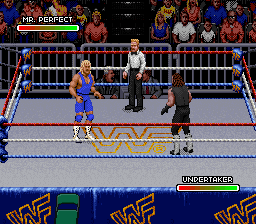
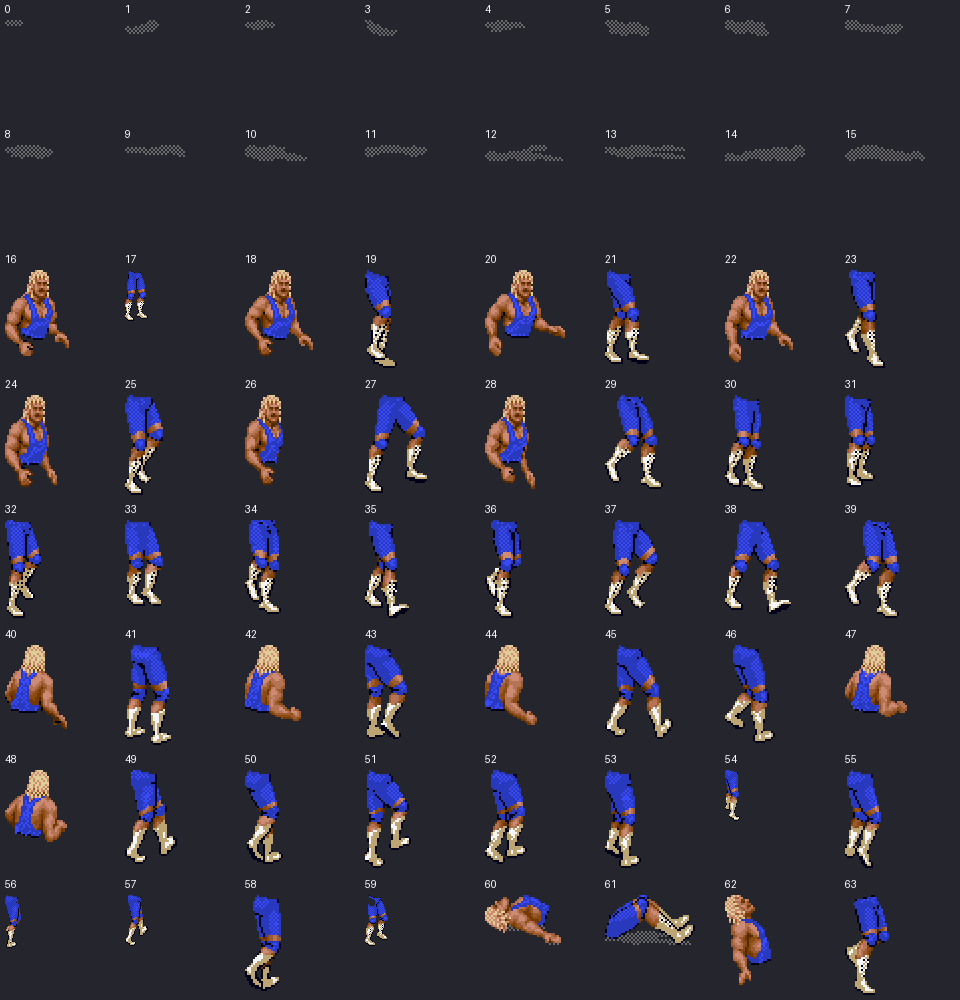
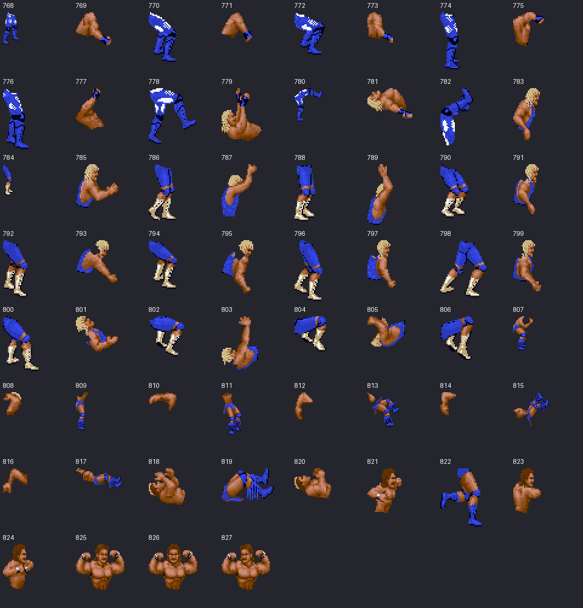

# Mr. Perfect: verified Royal Rumble source graphics

This is source extraction progress toward an independent thirteenth Raw slot.
**Mr. Perfect and the Perfect-Plex are not yet imported into Raw.** The existing
thirteenth-slot research probe still aliases stock graphics; it is not the import.

## Native source match

Captured from the supplied, unmodified Royal Rumble USA ROM through Snes9x.
Two players are controlled; no wrestler artwork was generated or redrawn.



## Recovered pose entries

828 directory entries resolve to 818 distinct pose pointers. The sheets show
individual body pieces, not assembled animation frames. Upper/lower pieces have
separate placement commands; placing both at the same origin would be incorrect.
Player one's native OAM uses OBJ palette 2 in this capture.





The source's tile mask codec matches Raw's, but Royal uses LoROM addressing,
different tile lookup tables, and chained pose descriptors. The parser follows
tail redirects into shared pieces. All 419 traced tile requests, including 285
compressed requests and 217 unique tile IDs, reproduce the game's decoded bytes
exactly. [Verification report](verification.json).

## Conversion candidates

Comparing Bret in both games finds exact opaque silhouettes for 293 of Raw's 953
own pose entries: 169 primary and 124 secondary. This establishes candidate
correspondence, not verified action timing, anchors, palette values or move logic.
[Candidate index report](bret-crosswalk.json).

## Reproduction

Private inputs are the verified original ROMs and emulator WRAM/CGRAM captures.
ROMs and save states are deliberately excluded from this repository.

```sh
bash tools/build_snes9x_royal_trace.sh /path/to/pinned-snes9x-build

python tools/replay_royal_capture.py CORE ROYAL_ROM --output /path/to/new-replay

# Set both variables when collecting Royal source trace data.
WWF_ROYAL_PROBE=1 WWF_TRACE_DIR=/path/to/capture \
  python tools/run_headless.py CORE ROYAL_ROM --output /path/to/capture \
  --load-state MATCH_STATE --frames 120 --interval 60 \
  --press 1:7 --press 45:0 --press 75:8

python tools/royal_rumble_sprites.py ROYAL_ROM WRAM CGRAM \
  --selector 1 --obj-palette 2 --output /path/to/catalog \
  --verify-trace /path/to/capture

python tools/compare_royal_raw_poses.py RAW_ROM RAW_WRAM ROYAL_ROM ROYAL_WRAM \
  /path/to/candidates.json
```

Royal ROM SHA-256:
`51c53e36ed0b959b0695fc6ef036fa7302d1c995eca35c28261d6f3cb77df0ca`.
Read-only instrumentation is layered on the pinned Raw research core and does
not write game RAM. The rebuild helper was exercised successfully twice.
The eight-stage controller-only replay was verified from cold boot: each stage's
PNG, WRAM, VRAM, OAM and CGRAM hashes matches the recorded source capture. The
existing Raw suite also passes all 21 tests with its original ROM and live trace.

Remaining work: verify the native Perfect-Plex command sequence; convert and
anchor the relevant poses; extend Raw's palette, graphics, profile, name, move
and selection tables while preserving all twelve existing slots and the common
fallback; then prove the new wrestler and bridge/pin behavior in Raw.
