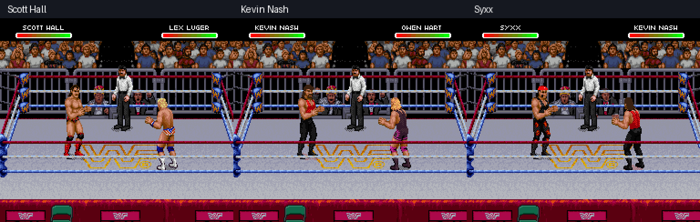

# Revised Scott Hall, Kevin Nash and Syxx gear

These are WWF Raw frames captured from Snes9x, using native sprite bodies and layouts.

[Before/after comparison](before-after.png)

- Nash: red top, small black Outsiders chest lettering, black pants and boots, dark brown hair. Lettering is an approximation within the native pixel dimensions and appears on suitable front views.
- Syxx: red bandana fitted to the head rather than the first sprite object, dark hair and a small three-row chin patch, red chest mark. White is restricted to a small bandana pattern; generic white marks on gear are removed.
- Scott: mapped trunk pieces gain red detail when they would otherwise be plain black. Existing marked poses are retained. Narrow or rotated views use clipped trim rather than a full word.

| Wrestler | Finisher | Mega Move | Walk | Kick |
| --- | --- | --- | --- | --- |
| Scott Hall | [Edge](scott-finisher.gif) | [Mega](scott-mega.gif) | [Walk](scott-walk.gif) | [Kick](scott-kick.gif) |
| Kevin Nash | [Jackknife](nash-finisher.gif) | [Mega](nash-mega.gif) | [Walk](nash-walk.gif) | [Kick](nash-kick.gif) |
| Syxx | [Top-rope finisher](syxx-finisher.gif) | [Mega](syxx-mega.gif) | [Walk](syxx-walk.gif) | [Kick](syxx-kick.gif) |

All six specials were replayed from cold boot with controller inputs on the final ROM, SHA256 `640436cfd937129116b75ff794567064fdb8e65ff8fcdec62191791c3490cde0`. [Special inputs and observed action words](special-inputs.json) record each successful capture. Syxx's setup was shortened so the opponent remained dizzy through the climb. The game move code was retained.

Thirty giving/taking controller recipes were sampled across the three wrestlers. [Observed grapple states](grapple-samples.json) distinguish what actually happened; some recipes reached only tie-ups or a character-specific alternative move. This is not proof that every possible move or interaction has been tested.

[Editor verification](verification.json) checks that all three browser presets reproduce the native build byte for byte, 385 captured previews match native OAM/VRAM pixel for pixel, and v0.8 Scott / v0.9 mods upgrade to the same result. It also checks private PNG edits, projects, reopening, and 6 MiB bio exports. [MIDI regression](music-verification.json) covers all twelve custom theme slots on the expanded ROM. [Profile regression](profile-verification.json) covers all twelve monitor photos, name artwork and existing theme assignments. Each wrestler exposes all 1,720 known frame entries. Native opaque masks and unrelated input bytes are preserved. Complete live animation coverage remains unverified.

[Download WrestleEdit v0.10](https://github.com/yourpalbones/WWF-Raw-Mod/raw/refs/heads/main/downloads/WrestleEdit-v0.10.zip). Extract All, open WrestleEdit.html, load your latest ROM, apply each wrestler's reference gear under Sprites, then Save & play. No ROM is included.
