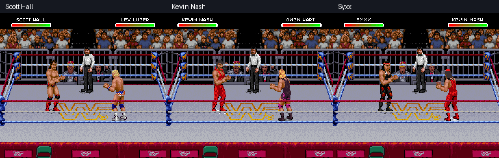

# Scott Hall, Kevin Nash and Syxx — native gameplay proof

These images are captured from WWF Raw running in Snes9x, using the original body artwork. No replacement body drawings or generated mockups are used.

| Wrestler | Finisher | Mega Move | Walking | Kick |
| --- | --- | --- | --- | --- |
| Scott Hall | [Razor’s Edge](scott-finisher.gif) | [Mega](scott-mega.gif) | [Walk](scott-walk.gif) | [Kick](scott-kick.gif) |
| Kevin Nash | [Jackknife](nash-finisher.gif) | [Mega](nash-mega.gif) | [Walk](nash-walk.gif) | [Kick](nash-kick.gif) |
| Syxx | [Top-rope finisher](syxx-finisher.gif) | [Mega](syxx-mega.gif) | [Walk](syxx-walk.gif) | [Kick](syxx-kick.gif) |

Scott’s formerly red common Edge trunks now use black/red gear. Nash uses an all-red outfit with his original dark hair. Syxx uses black/red gear, a red bandana and a small goatee. Small markings are approximated within the native pixel dimensions.

Each preset maps all 1,720 known frame entries, including common giving/taking move frames. The editor exposes 130 Scott, 109 Nash and 146 Syxx captured full-body poses plus decoded frame pieces. Captured actions include walking, rope running, punches, kicks, giving/taking grapples, and each wrestler’s finisher and Mega Move. Mapping every known frame is distinct from testing every live interaction; exhaustive match coverage remains unverified.

The six native special-action words and recorded controller inputs are in [special-inputs.json](special-inputs.json). Editor/native byte comparisons, pixel comparisons of captured previews, and save/reload checks are recorded in verification.json when the release checks pass. No ROM or extracted raw sprite memory is distributed here.

[Download WrestleEdit v0.9](https://github.com/yourpalbones/WWF-Raw-Mod/raw/refs/heads/main/downloads/WrestleEdit-v0.9.zip). Extract All, open WrestleEdit.html, load your ROM, choose each wrestler and apply their reference gear under Sprites, then Save & play.
