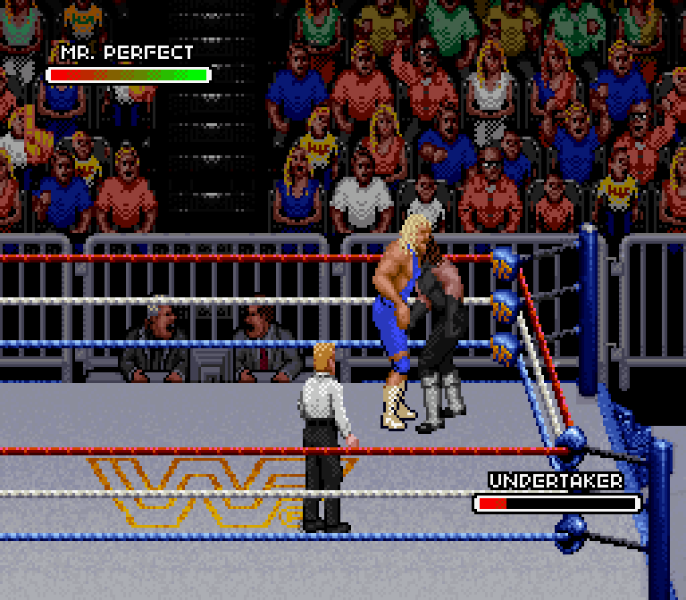
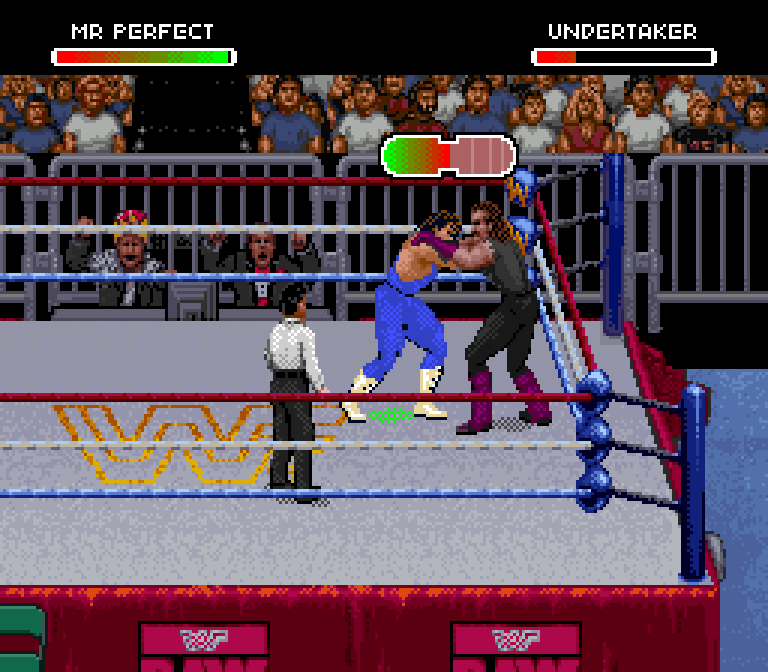

# Perfect-Plex receiving-animation revision — in progress

The v0.16 receiving animation used Raw's generic vertical-suplex parts. Its
pose and limb positions do not match Royal's Perfect-Plex. Passing damage and
recovery tests did not establish visual correctness.

## Actual Royal reference

## Raw test with actual Undertaker receiving drawings

This private test replaces the generic receiving parts with twelve drawings
decoded from Royal's Undertaker. It preserves the separate Raw Undertaker slot
and uses Raw's palette. No screenshot-painted sprites or emulator RAM edits are
used. Both wrestlers' component placement, transition frames, facing directions
and final bridge still need visual validation. This is not a finished release.

The source mapper reconstructs all twelve captured receiving drawings exactly
from Royal's tile references and native component anchors. It supplies recipes
for all twelve Royal wrestlers, including their own head and gear artwork.
Every recipe fits Raw's 17-object / 64-tile combined body-and-shadow budget.

Direct Royal counterparts exist for Raw's Bret, Undertaker, Yokozuna, Razor,
Lex and Shawn, plus the new Mr. Perfect. Raw-only wrestlers need receiving art
that preserves their identities; they must not silently become another donor
when the move starts. Existing customized gear also needs consistent receiving
drawings. Those cases remain open.

The experimental test currently supports **Undertaker as the receiver only**.
The released v0.16.1 fixes referee/announcer palettes; it does not contain this
receiving-animation prototype. ROM files and extracted pixel data are private.

## Frame-by-frame review (audit, no fixes)

The [labeled frame review](frame-review/README.md) compares these GIFs at
native resolution. It identifies a mirrored scene after the tie-up, receiver
misregistration behind the attacker, a detached receiver shadow and a missing
exit transition. Causes and fix order are in
[docs/perfect-plex-gaps.md](../../docs/perfect-plex-gaps.md). Roster status is in
[docs/animation-coverage.md](../../docs/animation-coverage.md).
