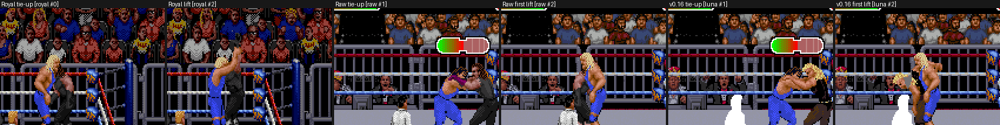
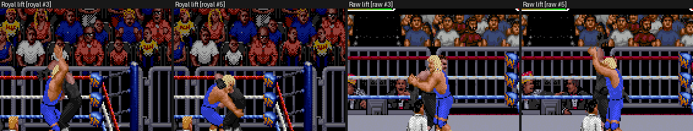
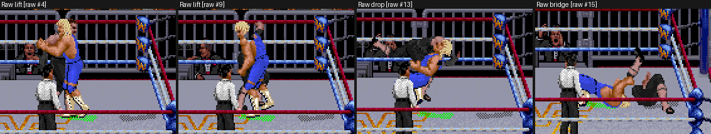
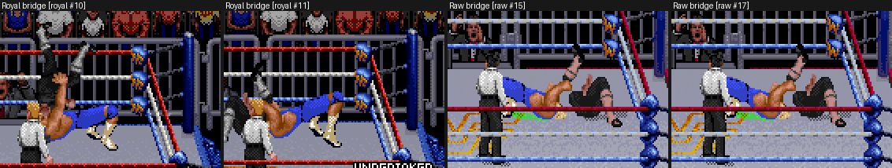
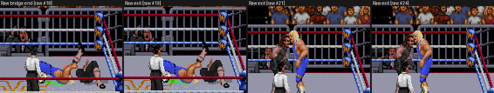

# Perfect-Plex frame review

These are labeled crops of the three committed gameplay GIFs: Royal native,
the private Raw Undertaker prototype, and the released v0.16 with Luna. Crops
are at native 256×224 coordinates and enlarged 2× with nearest-neighbour only.
They add no new captures. Each label names the source GIF and frame index.
Regenerate with `python3 tools/review_perfect_plex_gifs.py`.

| Sheet | Shows | Gap |
| --- | --- | --- |
| [entry-side-swap](entry-side-swap.png) | Tie-up to first lift. Royal keeps Perfect on the left; Raw (prototype and v0.16) switches him to the right. | PP-1 |
| [lift-registration](lift-registration.png) | In Royal both wrestlers are visible side by side; in the older Raw prototype the receiver is largely hidden behind Perfect. Cause open. | PP-2 |
| [detached-shadow](detached-shadow.png) | The receiver's grey shadow stays at its tie-up spot while the body is lifted. | PP-3 |
| [bridge](bridge.png) | Final bridge, mirrored in Raw; the receiver body and colours differ. | PP-1, PP-6 |
| [exit](exit.png) | In this older-prototype GIF the receiver appears standing, overlapping the attacker, after the bridge. Native action state recorded elsewhere is 70 (downed); the GIF's build is unidentified. | PP-4 |

Causes are provisional until confirmed by native traces. Diagnosis and suggested order: [docs/perfect-plex-gaps.md](../../../docs/perfect-plex-gaps.md).

