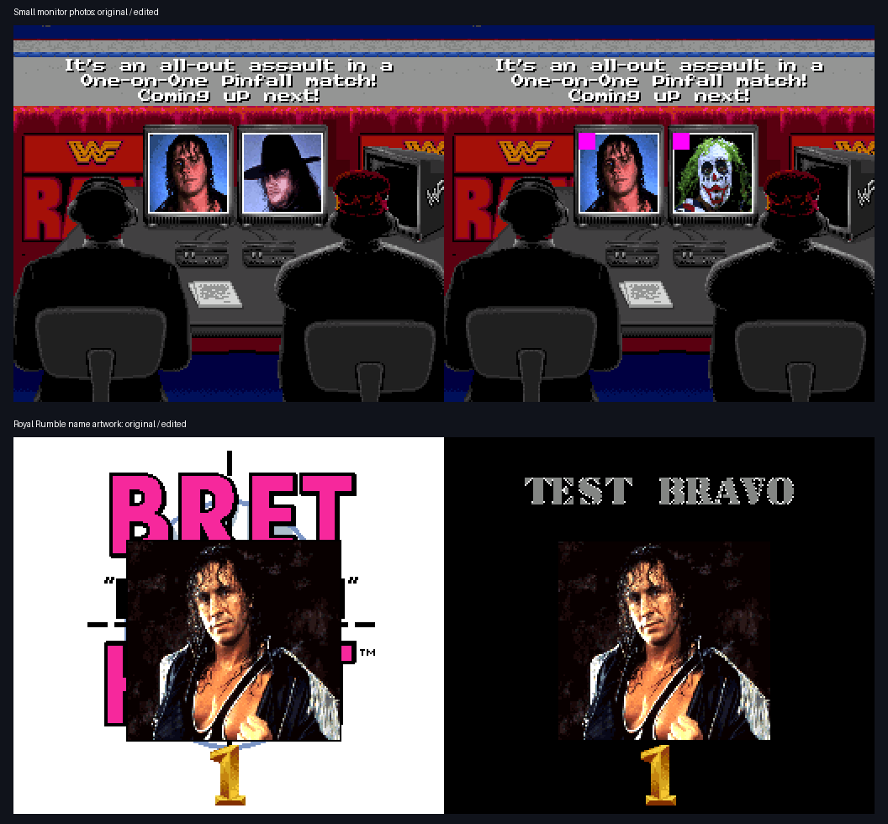
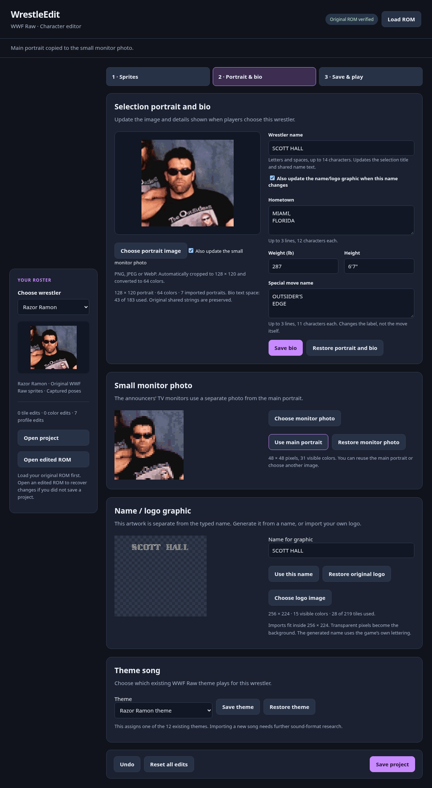

# Independent photos, name artwork and existing themes

The announcers' two monitor photos show magenta markers from imported test images. The Royal Rumble name card shows generated `TEST BRAVO` lettering in place of Bret's original name artwork. The normal selection title uses a separate text pointer; the uploaded ROM already displayed `SCOTT HALL` there.

## Asset references

All offsets are for the verified unheadered USA ROM. The existing 45-byte character record at `2EFAF5 + selector*45` contains:

| Offset in record | Asset |
| --- | --- |
| +8 | Compressed 4bpp name/logo tiles |
| +12 | Compressed 32 × 32 tile map, 2,048 bytes |
| +16 | Name-artwork palette |
| +20 | Compressed 8bpp small photo, 2,304 bytes |
| +24 | Small-photo palette, 32 colors |
| +28 | Shared name-text pointer |
| +44 | Existing theme ID |

Small-photo indices are 1–31, assembled as 48 × 48 pixels. The announcers use additional split pointer arrays at `2EE90F`, `2EE927`, `2EE93F` and `2EE957`, indexed in selector order. A further graphics/palette directory at `2FE35D`/`2FE38D` uses order 4, 1, 10, 7, 9, 6, 0, 11, 5, 8, 2, 3. Export updates all three reference sets. The first emulator check caught the additional announcer arrays; changing only the character record does not change that scene.

Imported monitor blocks and palettes occupy independent 4 KiB slots at `330000 + selector*1000`. Name tiles, tile maps and palettes occupy independent 32 KiB slots at `340000 + selector*8000`. Export expands to 4 MiB and updates the checksum. Original allocations stay intact. Imported logos are deduplicated and limited to each slot's original tile count; oversized artwork is rejected before replacing an edit. Generated names use the original 16 × 16 alphabet decoded from `2ADBE3`, placed above the portrait in the name card.

The theme reader at CPU `AAFEB6` reads record +44. Native music commands at `ADE71A` use command `06` with the chosen theme ID. All 12 reassigned IDs matched the native command trace. This verifies assignment to existing music; it does not implement a new-song importer or validate arbitrary music data.

## Validation and recovery

`verification.json` records all 12 original monitor and logo decodes, imported-photo and generated-artwork roundtrips, existing theme assignments, version 5 projects, version 4 renamed-character migration, undo, import refusal and checksum checks. It also records two native monitor decoder buffers and their CGRAM palettes, one native name-artwork decoder buffer, and all 12 native theme commands. No whole-animation or whole-soundtrack claim is made.

The actual uploaded edited ROM recovered seven replaced main portraits and the Scott Hall, Syxx and Kevin Nash names. **Open edited ROM** requires the original ROM first, verifies the edited checksum, recovers supported tile/palette/profile changes and refuses changes outside supported areas. A version 5 export was recovered and re-exported byte for byte; corrupted and unsupported ROM imports preserved the current project. The original 15-character Bam Bam name is allowed unchanged while editing other fields.

## Reproduce

Run `python3 tools/verify_profile_assets.py '/path/to/WWF Raw (USA).sfc'` to generate private `outputs/profile-assets-proof/profile-test.sfc` and expected metadata. Add `--edited-rom '/path/to/WWF-Raw-edited.sfc'` to test recovery. No ROM, extracted asset library or save states are committed.

Build the pinned research core with `bash tools/build_snes9x_profile_trace.sh /path/to/local/core-build`. The extra patch adds read-only record and final music-command tracing; it never changes game memory. Use `WWF_TRACE_DIR` matching each `run_headless.py` output folder.

For monitor proof, boot the generated ROM for 2,350 frames with Start at 600/900, A at 1,100/1,300/1,500, Start at 1,650, A at 1,830/1,980, and Start at 2,200. Each press lasts eight frames. Continue its saved state for 350 frames with A at 50 and Start at 250; continue for another 150 frames to capture the settled monitors. Inspect the two 2,304-byte decoder buffers and corresponding CGRAM palette slices against the exported monitor assets.

For the name card, start from the main-player menu at frame 1,000 (Start at 600/900). Continue for 1,050 frames: A at 1, Down at 101/151/201, A at 301/501/701. This selects Royal Rumble and reaches the name-artwork display. Compare the relocated logo's decoder buffer with its exported block.

For theme tracing, start from the earlier `roster-selection-ready/frame-000300.state`, run the generated ROM for 3,600 frames and press Right for eight frames at 1, 301, ... 3,301. Match the twelve command-06 parameters in `music.jsonl` with the exported theme assignments. This uses the same original-state selection cycle as the earlier selection evidence.
