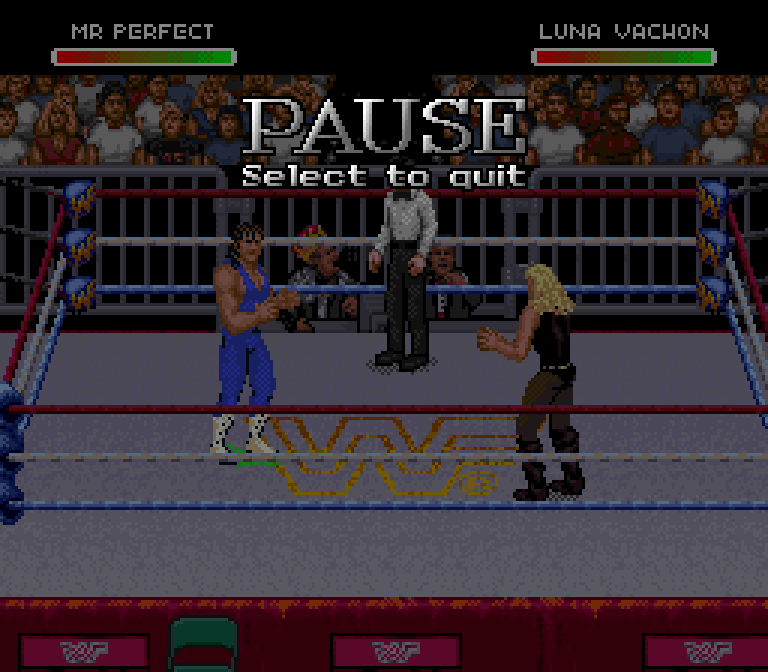

# Referee palette repair

The thirteenth-slot importer moved the wrestler palette table but omitted the
later NPC entries. The referee still had his native sprite objects and actor
state; missing colors made him a flat silhouette. Announcer palettes also read
the wrong data. The new table preserves all NPC entries in a separate allocation.

Before:

After a fresh cold boot:

All sixteen referee palette colors are restored. Existing v0.16 ROMs can be
loaded and exported with the updated editor: **Save & play → Save playable ROM**.
That export copies all thirteen edited wrestler palettes and restores the NPC
entries. Reopening and exporting again is stable. The legacy repair test checks
that only the palette allocation, palette-loader operand and checksums change.

The Perfect-Plex receiving animation is a separate visual defect. The generic
suplex approximation is being replaced by Royal's actual receiving sequence;
this palette repair does not claim to finish that work.
