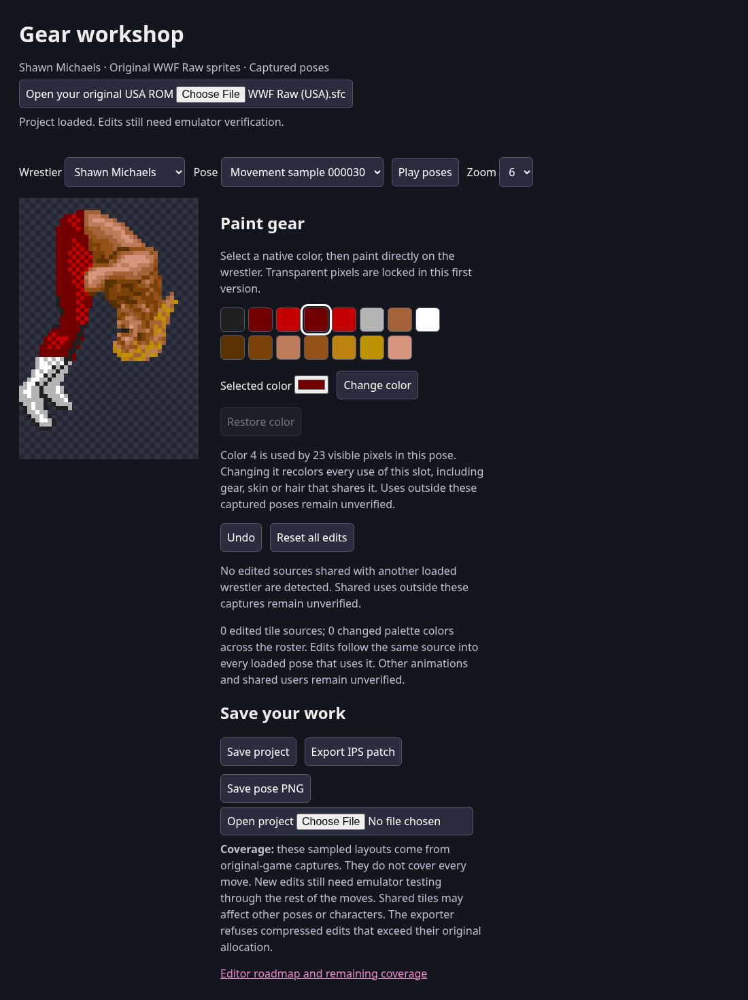
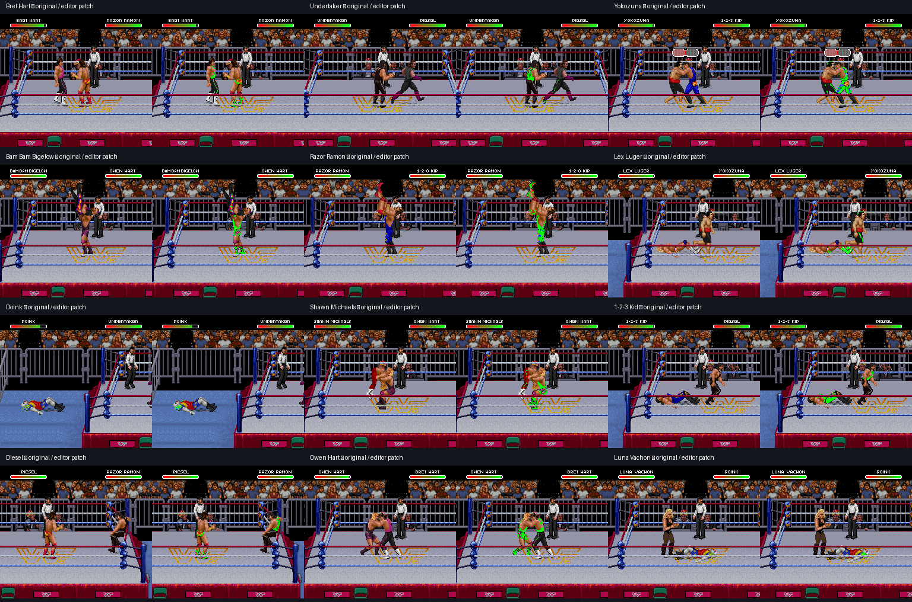

# All 12 wrestlers in the gear editor



The editor now includes every stock roster character, 102 native captured poses
and 2,174 distinct ROM tile sources. All previews use original sprite work.
Each wrestler has a verified palette address at `2CC4DA + selector * 32`.
The earlier roster match snapshots were paused and dimmed; new movement samples
resume those original states and wait for the normal palette to return.

## Verified behavior

- Every browser preview matched native OAM assembly pixel for pixel.
- Every source re-encoded to its original ROM bytes. The existing 21 decoder
  and sprite tests also passed with the local ROM and live trace supplied.
- Painting, palette editing and exported patch bytes passed for all 12 wrestlers.
- Character switches retained edits. A multi-wrestler project restored the full
  edit state. Version 1 and 2 Bret projects also loaded correctly.
- Shared tile edits identify other loaded wrestlers using the same ROM source.
- Invalid palette entries and oversized compressed packets were refused.
- An editor-exported test patch changed palette slot 4 to green for all twelve
  characters and included a small raw-tile edit per character. Each character's
  original match recipe was replayed with original and patched ROMs. All twelve
  native CGRAM slot-4 words matched the exported `03E0`; OAM matched each paired
  original capture at frame 1230. See [the machine-readable report](verification.json).



These are native emulator screenshots, not artist-created previews. This proves
sampled editor-to-ROM changes across the roster, not complete gear consistency
through every move. An edited source may have users outside the loaded previews.
The editor does not isolate shared graphics or relocate oversized packets.

## Reproduction

Use your original USA ROM and instrumented Snes9x core. For each identity in
`evidence/roster-inventory/identities.json`, load the local original
`trace_folder/frame-001200.state` and run `tools/run_headless.py` for 90 frames
at interval 6. Press Start with `--press 1:3:1`, then Right with
`--press 10:7:60`. Set `WWF_TRACE_DIR` to the absolute, empty output directory
`outputs/editor-roster-live/SELECTOR`. Keep captures from frame 30 onward,
after the unpause fade completes. These traces include raw and compressed
lookup provenance; no RAM editing is used.

```sh
python3 tools/build_roster_editor.py '/path/to/WWF Raw (USA).sfc' \
  --capture-root /path/to/raw-analysis --movement-root outputs/editor-roster-live
python3 tools/bundle_editor.py
python3 tools/verify_editor.py '/path/to/WWF Raw (USA).sfc' \
  --capture-root /path/to/raw-analysis --movement-root outputs/editor-roster-live \
  --page gear-workshop.html
```

Bret's prior standing capture and first 15 `gear-walk-original` captures are
retained. Address-only manifests include capture identifiers for verification;
no ROM, raw memory dumps, save states or tile libraries are published.

The browser verifier writes the private `editor-roster-test.sfc`. To reproduce
the paired emulator proof, replay each identity's original `run.json` selection
state and button schedule with the original ROM and then that test ROM. Extend
the run to frame 1230, add `--press 1201:3:1` to unpause, and capture frame 1230.
Compare native CGRAM slot 4 (bytes 264–265), OAM and framebuffer screenshots.
