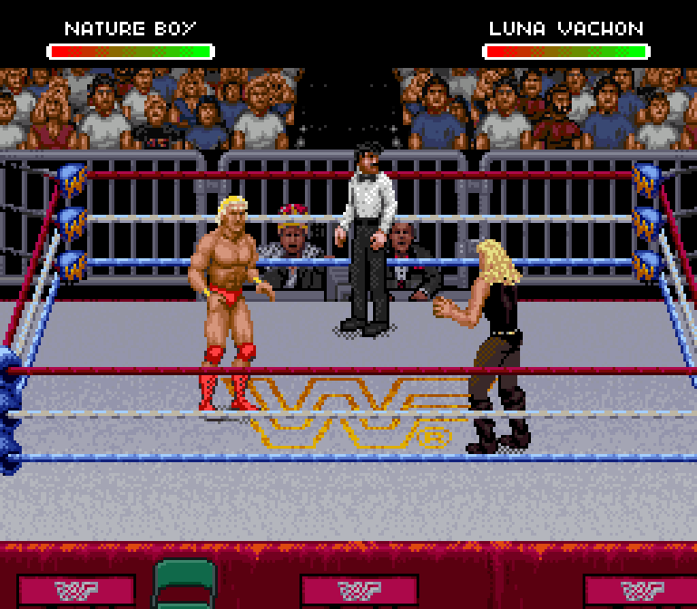

# Ric Flair and the sixteen-slot editor preview

[Flair selection screen](flair-selection.png) · [Edited name in native gameplay](native-edited-name.png) · [Editor after editing](editor-edited-flair.png)

## What is working

- Ric Flair is a separate sixteenth slot, after Mr. Perfect, Hulk Hogan and Big Boss Man. His portrait and full-body artwork come from the supplied SNES Royal Rumble USA ROM, selector 6.
- Reconstructed Royal's composite-pose table; standing pose 0 matches all 1,349 native sprite pixels. 255 native tile requests match the ROM bytes. The source game dims each RGB5 palette channel by one level; the port uses the original SNES palette.
- The new editor loads all 16, displays the mapped imported poses and edits sprites, palettes, portraits, monitor images, names, bios and themes. Projects and playable ROM downloads remain local.
- Real browser controls painted Flair, recolored his hair, renamed him NATURE BOY, copied the portrait to the monitor, imported a MIDI, exported and reopened the ROM. No page errors. Hogan's and Boss Man's tile hashes remain unchanged by Flair's paint edit.
- 50/50 native movement/attack snapshots match the actual editor canvas pixels, including the paint/palette changes. This compares the active body OBJ/VRAM/CGRAM pixels, not the background, camera placement or animation timing.
- The edited name appears above the health bar. The MIDI's song header reached SPC RAM at `8C79` during native source selection.

## Coordination and storage

The separate editor pins Claude's PR head `c8666bb`. No existing Claude editor, receiver or Perfect-Plex implementation file was modified. His code/art region `70F000..7FFFFF` remains byte-for-byte identical in the build and its unedited editor export. The first 13 profile records are unchanged in the built ROM. This is a preservation check, not a replay of all 20 of his scenarios.

The sixteen-slot initializer no longer executes the old extra-worker tail, which would overflow the sixteen-entry stat arrays. Byte-indexed HUD capacity is preserved by mapping blank name tiles to the existing blank tile, freeing slots for Flair without changing existing name pixels. The new editor repacks added-worker tiles inside protected pools, relocates name artwork away from the added slots and gives added-worker MIDI its own storage. Legacy reference-gear rebuilds are disabled on this expanded preview.

## Remaining game work

This is **not a completed v0.1 game release**. Flair's Figure Four, Boss Man's finisher, full imported receiving/grapple/recovery coverage and expanded match-mode coverage remain unfinished. Unmapped actions still use standing fallback artwork. The ordinary original-worker art coverage remains Claude's ongoing task.

The editor opens the prepared sixteen-slot ROM; it does not automatically import all three newest workers into an arbitrary ROM yet. Use the new editor for this preview; the old thirteen-slot editor does not understand these allocations.

No ROM, memory dump or decoded tile arrays are published here. Native screenshots/GIFs, address/geometry code and numerical verification reports are included.
