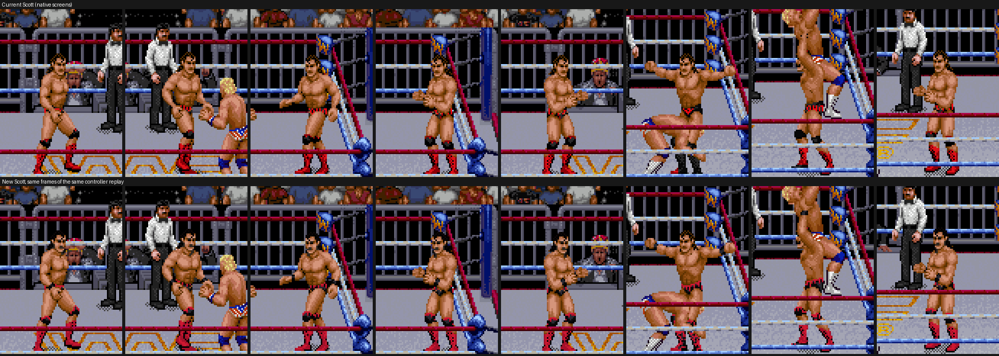
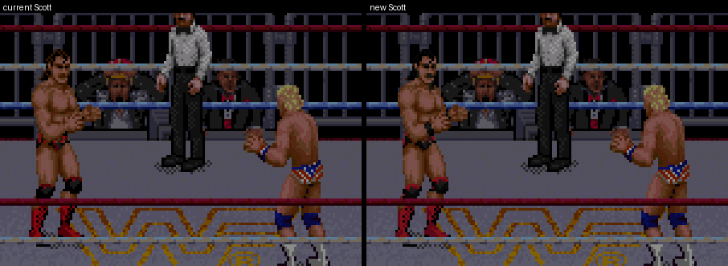
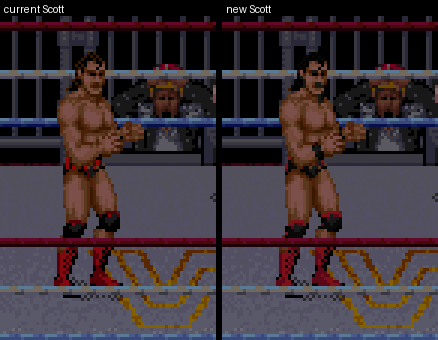
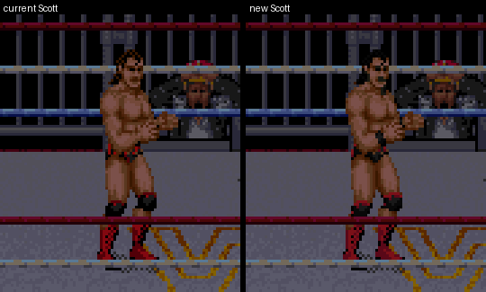
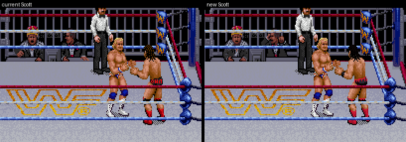
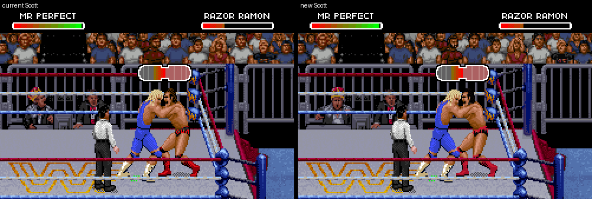

# Alternate Scott Hall (second take, beside the current Scott)

You asked for a pass at Scott Hall from the figure and the photo: black trunks with a red drip waistband, black
kneepads with red drips, red laced boots, slicked black hair, stubble, and no vest (he didn't wrestle in it). The
current Scott is unchanged: same files, same editor button. This is a second take you can compare it with.



Both rows are native Snes9x screens from the same frames of the same cold-boot controller replay
(`tools/capture_scott.py`). The two builds are the v6 gear reference mod (with Mr. Perfect), first with the current
Scott and then with this one. They are enlarged with nearest-neighbour scaling only.

| Walking | Off the ropes |
| --- | --- |
|  |  |

| Punch | Kick |
| --- | --- |
|  |  |





## What is different

| | Current Scott | New Scott |
|---|---|---|
| Hair | Razor's brown | Near-black, slicked, with a dark brown sheen, and the front curl kept. Only pixels inside the head change: Razor's hair browns also shade his whole body |
| Face | Razor's brown moustache | The moustache and jaw stubble are dark brown |
| Trunks | Black, with red marks and lettering | Black, with one red waistband and drips running down toward the legs, front and back |
| Kneepads | Black | Black, with a red top edge and drips toward the boots |
| Wrists | Razor's gold bands painted as skin | Black wrist bands |
| Boots | Red | Razor's own red; the dark dots read as laces |

There is no vest, no new body and no new animation. Every pixel is only recoloured, so each silhouette stays Raw's.
There is no "OUTSIDER" lettering: the trunks are about 8 pixels tall in the front view, so the drip band is the motif.

## How it is made

- `tools/scott_alt_art.py` authors every one of Razor's 1,720 pieces.
  - It starts from the current gear's reviewed split of trunks, kneepads, boots and gold, then redraws the details.
  - Hair is only found inside the head bounds that Raw's shared base body gives (`data/nwo-native-anatomy.json`).
- `tools/build_scott_alt.py` applies it.
  - It reads Razor from your ROM with the static part resolver through the game's own directory. No memory dump is
    needed, and your ROM's pixels are not in the repository.
  - It uses the same storage, hooks and marker (`SCOTT-HALL-GEAR3`) as the current gear, so tools read it as the
    Scott gear.
  - On a ROM that already has the current Scott gear, it replaces it and leaves the sprite programs alone. On the
    original game, it installs them as `tools/build_scott_hall_gear.py` does.

```
python3 tools/build_scott_alt.py RAW.sfc --output OUT.sfc
```

## Checks

- **Donor:** the ROM-only donor catalog equals the memory-dump catalog on all 1,720 pieces.
- **Writer:** given the current art, its palette and its tile spacing, the writer rebuilds exactly what
  `tools/build_scott_hall_gear.py` writes, byte for byte.
- **Storage:** this art needs 12,923 private tiles, against 9,691 for the current gear.
  - They are packed 32 bytes apart (the game copies 32 bytes per tile), not 36, so they fit Scott's reserved banks.
  - Compared with the input, only Scott's storage, his two tables, the slot-5 palette and the checksum change.
- **Mr. Perfect:** Add Mr. Perfect moves the palette table. The builder writes Scott's colours to both copies, so it
  works on a ROM with or without Mr. Perfect.
  - The Crow Sting builder had the same gap and now writes to both copies too. Its output on the earlier reference mod
    is unchanged.
- **Same result either way:** building from the original game or from a ROM with the current Scott gear gives the
  same Scott.
- **Replays:** both builds replay the same inputs through walk, ropes, punch, kick and the full Razor's Edge (action
  600 observed in both).
  - The wrestlers' state matched on every sampled frame, except one counter byte on two walking samples, which caught
    up again.
  - The crowd animation runs a few frames apart between the builds.
- **Perfect-Plex:** the Scott scenario
  (`evidence/perfect-plex-receivers/recipes/scott-gear-attacker-left.json`) replays on the new build, and Scott shows
  the new art while taking it and afterwards.

## Not done

- It is not an editor preset yet. Build it with the command above. Choosing "Use Scott reference gear" in the editor
  puts the current Scott back.
- No elbow pad: Razor's sprites have bare elbows, and this pass only recolours.
- The game's shared generic bodies (used in some throws) get the trunks, kneepads and boots but keep their generic
  heads, as in the current Scott.
