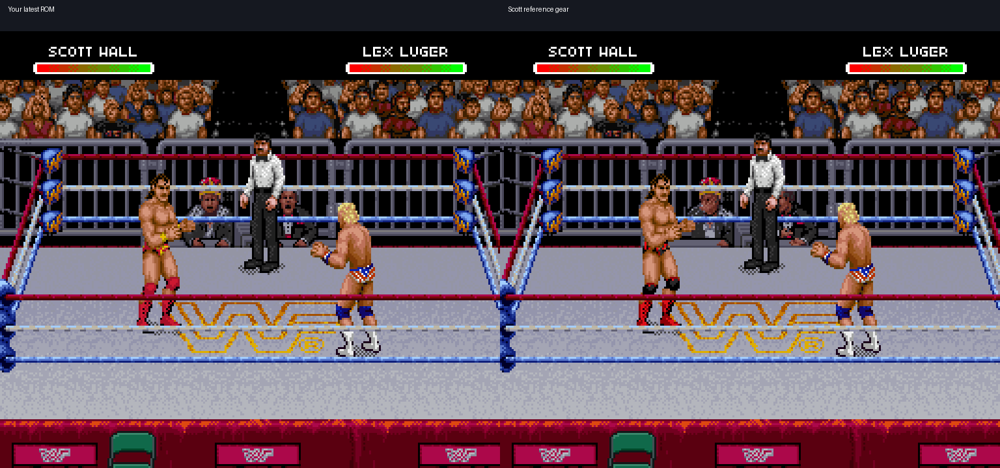
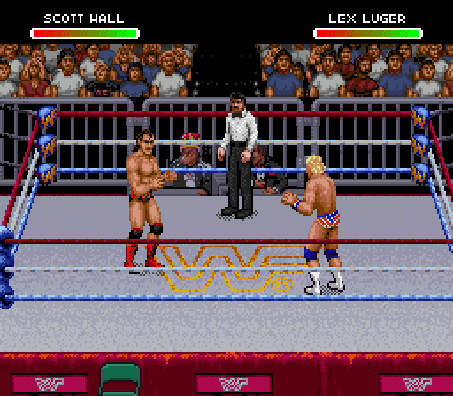

# Scott Hall reference gear — v0.8

These are actual Snes9x gameplay captures from the user's latest edited ROM,
with the original WWF Raw body sprites retained. The patch adds black trunks
with red detail, red boots and black/red knee-pad details, and removes old gold
jewelry. No vest, new body model or replacement animation is introduced.

[Download WrestleEdit v0.8](https://github.com/yourpalbones/WWF-Raw-Mod/raw/refs/heads/main/downloads/WrestleEdit-v0.8.zip).
Extract All, open WrestleEdit.html, load your current ROM, choose Scott,
click **Sprites → Use Scott reference gear**, then **Save playable ROM**.
Use the new ROM in Snes9x. No ROM is included in the download.

## Watch it in the game

| Action | Native gameplay capture |
| --- | --- |
| Walking | [GIF](walking.gif) |
| Running at the ropes | [GIF](running-ropes.gif) |
| Giving a body slam | [GIF](giving-slam.gif) |
| Taking a piledriver | [GIF](taking-piledriver.gif) |
| Outsider’s Edge / Razor’s Edge | [GIF](finisher.gif) |
| Mega Move | [GIF](mega-move.gif) |

The GIFs use emulator screenshots sampled every six game frames, displayed at
100 ms per sample. They are gameplay recordings, not the editor's pose player.
[Controller inputs](controller-recipes.json) accompany the captures. Special
setups replay the Scott recipes in
[the original-game capture inventory](../../data/roster-special-captures.json).

## What is mapped

The editor now exposes **207 distinct captured full-body Scott poses**, including
grapples, reactions, finisher and Mega Move. It also exposes **1,720 decoded
frame pieces**: 527 Scott upper-body entries, 426 lower-body entries, and 767
structurally parsed common fallback entries. Pieces are grouped separately from
full-body previews and can be painted or exported/imported as pose PNGs.

Modified descriptors and tiles are private copies. Common pieces are redirected
only for Scott. Original shared graphics, other wrestler palettes and existing
portrait/bio/name/song regions are retained. The local browser recipe contains
authored pixel edits and address metadata; game graphics are read from your ROM.

The 6 MiB ExHiROM layout was checked against the input ROM before garment changes:
cold-boot video, WRAM, VRAM, OAM, CGRAM, SPC RAM and DSP registers matched exactly.
The same comparison also passed for a resumed match scene. This establishes the
mapping baseline; it does not certify every emulator or every gameplay scenario.

## Remaining visual work

This is a first gear pass. Trunk markings are limited by native sprite resolution
and need review across rotated/foreshortened views. New elbow-pad artwork,
stubble and chest hair have not been added. No extra anatomy was guessed into
unidentified frame pieces. The original opaque/transparent silhouette is kept.

The parsed directory count is not proof of exhaustive live animation coverage.
Reversals, interruptions, alternative special variants and every ring position
still need gameplay checks. The other eleven wrestlers keep their sampled editor
pose sets. Larger roster expansion and MSU-1 are separate research tasks.

## Verification

[Machine-readable results](verification.json) record 40,703 native tile decoder
comparisons, including 11,992 private-tile events, and pixel-exact comparisons
for all 207 editor full-body poses. The browser recipe matches the native builder
byte for byte. Private-tile edit, undo, project reload, edited-ROM reopen and bio
export preserve the 6 MiB layout. Non-Scott native palettes match the input
capture. Existing twelve-wrestler pose-import, profile and MIDI regressions passed.

The ZIP’s bundled HTML was exercised through the cloud browser over local HTTP.
Opening it through `file://` is blocked by this cloud Chromium’s administrator
policy, so a Windows local-file launch was not verified here. The package is
self-contained; no runtime server or internet is required by the app.
