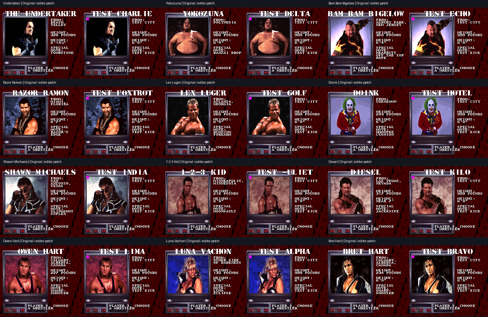
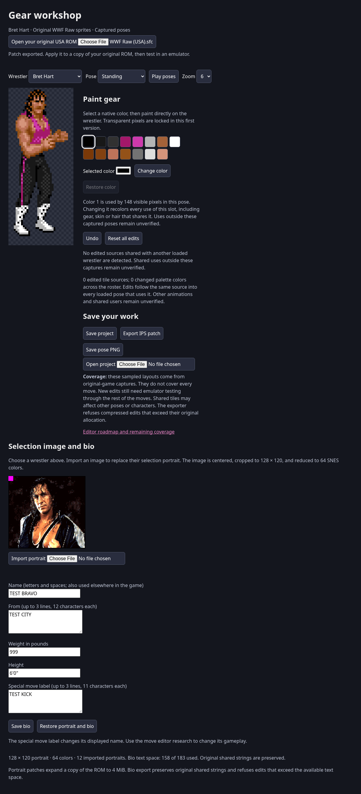

# Selection portraits and bios for all 12 wrestlers



All twelve selection portraits decode from the user's local ROM. Importing a
PNG/JPEG/WebP creates a 128 × 120, 64-color portrait with SNES color precision.
Names, hometowns, weights, heights and special-move labels can be edited and
saved with the existing gear edits in version 4 projects.

## Format and safe export

Character selection records start at `2EFAF5`, with a 45-byte stride in roster
selector order. Each record supplies the portrait source, palette source,
16-bit bio string references, inline weight and other game data.

Original portraits are 15,360-byte mode-2 compressed 8bpp tile blocks. Visible
portrait indices occupy 64–127; their 64 palette colors come from the selection
palette source plus 64 bytes. Imported images are re-encoded as native mode-1
literal blocks, placed in independent 16 KiB slots starting at ROM `300000`,
and redirected through the existing three-byte portrait pointers. IPS export
expands to 4 MiB using fill records and updates the checksum. Original portrait
allocations, in-ring assets and unrelated selection-record fields are preserved.

Edited bio strings are stored in the verified `FF` padding at `2EFF49`, with
183 bytes available across the project; unchanged originals are retained.
Equal edited strings can share storage, while subsequent edits are recomputed
on each export. Original shared strings are never overwritten. Weight uses its
existing four-byte inline field. The lower-half bank padding cannot be used:
the game's text bank mirror maps those addresses outside ROM. The first emulator
check caught that addressing issue; all published evidence uses the corrected
upper-half region. Export refuses text overflow.

New names are limited to letters and spaces supported by the large title font.
Original names containing digits can remain unchanged. Names may affect other
screens that use the same character record. A special-move label edit changes
text only; it does not change move logic or animations.

## Validation

- All 12 browser portrait decoders matched the existing Python reference.
- Imports, all five bio fields and expanded IPS output were checked for all 12.
- Every imported block decoded to the expected pixels; exported palette words,
  all bio strings, original shared strings and the 4 MiB checksum were verified.
- Project reload and undo include selection edits. Invalid portrait data,
  overlong bio lines and combined text-space overflow were refused.
- The original 12-wrestler gear browser checks and 21 decoder/sprite tests passed.
- A patched selection cycle showed all twelve replacements. Every portrait's
  VRAM and CGRAM matched the exported data exactly. The comparison shows a small
  magenta marker imported into each portrait and test bios with distinct names,
  `TEST CITY`, `999` pounds, `6'0"`, and `TEST KICK`.



No ROM, extracted portrait library, save states or memory snapshots are included.
The test patch and authored import fixtures remain under ignored local outputs.
This milestone verifies selection-screen editing, not every other screen's use
of character names or every imported image's artistic quality.

## Reproduce

```sh
python3 tools/build_selection_manifest.py '/path/to/WWF Raw (USA).sfc'
python3 tools/bundle_editor.py
python3 tools/verify_selection_editor.py '/path/to/WWF Raw (USA).sfc'
```

The verifier writes a private `outputs/selection-editor/selection-test.sfc` and
checks all portrait/bio patch roundtrips. To reproduce the emulator proof, load
that patched ROM in the instrumented Snes9x core using the original local
`roster-selection-ready/frame-000300.state`. Run `tools/run_headless.py` for
3600 frames, with interval 300. Press Right for eight frames at frames
1, 301, 601, ... 3301. This cycles Undertaker through Bret, reloading each portrait
and bio from the patched ROM. For each snapshot, compare VRAM bytes 0–15359
with the relocated decoded portrait and CGRAM bytes 128–255 with the exported
64-color palette. See [verification.json](verification.json).
