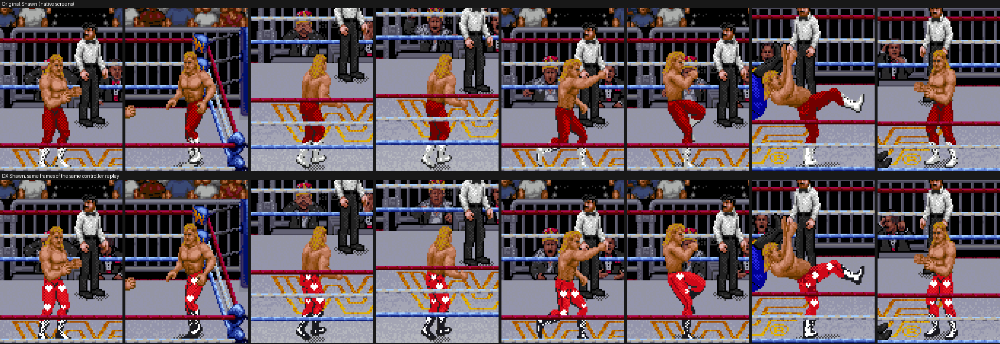
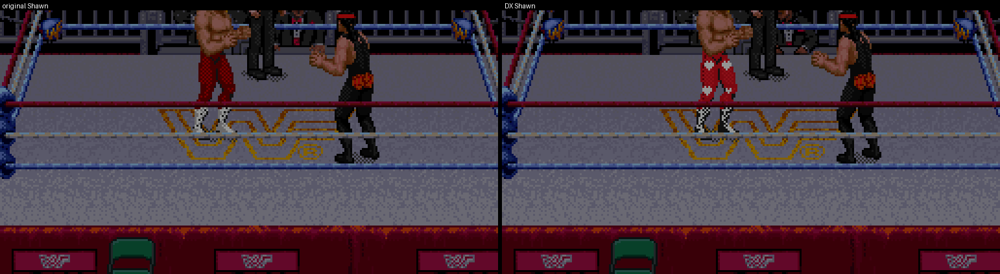
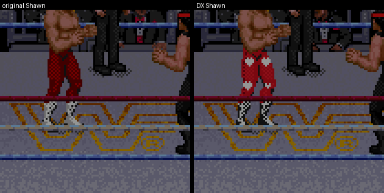
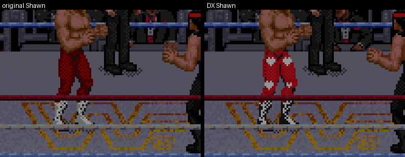
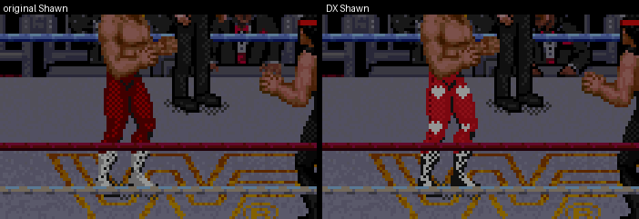
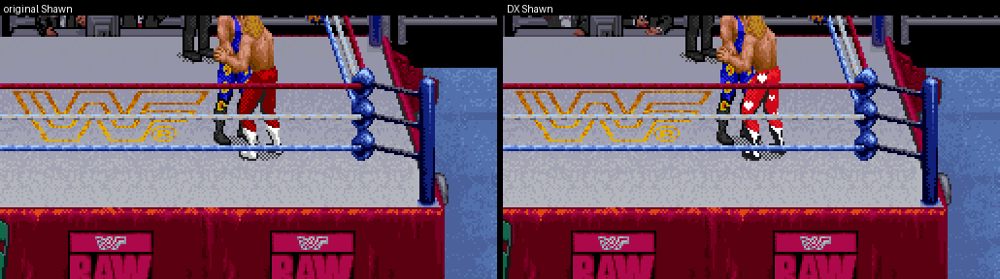
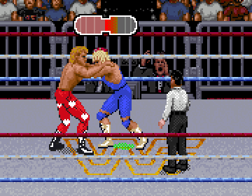

# Shawn Michaels in his red DX gear

You asked for Shawn in the red DX-era gear from your three reference images (the two match photos and the close-up
of the tights): vivid red tights, HBK hearts with DX X straps, the "degeneration X" heart on the seat, black boots.
This build gives him that look in every pose that shows his tights, in Raw's own style. His body, hair, face, moves
and timing are unchanged.



Both rows are native Snes9x screens. Each pair is the same frame of the same cold-boot controller replay
(`tools/capture_wrestler.py --capture shawn-michaels-finisher`), with only nearest-neighbour enlargement. From left
to right:

- walking toward the camera, then side on;
- two frames from behind, showing the seat emblem;
- a punch and a kick;
- two moments of his finisher.

The first six are on the v6 gear reference mod (Mr. Perfect included). The finisher is on the original game,
because the finisher recipe was recorded there and does not replay on the modded roster.

| Walking | Walking, seen from behind |
| --- | --- |
|  |  |

| Off the ropes | Punch | Kick |
| --- | --- | --- |
|  |  |  |

| Finisher | Taking Mr. Perfect's Perfect-Plex (DX build only) |
| --- | --- |
|  |  |

## What changed

| | Original Shawn | DX Shawn |
| --- | --- | --- |
| Tights | Dull dithered maroon | Vivid red, with Raw's own shading kept |
| Legs | Plain | A white heart on each thigh and each shin, centred on the leg and pointing toward the boot, so they follow the leg through walking, kneeling, lying and upside-down poses. On a wide thigh the heart carries the black X straps |
| Seat (views from behind) | Plain | The white heart on a bold black X: the DX emblem from the close-up |
| Boots | White | Black, with the white lacing panel kept |
| Generic bodies (some throws and grapples) | Raw's shared bodies in Shawn's colours | The same red and black. Full-tights lower bodies also get the hearts |
| Hair, face, body, silhouette, moves | — | Unchanged |

**Simplified for the sprite size.** At gameplay scale a leg is only 6–9 pixels wide, so:

- The detailed hearts become bold white hearts.
- The X straps appear where a thigh has room, and on the seat.
- The flag pattern inside the hearts, the "degeneration" lettering and the HBK letters are left out: they turned
  into pixel noise in every test.

## How it is built

Phase 1, what I found:

- **Slot.** Shawn is slot 8. His directory is also the game's shared table for the generic bodies every wrestler
  uses, so his gear cannot be painted into the game's own tiles without changing everyone.
- **Palette.** His palette already has the right roles:
  - 2 and 3: his tights;
  - 4 and 5: a side seam on his own pieces, and the tights of the generic bodies;
  - 6 and 8: his boots;
  - 13 and 14: his hair.
- **Storage.** The 8 MiB ROM's free space is all claimed by the reference gear, Mr. Perfect, profile art, match
  names and music. The one region no shipped editor feature writes is 0x300000–0x32FFFF; only experimental Python
  prototypes have used it.

What the build does:

- **Palette.** The colours come from slot 8's palette, written to the stock table and to the copy Mr. Perfect's
  import makes.
- **Private art.** The hearts are drawn into private copies of 433 of Shawn's pieces: 2,176 tiles and 421
  descriptors in 0x308000–0x32FFFF (HiROM banks $F0–$F2). The game's own tiles are untouched.
- **Engine hook.** One guarded branch for slot 8 goes at the start of the sprite dispatcher that the reference gear
  and Mr. Perfect already use. The branch acts only when the marker `SHAWN-DX-GEAR1` is present.
- **Your ROM.** The tool reads Shawn's art from your ROM and writes a new ROM. Your ROM's pixels are not in the
  repository.

```
python3 tools/build_shawn_dx.py RAW.sfc --output OUT.sfc
```

RAW.sfc can be the original game (as the editor saves it) or your edited ROM, with or without the reference gear
and Mr. Perfect. On a ROM that has Mr. Perfect but no reference gear, apply Shawn DX first and then Add Mr. Perfect.
The tool refuses, and changes nothing, if another patch already uses 0x308000–0x32FFFF.

Files:

| File | What it is |
| --- | --- |
| `tools/shawn_dx_art.py` | The palette, logo shapes and placement rules (new) |
| `tools/build_shawn_dx.py` | The ROM builder (new) |
| `tools/capture_wrestler.py` | Cold-boot capture of any wrestler's actions and finisher (new; `tools/capture_scott.py` now calls it) |
| `tools/raw_parts.py`, `editor/raw-parts.js` | The part resolvers read Shawn's DX pieces (Python and the editor) |
| `editor/editor.js`, `editor/scott-sprites.js`, `editor/gear-workshop.html` | The editor loads a DX ROM, and applying another reference gear keeps Shawn's branch |

## Checks

- **Other wrestlers.** Every piece of the other twelve wrestlers resolves to identical pixels before and after (20,656
  pieces), on the gear mod and on the original game with Mr. Perfect. Their palettes are unchanged.
- **Bytes.** Only these change:
  - Shawn's region, the dispatcher (259 bytes), his palette and the checksum;
  - on the original game, also the three sprite hooks and the header size byte;
  - a 4 MiB ROM grows to 6 MiB, with bank 0's mirror and the dispatcher in the new space, as the reference gear
    does.
- **Rebuilds.** Rebuilding over a DX ROM gives the same bytes. Building from the original game or from the gear mod
  gives the same Shawn region.
- **Editor resolver.** The editor's JavaScript resolver agrees with the Python one on all 5,160 pieces of slots 8, 5
  and 0 of the DX ROM.
- **Editor.** In the bundled editor, a DX ROM loads, Add Mr. Perfect works on it, and applying the Scott reference
  gear afterwards keeps Shawn's branch and art.
  - Add Mr. Perfect on the original game still gives the recorded v6 stock build (`dedd76cd…`).
- **Replays.**
  - Walk, ropes, punch, kick and the finisher replay the same inputs on both builds. The finisher (action 606) runs on
    both.
  - Every clip ends in identical wrestler state, and the action matched on every sampled finisher frame.
  - Twice while walking and once while running, Shawn's next animation step starts a frame apart. Two animation
    timers (`$06CC`, `$06D8`) run a step apart at times: the private art is uncompressed, which shifts the game's
    spare frames.
- **Perfect-Plex.** A new bot recipe ([`recipes/shawn-dx-attacker-left.json`](recipes/shawn-dx-attacker-left.json))
  plays the Perfect-Plex on DX Shawn, built from the original game and then Add Mr. Perfect. The older Shawn recipe
  is frame-exact to the v6 build, and it desyncs on this one for the timing reason above.
- **Selection screen.** The portrait is a head-and-chest photo with no tights in it, so it needs no change. It is
  identical on both builds.

## Limits

- **Opponent limbs.** In a few grapple drawings, Raw paints the opponent's arm or leg that Shawn holds in his boot
  grey. Those become near-black, and one forearm wrap becomes black arm tape. That colour is needed for the black
  boots.
- **Perfect-Plex.** Shawn's twelve receiving drawings come from Royal Rumble with Add Mr. Perfect. They take the
  red-and-black colours but show Royal's tights pattern instead of the hearts.
- **Generic upper bodies.** Their tights can run up into a singlet, so they get the colours only.
- **Editor.** There is no editor button yet: build it with the command above.
  - If you edit Shawn's sprites in the editor afterwards, run the tool again; it rebuilds from his current pieces.
  - Applying another reference gear in the editor keeps it.
- **Prototypes.** The experimental superkick and kick prototypes for Shawn, and the old Bret prototypes, also used
  0x300000–0x32FFFF. They cannot be combined with this build as they are.

Rollback: the tool never changes its input ROM. In the repository, the local tag `pre-shawn-dx` marks the commit
before this work.
