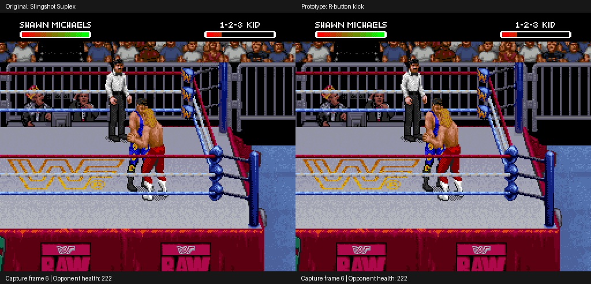
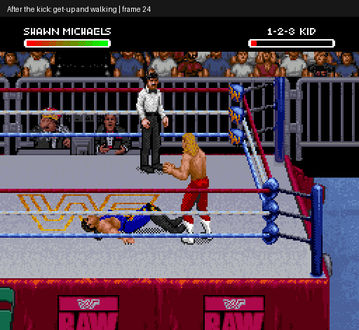

# Shawn: first kick-finisher prototype

This experimental ROM patch replaces Shawn's R-button Slingshot Suplex path
with a standing kick against a nearby, red-health, dizzy opponent who is
facing him. It uses the original kick animation and collision/reaction code.
**This is a functional move-editing proof, not a finished Sweet Chin Music
animation.** There is no new leg/head-contact artwork or corner wind-up yet.

The [raised-leg pose update](../shawn-superkick-pose/README.md) adds an isolated
extension and two-direction captures. This earlier package retains its original
stock-art checks; those exact-byte results do not apply to the later graphics build.

## Actual emulator footage

[Open the original/prototype comparison GIF](comparison.gif)



The left capture is the original game: position behind the opponent, then R
at frame 140. The right capture starts in front of the opponent and presses R
at frame 10. These are different required setups and timings; the clips are
not a frame-identical comparison of one controller schedule.

[Open the subsequent get-up and walking GIF](recovery.gif)



These captures use real emulator output. No emulator memory edits or generated
mock-up graphics were used. The patched setup was replayed from cold boot.

## Verified scope

- R initiates stock kick action `$007E`, rather than Slingshot Suplex `$025E`.
- Contact knocks the opponent down. In the demonstrated setup, health drops
  from 222 to 78: the original kick's 18 loss plus an additional 126 at contact.
- The attacker returns to standing. With further controller input, the defender
  gets up and Shawn walks afterward.
- An A-button kick and Undertaker's finisher retain matching gameplay RAM,
  image, VRAM, OAM and CGRAM endpoints against their original-ROM controls.
- The tested behind-opponent setup does not initiate the kick or old finisher.
- Seven cold-boot setup stages match 28 original image/PPU hashes and seven
  gameplay RAM comparisons. RAM comparisons exclude `$0FD0–$0FFF`, where
  inactive CPU stack contents differ because the new hooks add calls.
- Existing suite: 21 passed, no skips. Published IPS independently reconstructs
  the generated ROM exactly and its checksum validates.

[Verification metadata](verification.json) · [Patch metadata](patch-report.json)

Player 2 as Shawn, AI use, interruptions, multiple opponents and a complete
match remain unverified. A full replacement animation is also still needed.
Health loss across other opponents/attribute settings has not been established.

## Build and reproduce

Use your own exact unmodified USA ROM; its expected SHA-256 is in the patch
metadata. Do not commit or distribute the ROM or emulator states.

```sh
python3 tools/build_shawn_kick_prototype.py ORIGINAL_ROM \
  --output outputs/shawn-kick
```

The builder creates a local expanded 4 MiB ROM, an IPS patch and metadata.
The small [experimental IPS](shawn-kick-prototype.ips) contains authored code,
header edits and erased-space expansion instructions, rather than a ROM image.
It is an alternative prototype; it has not been combined with Bret's gear patch.

The input recipe in [verification.json](verification.json) refers to the
`shawn-michaels-finisher` setup in
[the roster capture recipes](../../data/roster-special-captures.json). Run its
first seven stages with the patched ROM, then use the recorded kick/recovery
inputs. Snapshot interval is six frames. Local emulator setup is documented in
[the repository README](../../README.md).

## Implementation and next work

Three guarded hooks redirect the finisher dispatch, consume a temporary
Shawn-only contact marker and clear that marker on ordinary kick entry. The
marker uses the existing actor special-hold counter `$0BEC`; its interaction
with interrupted attacks needs further testing. Native facing/range checks,
kick collision and opponent knockdown are retained. The contact callback adds
126 health loss and uses the stock finisher-style recovery delay.

Next: map the kick's frame parts, author a recognizable superkick extension,
and test its contact alignment and recovery in both directions. Then test
interruptions, both player slots and AI before treating this as a finished move.
