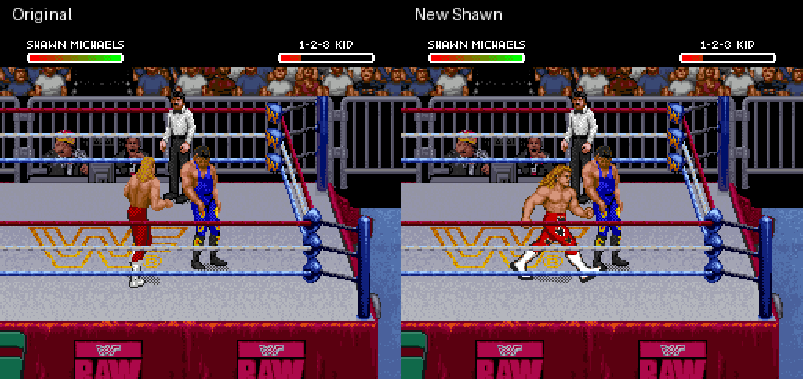

# Shawn's new look: standing and walking

Shawn now uses the superkick character design during idle and walking: golden
hair, shaded muscles, red heart-patterned tights and white boots. There are
matching front and rear views, with six walking poses per view. The previous
front-facing Sweet Chin Music artwork and its preparation step are included,
with body placement aligned to the native ground line.

[Watch original versus new Shawn in actual gameplay](standing-walking.gif)



[Rear-view walking](rear-walking.gif) · [Sweet Chin Music in both directions](sweet-chin-music.gif)

[Standing comparison](standing-comparison.png) · [Rear comparison](rear-comparison.png)

These are captures of the running ROM in Snes9x, driven by controller input.
No emulator RAM edits or artwork preview is used as gameplay proof. Scenes
load controller-generated original-ROM setup states. The walking clips begin
after the first graphics refresh; previously loaded states initially contain
the old graphics. Every game frame is sampled and displayed for 20 ms, about
20% slower than native gameplay. Screenshots are enlarged with nearest-neighbor
scaling; the game scenes themselves are unaltered.

## Scope and artwork

**This is a standing/walking prototype, not a finished whole-character replacement.**
Running, grappling, ordinary attacks, taking moves, rope transitions and other
unmapped actions still need matching artwork. The ordinary A kick retains its
original sprites. The new walk cycle, pose proportions, heart placement and
transition into the taller superkick still need visual review.

[Front assets](../../assets/shawn-movement-art) and
[rear assets](../../assets/shawn-movement-back-art) contain newly authored,
reference-guided generated artwork converted to the native sixteen-color palette.
They contain no extracted original body tiles. The first idle variant in each
sheet is used; the second was authored but is not activated by the stock idle
sequences. Fourteen poses are used in total: two idle and twelve walking poses.

Both walking sheets use a 76-pixel reference height to fit the established
17-body-object / 60-body-tile budget, with four further shadow tiles. Registration
uses the waist and ground line rather than switching between planted boots.
The generated rear sheet had different scales between rows; each row is
uniformly scaled to the same reference height during conversion. No limbs are
cut from or rotated out of stock artwork.

The builder redirects 32 graphics profiles referenced by the native idle,
cardinal-walking and diagonal-walking sequences at C4:03A2–0671. It preserves
the native walking sequences and movement values. A character identity check
limits redirects to Shawn, including profiles otherwise shared by the game.
Part-pointer redirects additionally require the private artwork bank so stock
moves that reuse the same numeric part IDs still use their original tables.
Unmapped graphics continue through the original lookup. The superkick keeps
its own private sequence and artwork.

## Verification

- 172 settled movement snapshots match their authored indexed poses exactly
  after reconstruction from emulator OAM/VRAM. All fourteen used poses pass in
  both horizontal orientations: 28 pose/orientation combinations.
- Four controller recipes exercise left, right, up and down, including front,
  rear and mirrored setups. Positions, actions and health at each endpoint
  match the corresponding original-ROM control. Some intermediate updates
  fall on different capture frames; this is not frame-identical timing.
- Twenty-four of the 32 redirected native profiles appear in these runtime
  traces. All 32 are present in the parsed native sequence range. Complete
  diagonal-input coverage is not established.
- Frontal and rear standing samples place the soles on the same screen ground
  line as their original-ROM controls. All authored bodies receive the same
  eight-pixel placement correction, including the superkick, to keep their
  ground registration consistent.
- Both Sweet Chin Music captures still connect for 144 health damage, take
  the mirrored four-pixel preparation step, clear the special marker, and
  return to the appropriate newly authored idle. All eight finisher poses
  pass pixel checks in both directions.
- The opponent tile buffer matches stock at representative settled samples
  in every movement case. It matches all 300 samples in the main walk case.
  Buffer differences at other sample frames are recorded, so complete
  frame-identical opponent rendering is not claimed.
- Ordinary A-kick tiles match stock at frames 18, 24 and 30. Undertaker's actor
  tile buffer matches stock in all 100 captured samples; both control moves
  retain their tested endpoint position, action and health.
- The IPS reconstructs the built ROM exactly and its SNES checksum is valid.
  The existing standalone superkick builder remains byte-identical to its
  previously verified ROM. Existing tests pass: 21, zero skipped; lint and
  formatting checks pass.

[Verification results](verification.json) · [Patch metadata](patch-report.json) ·
[Controller recipes](controller-recipes.json)

Fresh-boot finisher setup reproduction remains unresolved from prior research.
Full-match play, interruption/escape cases, player 2 control, gear-patch
combinations and complete diagonal controls remain unverified.

## Build and verify locally

```sh
python3 tools/build_shawn_redesign.py ORIGINAL_ROM \
  STOCK_KICK_REFERENCE_PREFIX --output outputs/shawn-redesign

python3 tools/verify_shawn_redesign.py CAPTURE_ROOT outputs/shawn-redesign \
  ORIGINAL_ROM --output outputs/shawn-redesign/verification.json
```

The builder defaults to the published movement and front-facing superkick
assets. The reference prefix is frame 24 of the earlier stock-art R-kick
prototype; setup details are in the
[eight-pose implementation](../shawn-superkick-animation/README.md).
The verifier requires the four movement cases and their stock controls plus
left/right finisher, ordinary A-kick and Undertaker-finisher captures. Capture
names and input schedules are in the controller recipes.

The [experimental IPS](shawn-redesign.ips) applies to the exact original USA
ROM listed by hash in the metadata. It includes Sweet Chin Music and replaces
the earlier superkick patch; apply it to the original ROM rather than layering
patches. No ROM, emulator binary, save state, raw memory dump or extracted
original body tile file is distributed.
