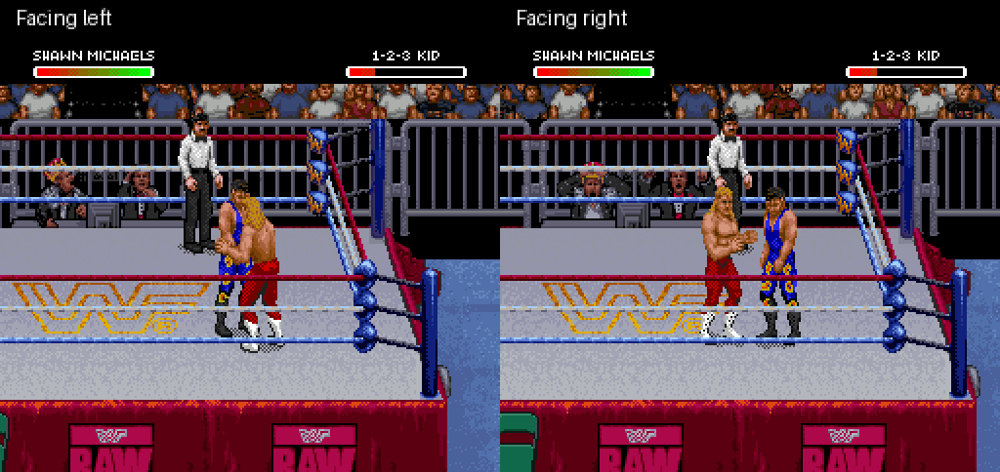

# Shawn superkick: newly drawn eight-pose animation

A newer [game-style artwork revision](../shawn-superkick-style/README.md)
replaces the geometric drawing while retaining this sequence implementation.

This revision replaces the experimental finisher's entire four-pose stock kick
sequence with eight newly drawn full-body poses. The sequence covers stance,
knee chamber, extension, follow-through, retraction, lowering the leg and
settling back into stance. Legs and boots are drawn as connected shapes;
no stock sprite pixels are rotated or cut to create these poses.

**This is a first artwork draft, not a polished final animation.** The geometry
and shading need refinement to match the game's original artwork. The sequence
still makes a large change between chamber and full extension; further
intermediate poses and timing work remain appropriate.

[Watch the newly drawn animation in both directions](both-directions.gif)



[Impact screenshot](contact.png) · [Subsequent get-up and walking](recovery.gif)

These are actual emulator captures with controller input and no emulator RAM
edits. Both captures load controller-generated original-ROM setup states.
The main GIF samples every game frame and displays it for 20 ms, approximately
20% slower than gameplay. The recovery clip samples twelve game frames per
GIF frame and displays each for 200 ms. No artwork preview is presented as
in-game footage.

## Verified

- Every drawn pose was reconstructed independently from captured OAM/VRAM and
  compared pixel-for-pixel with the authored source, in both directions. All
  sixteen comparisons pass, allowing a single translation for camera position.
  No body pixels disappear during the tested settled poses.
- Shawn's world X/Y stays fixed throughout the sequence, keeping the supporting
  foot planted. Screen position can shift as the camera follows the opponent.
- The left-facing kick reduces health from 222 to 78; the right-facing kick
  reduces it from 238 to 94. Shawn returns to idle and the temporary move marker
  clears in both captures.
- Subsequent controller input gets the opponent up and lets Shawn walk.
- Normal A-kick actor tile buffers match the original at frames 18, 24 and 30.
  Normal A-kick and Undertaker-finisher controls retain their tested endpoint
  health and action. Frame-identical timing is not established for every action.
- The IPS reconstructs the generated ROM exactly and the SNES checksum is valid.
  Existing decoder/sprite tests pass: 21, zero skipped.

[Verification](verification.json) · [Patch metadata](patch-report.json)

Fresh-boot setup reproduction remains unresolved from the preceding prototype;
these tests do not establish fresh-boot finisher reproduction. Full-match play,
interruptions, AI, player 2 as Shawn, alternate attributes, multi-opponent matches
and combination with the gear patch remain unverified. The native kick's
collision and damage logic remain in use; the animation sequence is new.
There is no corner “tuning up the band” sequence.

## Build and reproduce

```sh
python3 tools/build_shawn_superkick_animation.py ORIGINAL_ROM \
  STOCK_KICK_REFERENCE_PREFIX --output outputs/shawn-superkick-animation
```

The local reference prefix is frame 24 of the earlier
[stock-art R-kick prototype](../shawn-kick-prototype/README.md). The inherited
base builder validates that snapshot before installing the native damage
marker and raw-tile decoder hooks. The newly selected artwork comes entirely
from [draw_shawn_superkick.py](../../tools/draw_shawn_superkick.py).

For left-facing capture, load the original `dizzy-jabs/frame-000216.state`
setup: the first seven stages of `shawn-michaels-finisher` in
[roster recipes](../../data/roster-special-captures.json). The earlier
[mirrored setup metadata](../shawn-superkick-body/mirrored-reference-setup.json)
records the right-facing original-ROM setup. Run the new ROM for 180 frames,
pressing R at frame 10 for eight frames, capturing at interval one.

```sh
python3 tools/verify_shawn_superkick_animation.py CAPTURE_DIRECTORY \
  outputs/shawn-superkick-animation/patch-report.json
```

The verifier checks the eight settled poses at frames 12 through 54. It selects
Shawn's actor palette/tile buffer, accounting for changing OAM order, ignores
inactive objects, and permits translation while requiring the complete pixel
pattern to match. This is a sprite-memory comparison, not a claim that every
screen pixel remains unobstructed by opponents, ropes or background priority.

For recovery, load the left capture's frame-180 state. Press player 2 B and A
for eight frames every twenty frames from 10 through 1010, then player 1 Left
at frame 1050 for thirty frames. Run 1200 frames.

## Sequence implementation

A Shawn-only marked-R-kick hook at `$80:F073` selects a private seven-byte-entry
animation sequence. Eight private fourteen-byte graphics profiles reference
new upper/lower frame descriptors and native shadow art. Normal actions retain
their original sequence tables. The hook restores the original table bank at
the sequence's terminal transition; idle graphics clear the marker.

Mixed 8×8/16×16 packing fits each pose within seventeen body objects and sixty
body tiles, leaving four tiles for the native shadow. Small objects require an
eight-pixel coordinate adjustment when encoded alongside large ones; the
independent emulator comparisons verify the result in both directions.

The [experimental IPS](shawn-superkick-animation.ips) applies to the exact
original USA ROM, not over another patch. Required input hash is in metadata.
No ROM, save state, extracted tile data or emulator binary is distributed.
