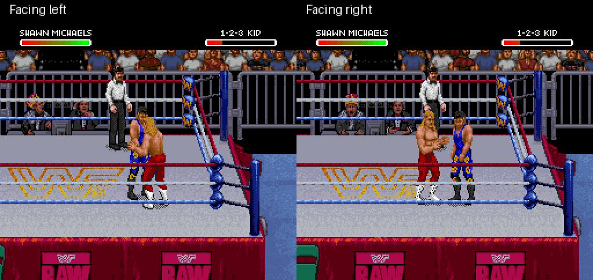

# Shawn superkick: leaning full-body prototype

This revision reposes Shawn's torso during the chamber, impact and retraction.
At impact he leans back over the planted support leg and raises the kicking
boot toward the opponent's head, following the supplied reference photo.
These are experimental keyframes assembled from native pixels. The stock
wind-up and phase timing remain; this is not the finished new animation.

[Watch the new move in both directions](both-directions.gif)



[Open the impact screenshot](contact.png) · [Watch subsequent get-up and walking](recovery.gif)

These are actual emulator captures from the patched ROM, with controller input
and no emulator RAM edits. Both directions load controller-generated setups
from the original ROM. Footage is slowed: six game frames per GIF frame shown
at ten GIF frames per second. The recovery clip samples twelve game frames
per GIF frame shown at five GIF frames per second.

## Verification and limits

- Left-facing contact reduces opponent health from 222 to 78; right-facing
  contact reduces it from 238 to 94. Shawn returns to idle and the temporary
  move marker clears in both recordings.
- Subsequent controller input gets the opponent standing and lets Shawn walk.
- The normal A-button kick's actor tile buffers match the original at the
  three edited phases. The opponent's tile buffer matches the previous
  stock-art R-kick reference at those phases.
- Normal A-kick and Undertaker-finisher controls retain the tested endpoint
  health and action. This does not establish frame-identical gameplay timing.
- The IPS reconstructs the generated ROM exactly; its SNES checksum is valid.
  Existing decoder/sprite tests passed: 21, zero skipped.
- **Fresh-boot finisher reproduction remains unresolved.** Seven stages of the
  original setup recipe run, but its final jabs knock the opponent away rather
  than producing the required dizzy condition. A faster jab schedule also
  failed. The successful clips above demonstrate loaded-state gameplay.

[Verification metadata](verification.json) · [Patch metadata](patch-report.json)

Full-match behavior, interruptions, AI, player 2 as Shawn, attribute changes,
performance and combination with the gear patch remain unverified. There is
no corner “tuning up the band” sequence. The torso, arms and transition timing
need further artwork refinement before calling this Sweet Chin Music complete.

## Build and reproduce

```sh
python3 tools/build_shawn_superkick_body.py ORIGINAL_ROM \
  STOCK_KICK_REFERENCE_DIRECTORY --output outputs/shawn-superkick-body
```

The local directory must contain stock-art R-kick snapshots at frames 18, 24
and 30. Generate them with the earlier
[stock kick prototype](../shawn-kick-prototype/README.md), loading the original
`dizzy-jabs/frame-000216.state` setup, pressing R at frame 10 for eight frames,
and capturing at interval six. That setup is the first seven controller stages
of `shawn-michaels-finisher` in
[data/roster-special-captures.json](../../data/roster-special-captures.json).
The [mirrored setup metadata](mirrored-reference-setup.json) records the
original-ROM right-facing setup. The builder checks snapshot hashes in
[data/shawn-superkick-body.json](../../data/shawn-superkick-body.json).

Run the new ROM from those same setups for 360 frames, pressing R at frame 10
for eight frames. Impact is visible at frame 24. For the recovery demonstration,
load the left clip's frame-360 state; press player 2 B and A for eight frames
every twenty frames from 10 through 1010, then player 1 Left at 1050 for thirty
frames. Run 1200 frames in total.

Mixed 8×8/16×16 objects keep each edited phase within its original combined
upper/lower object allocation and the 64-tile actor budget, including shadow.
This avoids the opponent corruption seen in an earlier discarded layout.
Private descriptors and tiles are selected only for Shawn's marked R kick.

The [experimental IPS](shawn-superkick-body.ips) applies to the exact original
USA ROM, not over another patch. Its required input hash is in patch metadata.
ROMs, save states, raw tile data and emulator binaries remain local.
