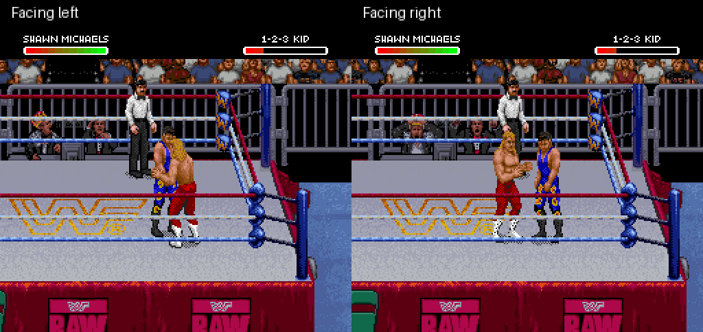

# Shawn superkick: front-facing revision

Latest: [matching standing and walking sprites](../shawn-redesign/README.md), including this finisher.

Shawn now keeps his face, chest and abs open toward the screen during the
kick. The eight newly authored poses include preparation, a small backward
step, entry into the kick, extension and standing recovery. Native animation
sequence movement takes him four world pixels back, then four forward; it
mirrors correctly when facing the other direction.

**This remains a prototype.** Style matching and animation transitions need
visual review. It is not a claim of a finished production animation.

[Watch actual gameplay in both directions](both-directions.gif)



[Impact screenshot](contact.png) · [Opponent get-up and subsequent walking](recovery.gif)

The footage above comes from the running patched ROM, not from the generated
artwork preview. It uses controller input and no emulator RAM edits. Both scenes
load controller-generated original-ROM setup states. Every game frame is
sampled in the main GIF and displayed for 20 ms, approximately 20% slower than
real gameplay. The recovery clip samples twelve frames at a time, displayed
for 200 ms each.

## Artwork and motion reference

The new artwork was generated using the original sprite's appearance and the
viewed motion reference, then converted to native indexed-color sprites.
The [eight indexed assets](../../assets/shawn-superkick-front-art) are the actual
inputs inserted into this build, with hashes and conversion metadata in the
[artwork manifest](../../assets/shawn-superkick-front-art/manifest.json).
They are newly authored assets, not extracted original game body tiles.

Motion reference: [the user's new Sweet Chin Music GIF](https://d2thvodm3xyo6j.cloudfront.net/media/2016/05/7f9970d1dcb91d3a-600x338.gif).
We downloaded and inspected its 59 frames (30 ms each, 1770 ms total).
Frames 0–20 guide the frontal chest orientation, lean and head-height boot
extension. Shawn's subsequent fall is omitted. Playback speed is not treated
as measured real-time motion speed.

The artwork uses one uniform scale and a supporting-boot anchor. Actual alpha
silhouettes define the eight source regions, since some generated figures
cross nominal sheet cell boundaries. Conversion removes transparent pixels
and maps foreground colors to the original sixteen-entry sprite palette.

## Verified

- All eight settled poses match the authored indexed artwork pixel-for-pixel
  after reconstruction from actual emulator OAM/VRAM, in both directions.
  Sixteen comparisons pass; a single translation accounts for camera position.
- Actor world X moves four pixels backward at preparation and returns to its
  starting position before impact. Y remains fixed. Both captures connect:
  opponent health changes from 222 to 78 facing left and 238 to 94 facing right.
  Shawn returns to idle and the temporary move marker clears.
- Further controller input gets the opponent standing and lets Shawn walk.
- Normal A-kick actor tile buffers match stock at frames 18, 24 and 30. Normal
  A-kick and Undertaker-finisher controls retain their tested endpoint health
  and action. Complete frame-identical behavior is not established.
- The IPS reconstructs the generated ROM exactly, with a valid SNES checksum.
  Existing decoder/sprite tests pass: 21, zero skipped.

[Verification metadata](verification.json) · [Patch metadata](patch-report.json)

Fresh-boot finisher setup reproduction remains unresolved from the earlier
prototype. These clips prove loaded-state gameplay. Full-match play,
interruptions, AI, player 2 as Shawn, attribute changes, multi-opponent matches,
and combination with the gear patch remain unverified. Intermediate frames,
consistent limb proportions and transition timing still need visual refinement.
There is no corner “tuning up the band” sequence.

## Build and verify

```sh
python3 tools/build_shawn_superkick_animation.py ORIGINAL_ROM \
  STOCK_KICK_REFERENCE_PREFIX --art-dir assets/shawn-superkick-front-art --step-back 4 \
  --output outputs/shawn-superkick-front

python3 tools/verify_shawn_superkick_animation.py CAPTURE_DIRECTORY \
  outputs/shawn-superkick-front/patch-report.json \
  --art-dir assets/shawn-superkick-front-art
```

The reference prefix is frame 24 of the earlier stock-art R-kick prototype.
For setup and controller recipes, see the
[eight-pose implementation](../shawn-superkick-animation/README.md).
Omitting `--step-back` disables preparation movement.
Omitting `--art-dir` preserves the earlier geometric draft for reproducibility.
New PNG inputs must be 96×96 indexed images with the manifest's palette and
matching hashes. An edited asset requires updating its manifest hash.

`tools/import_shawn_superkick_art.py` converts an authored transparent 4×2
sheet using a local verified CGRAM snapshot. The published indexed files are
sufficient to rebuild; no external image generator or reference download is
needed at build time.

The [experimental IPS](shawn-superkick-animation.ips) applies to the exact
original USA ROM, not over another patch. Required ROM hash is in metadata.
No ROM, emulator binary, save state, raw memory dump or extracted game body
tile file is distributed.
