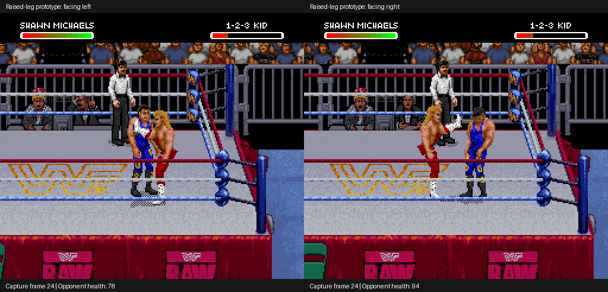

# Shawn superkick: raised-leg pose prototype

The experimental R-button finisher now has an isolated raised-leg extension.
The kicking thigh, shin and boot rotate upward around the hip; the supporting
leg retains its original pixels and position. Native horizontal flipping renders
that pose in both directions. The original wind-up, knee lift and recovery
remain in place. This is still an experimental move, not a finished animation.

## Actual emulator footage

[Watch both directions](both-directions.gif)


[Open the contact screenshot](contact.png)



[Watch subsequent get-up and walking](recovery.gif)

All images are actual emulator captures. No generated mock-up or emulator RAM
patch was used. Clips are slowed for inspection: six game frames per GIF frame,
shown at ten GIF frames per second. Left and right use different opponent
positions; they are not identical mirrored scenes.

## What was verified

- Facing left: R starts the kick, contact reduces the demonstrated opponent's
  health from 222 to 78, and Shawn returns to idle. Further controller input
  gets the opponent up and lets Shawn walk.
- Facing right: R starts the kick, contact reduces health from 238 to 94, and
  Shawn returns to idle. The temporary visual marker clears in both cases.
- Normal A-button kick and Undertaker finisher controls retain their tested
  health result and final action, with matching endpoint OAM and CGRAM.
- Their endpoint PNG, VRAM and WRAM comparisons do **not** all match. Additional
  graphics hooks shift game timing slightly; frame-identical preservation has
  not been established for this new graphics build.
- The left-facing setup reaches the intended scene from cold boot on the patched
  ROM using seven controller stages. Of 35 original endpoint hash comparisons,
  19 match; these comparisons are recorded rather than presented as all passing.
- The right-facing capture loads a controller-generated original-ROM setup state
  into the patched ROM. Its patched-ROM cold-boot setup replay remains unverified.
- Native stock kick frame-part references and tile decodes were checked before
  authoring the new pose. The IPS reconstructs the generated ROM exactly, with a
  valid checksum. Existing decoder/sprite tests: 21 passed, zero skipped.

[Verification metadata](verification.json) · [Patch metadata](patch-report.json)
· [Native kick frame map](native-kick-mapping.json)

## Isolated artwork and build

The stock extension uses primary part 213 and secondary part 393. Only secondary
part 393 is replaced, only for Shawn's marked experimental kick. A private F1
frame descriptor and F2 raw tile bank contain the locally constructed pose.
The replacement has nine large objects and 36 tiles; the stock shared directory
and source tiles are not overwritten. Normal A-button kicks retain stock art.

Build from your own exact original USA ROM and the verified local stock kick
reference snapshot:

```sh
python3 tools/build_shawn_superkick_pose.py ORIGINAL_ROM \
  STOCK_KICK_REFERENCE_PREFIX --output outputs/shawn-superkick
```

The reference is frame 24 of the earlier R-kick prototype, pressing R at frame
10 from the original `dizzy-jabs` setup (the first seven stages of
`shawn-michaels-finisher` in the roster recipes). Capture at interval one with
`tools/run_headless.py`. Snapshot hashes in
[data/shawn-superkick-pose.json](../../data/shawn-superkick-pose.json) reject a
reference with different VRAM, OAM, palette or register contents.

The builder creates an ignored local 4 MiB ROM plus IPS/metadata. The small
[experimental IPS](shawn-superkick-pose.ips) applies to the **original ROM**,
not on top of the earlier kick patch or Bret gear patch. Original ROM hash is
in patch metadata. No ROM, save state or extracted tile file is distributed.

Left-side setup and capture inputs are recorded in verification metadata.
The [right-facing original-ROM reference setup](mirrored-reference-setup.json)
records controller stages and hashes without including emulator memory files.

## Still unfinished

The extension needs visual refinement and timing/performance regression work.
There is no corner "tuning up the band" sequence. AI, player 2 as Shawn,
interruptions, multi-opponent matches, different attributes, full-match behavior
and combining this with the gear patch remain unverified. The post-impact
marker uses the existing special-hold counter; its cleanup is verified for the
observed idle transitions, rather than every possible interrupted transition.
