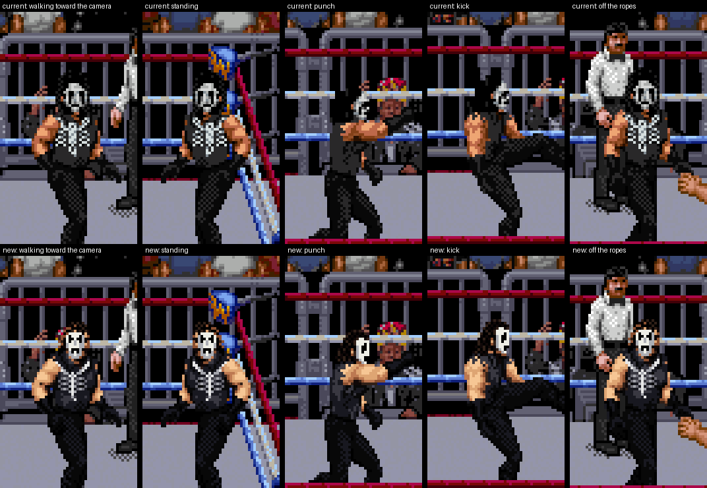
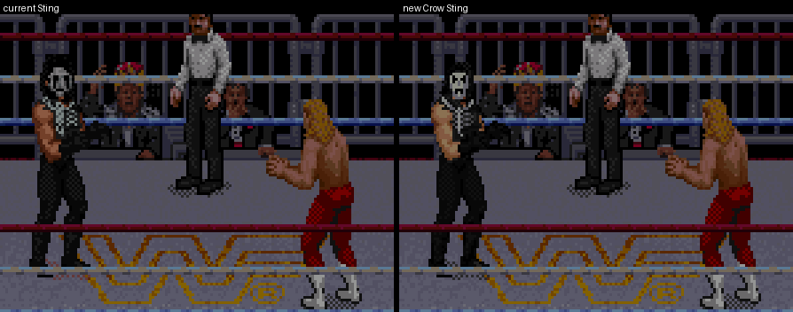
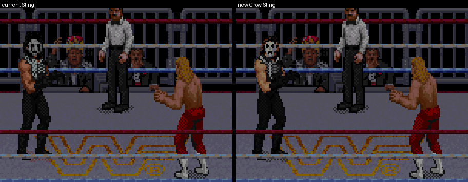
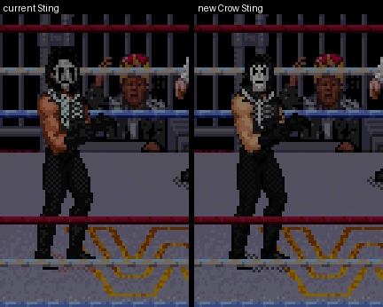
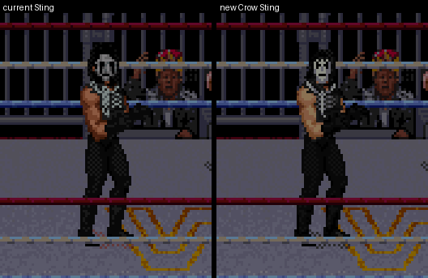
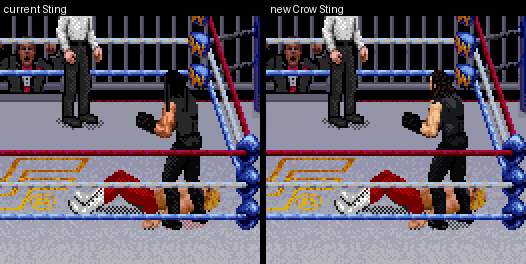

# Alternate Crow Sting (second take, beside the current Sting)

You asked whether Sting could be made better in Raw's style, from two photos of Crow‑era Sting (white face paint, long
dark hair, black sleeveless top with the silver scorpion skeleton, black gloves, trousers and boots). The current Sting
is unchanged: same files, same editor button. This is a second take you can compare it with.

Both rows are native Snes9x screens from the same cold-boot controller replay (`tools/capture_sting.py`), on the
gear reference mod with the current Sting and with this one; nearest-neighbour enlargement only.

| Walking | Off the ropes |
| --- | --- |
|  |  |

| Punch | Kick |
| --- | --- |
|  |  |

## What is different

| | Current Sting | New Crow Sting |
|---|---|---|
| Hair | A flat black shape around the head | The Undertaker donor's own long hair, darkened; Raw's dithering and strands stay |
| Face | Grey mask, heavy black eye and jaw shapes | White paint with a grey shadow side, inside the donor's own face; thin Crow marks: brow points, eyes, cheek streaks, black lips, chin lines |
| Scorpion | White checker grid | Three greys: pincers, carapace, segmented spine, ribs and tail |
| Skin, gloves, boots | Orange skin; black gloves and boots | Tan skin; black gloves and boots with the shirt's own highlight; no trouser stripe |
| Shadow | Pink tint: its recolour moved the shadow's colour index | The game's grey shadow (shadow pieces keep their index) |

Unchanged: the Undertaker donor anatomy, Doink's moves with the Scorpion Deathlock, the storage, the worker and the
`STING-NATIVE-GEAR4` marker. The head positions come from the earlier Sting work (`data/sting-rebuild-heads.json`).

## How it is made

- `tools/sting_crow_art.py` authors every one of the donor's 1,720 pieces:
  - a palette remap: shirt, trousers, gloves and boots black; hair darkened; skin tan;
  - the front and walking‑profile faces drawn explicitly (`FACE_GRIDS`), the profile and tilted views too;
  - other registered heads get the same makeup placed from their eye, mouth and jaw landmarks;
  - the few heads without landmarks keep the earlier paint, in this palette;
  - the scorpion on front‑facing shirts; the Deathlock's shared torsos filled with the shirt.
  - Pixels are only written where the donor already has one, so every silhouette stays Raw's.
- `tools/build_sting_crow.py` applies it. It reads the donor from your ROM with the static part resolver, so no
  memory dump is needed; your ROM's pixels are not in the repository.

## Checks

- The ROM-only donor catalog equals the WRAM-based catalog on all 1,720 pieces.
- `tools/build_sting_replacement.py` (now accepting another art function) still rebuilds the current Sting byte for
  byte.
- Both builds replay the same inputs identically through walk, ropes, punch, kick and the full Scorpion Deathlock
  (action 592 observed).
- The Perfect-Plex scenario on Sting replays in sync on the new build, and the receiver shows the new art.

## Not done

- It is not an editor preset yet. Build it with `python3 tools/build_sting_crow.py RAW.sfc --output OUT.sfc`, then
  Add Mr. Perfect.
- Moves that use the game's shared generic bodies (thrown, slammed) show that generic body, in both versions.
- No bat.
