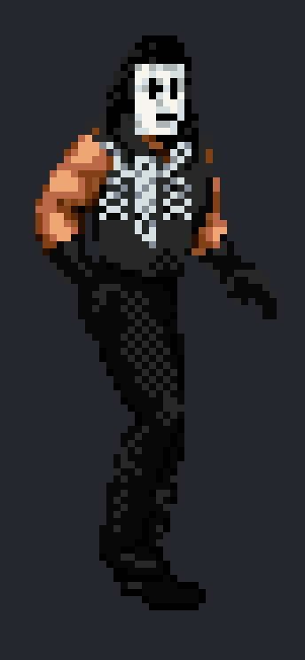
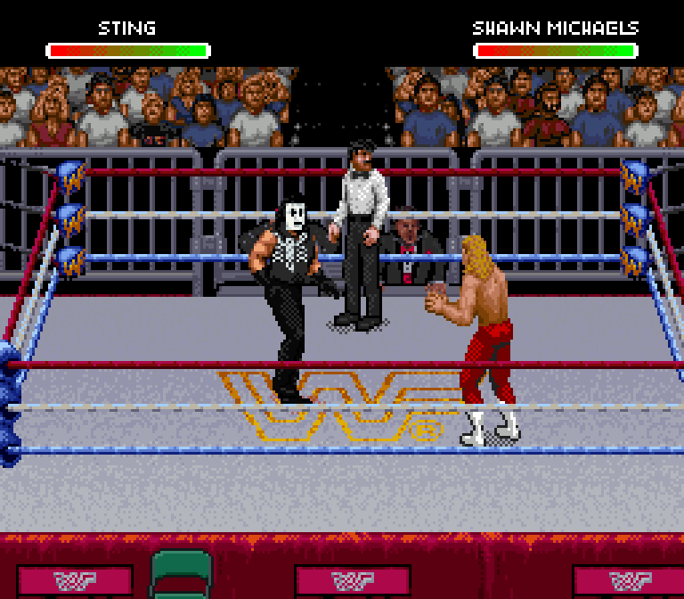
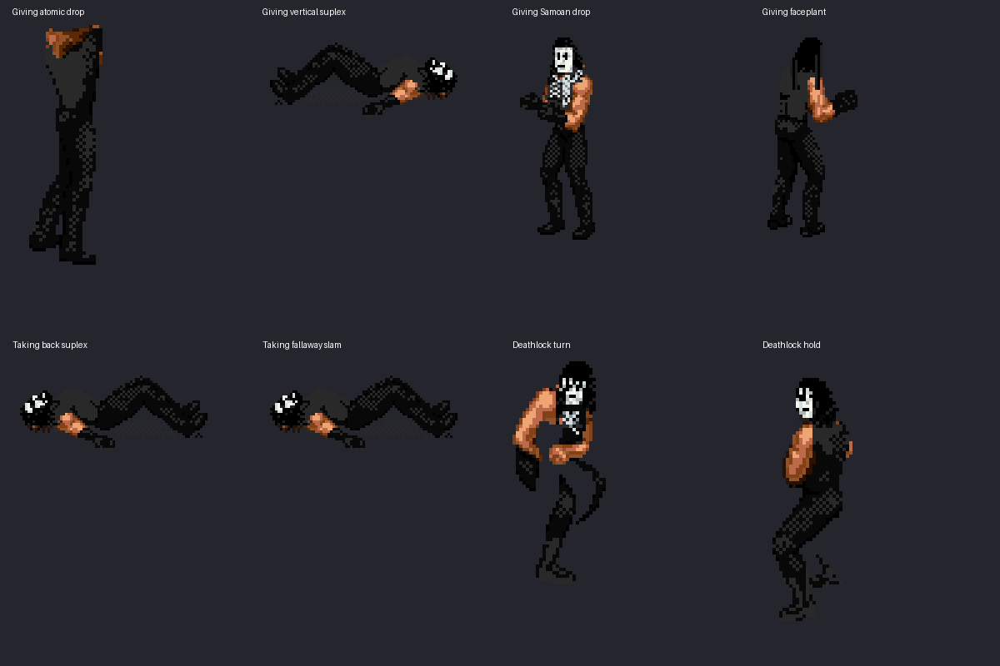
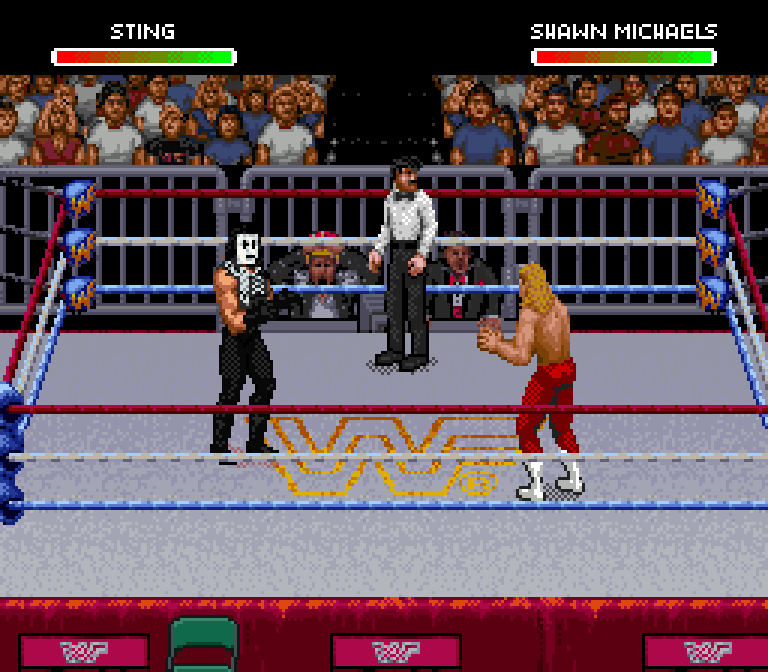
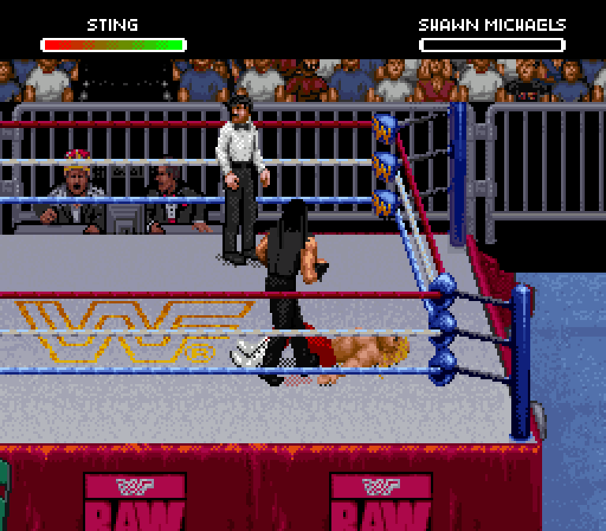
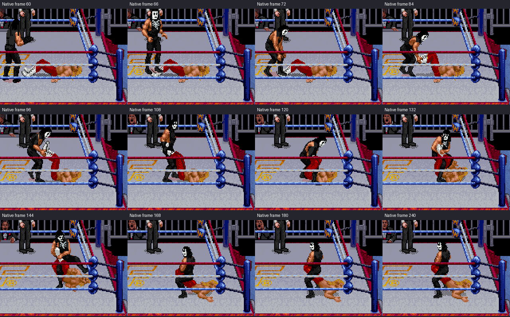

# Sting native face and gear revision — v0.14 candidate

This replaces the rejected flat makeup draft with native facial shading. The
front face uses 1-2-3 Kid's actual eye, nose and lip anatomy, positioned inside
Sting's head. Other views retain their own native face planes. Thin eye paint,
white/gray face shading and tapered dark locks follow the supplied references.
The body remains in the game's original sprite style.

**The screenshot and GIFs below are actual Snes9x captures of the exported ROM.**
The isolated close-up uses those same native OBJ pixels, enlarged without smoothing.

## Head placement

Top: the earlier v0.13 head. Bottom: this native-shading candidate.

The red circles identify the front eye landmarks; the blue dot identifies the
nose. These derive from the user-marked Kid/Syxx face: the nose is two rows below
the eyes, and the lips four rows below. Crop row numbers differ with crown bounds.

## Gear review

The sleeveless black shirt, scorpion chest mark, trousers, boots and gloves
remain the approved outfit. Comparing native poses with the full-body reference
found two defects:

- The seated Deathlock left a strip of bare flank/waist beneath the shirt. That
  area is now covered; the foreground arm remains bare.
- A shared black tile had picked up a white face-paint pixel in v0.13. Its uses
  produced 48 stray white pixels across 46 lower-body drawings. Those pixels
  now return to their native black. All 426 wrestler-specific lower drawings
  were checked; the remaining 380 are unchanged.

The logo remains a small SNES interpretation. Its claws, legs and tail still
need visual review in narrow and rotated views. This candidate does not claim
Sting's likeness or every possible interaction is finished.

## Actual movement and Deathlock

| Walking | Running / ropes |
| --- | --- |
|  |  |

[Giving atomic drop](give-atomic-drop.gif) · [Giving back suplex](give-back-suplex.gif) ·
[Giving Samoan drop](give-samoan-drop.gif) · [Giving faceplant](give-faceplant.gif) ·
[Giving vertical suplex](give-vertical-suplex.gif) · [Taking atomic drop](take-atomic-drop.gif) ·
[Taking back suplex](take-back-suplex.gif) · [Taking faceplant](take-faceplant.gif) ·
[Taking fallaway slam](take-fallaway-slam.gif) · [Taking vertical suplex](take-vertical-suplex.gif)

## Try the candidate

[Download WrestleEdit v0.14](https://github.com/yourpalbones/WWF-Raw-Mod/raw/refs/heads/main/downloads/WrestleEdit-v0.14.zip).
Extract the ZIP, open **WrestleEdit.html**, load your latest mod, select the
**Doink / Sting slot**, then **Sprites → Rebuild Sting sprites → Save & play**.
Your other wrestlers, photos, profiles and songs are retained. No ROM is bundled.

Older v0.12/v0.13 mods load and export unchanged before you choose to rebuild.
Their original captured previews remain available. The new candidate has 101
native full-body previews and 1,720 pieces. Each captured preview was compared
pixel for pixel against the native PPU snapshots. The complete Deathlock and ten
giving/taking samples executed in the emulator. Rare poses and Mega Move
reproduction remain unverified; portraits are separate assets.

[Head and gear checks](head-and-gear-verification.json) ·
[Native replay inputs](native-replays.json) · [Identity checks](identity-verification.json) ·
[Editor checks](editor-verification.json) · [Preview checks](native-previews.json) ·
[ZIP and older-mod checks](package-verification.json)
