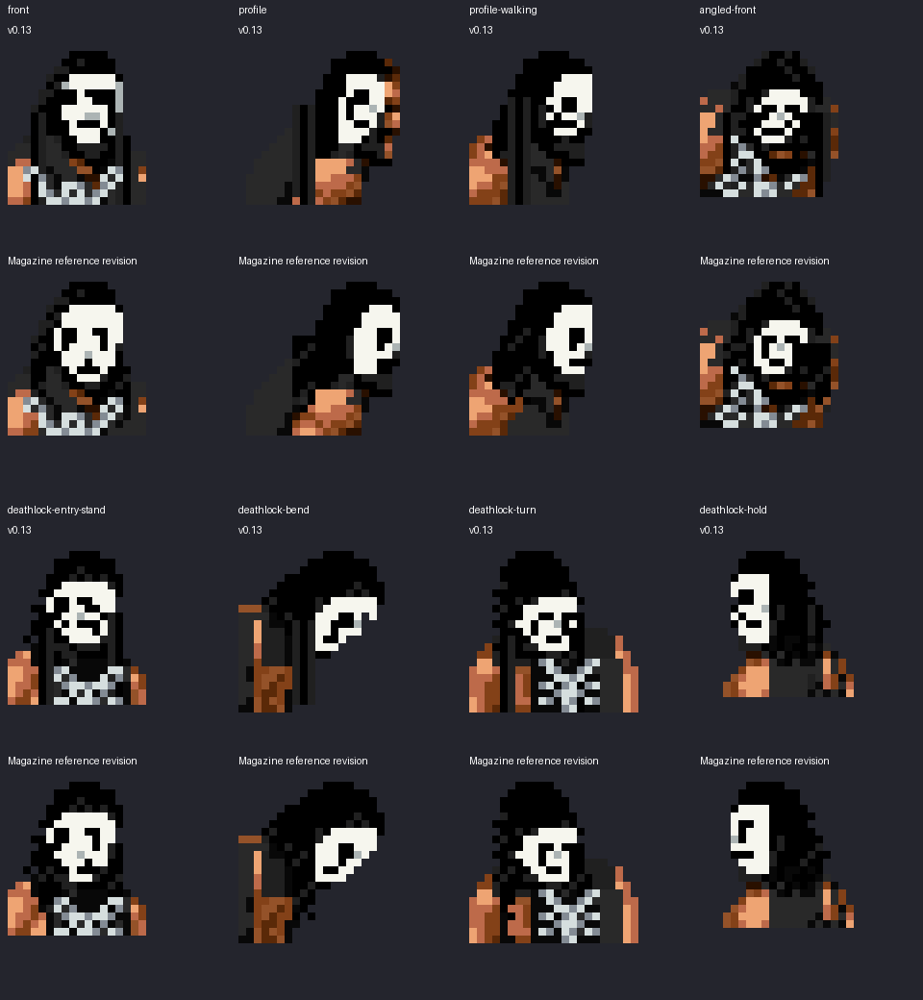
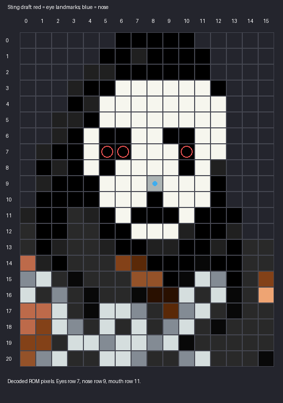

# Sting head revision — review draft

These are actual pixels decoded from the draft ROM, enlarged without smoothing.
The gear remains the approved v0.13 scorpion outfit. The head revision follows
the magazine reference with separate black eye sockets, thin paint trails,
white jaw and dark tapered side locks.

The front head uses the same eye/nose/lip spacing as the user-marked Syxx face:
the nose is two rows below the eyes, and the lips four rows below. The native
donor drawings have different crown bounds, so crop row numbers differ.
The profile mask was also shifted onto the native nose/jaw; the old version
painted too far behind the face and left a brown strip along its front.

The red circles identify eye landmarks; the blue dot identifies the nose. These
are a placement review, not a claim that Sting's likeness is finished. Native
movement and the complete Scorpion Deathlock are being verified before packaging.
