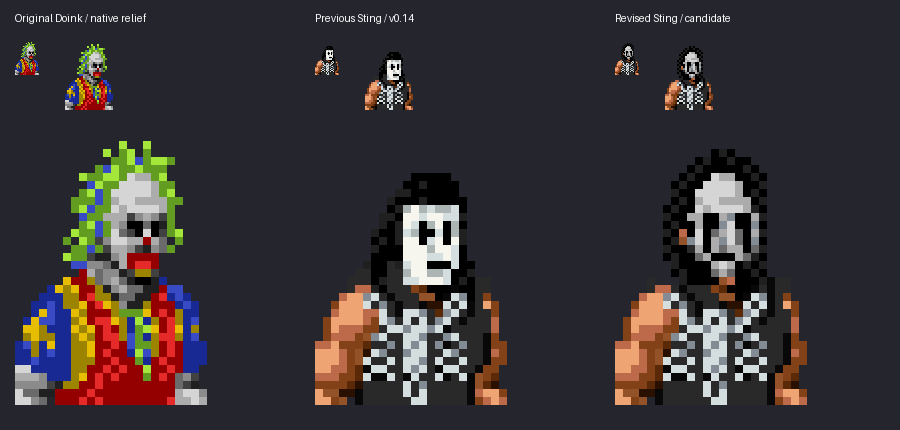
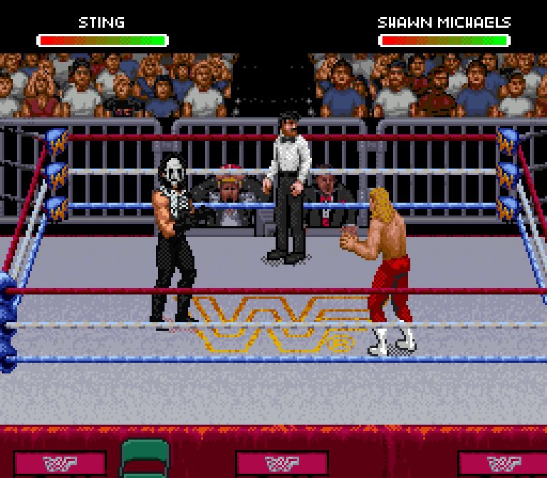

# Sting native face study

The new front head uses native Doink facial relief with individually drawn Crow paint: separate black eye sockets, a lit nose, thin outer cheek trails and low black lips. The gray levels preserve facial volume. Hair and the jaw replace the old head silhouette within existing SNES sprite objects.

This is an art candidate. The comparison reads actual ROM pixels. It is not a generated mockup. Only the front and standing side head are revised in this first checkpoint; the other animation heads are being authored separately.

Actual Snes9x gameplay screenshot, enlarged without smoothing:

The approved black scorpion outfit remains. The private test ROM also retains the newly imported Sting and Luger themes. No ROM is distributed here.

The face direction was approved. [The revised hair and final movement proof are here](../sting-native-heads/README.md).
