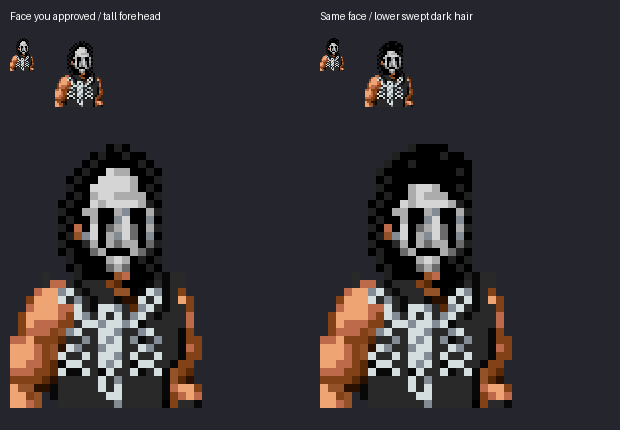
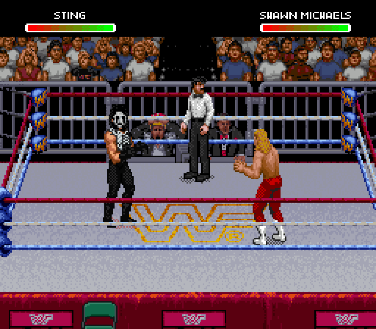
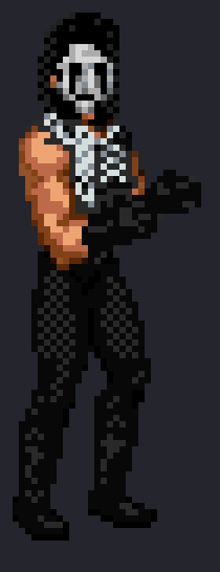
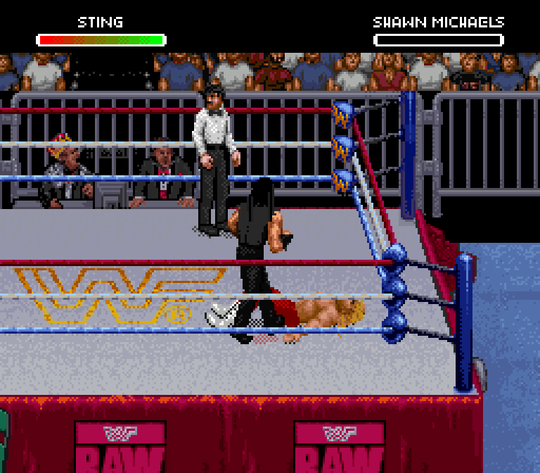

# Sting face, hair and movement — v0.15

The face keeps the direction you approved: a shaped nose and jaw, separate black eye sockets, thin cheek paint and low black lips. The new swept hairline reduces the tall forehead, with fuller dark locks around the face and neck.

This comparison reads actual ROM pixels. Left is the approved face study; right keeps those facial features with the revised hair. The small views show native size and 2×; the large views use nearest-neighbor enlargement.

Actual emulator screenshot and isolated native sprite pixels:

## Movement

These are Snes9x captures from cold boot and controller inputs.

[Running through the ropes](run-ropes.gif) · [Punching](punch.gif) · [Kicking](kick.gif)

The complete Scorpion Deathlock keeps Sting through the entry, turn and seated hold. The seated face now points left, matching its native anatomy.

[Deathlock frame sequence](deathlock-sequence.png) · [Eight native head views, before and after](native-head-comparison.png)

Giving moves: [atomic drop](give-atomic-drop.gif) · [back suplex](give-back-suplex.gif) · [Samoan drop](give-samoan-drop.gif) · [faceplant](give-faceplant.gif) · [vertical suplex](give-vertical-suplex.gif).

Taking moves: [atomic drop](take-atomic-drop.gif) · [back suplex](take-back-suplex.gif) · [faceplant](take-faceplant.gif) · [fallaway slam](take-fallaway-slam.gif) · [vertical suplex](take-vertical-suplex.gif).

## Use the updated editor

[Download WrestleEdit v0.15](https://github.com/yourpalbones/WWF-Raw-Mod/raw/refs/heads/main/downloads/WrestleEdit-v0.15.zip). Extract the ZIP and open WrestleEdit.html. Load your latest ROM, choose the Doink / Sting slot, then **Sprites → Rebuild Sting sprites → Save & play**.

The existing black scorpion outfit, other wrestlers, portraits, bios and songs are preserved. Older Sting mods keep their correct previews before upgrading.

## Verification

All 101 updated editor captures match native OAM/VRAM pixels. All 101 older Sting3 previews also match their archived native captures. The browser rebuild matches the native builder byte for byte; offline export/reopen and sprite project round trips pass.

All 1,720 frame descriptors use private Sting tiles. All 426 wrestler-specific lower drawings remain byte-identical to the prior mod. Fourteen Deathlock head pieces have separate, checked facial gray planes and mapped landmarks. Foreground hands/arms are preserved, including the formerly white forearm in pose36. The imported Sting/Luger MIDI allocations and all 94 stock audio uploads remain unchanged.

The existing codec and sprite test suite also passes all [21 tests](unit-tests.log), including comparisons with the original decoder and 843 live tile outputs.

These samples verify the listed actions and captured previews. Rare poses and complete live interaction coverage still need review; the edited Mega Move has not been verified. The artwork remains open to visual refinement.

[Native head/scope checks](head-verification.json) · [Observed tile requests and finisher landmarks](identity.json) · [Editor/export checks](editor-verification.json) · [Older-mod compatibility](legacy-verification.json) · [Capture provenance](native-replays.json). No ROM is distributed here.
