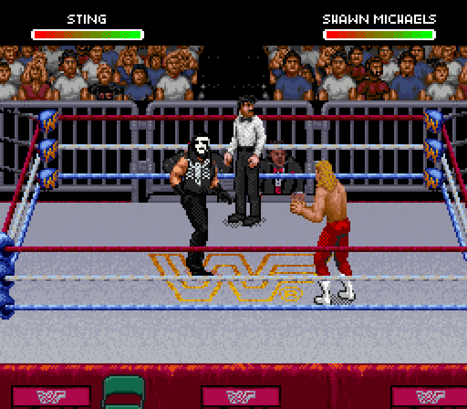
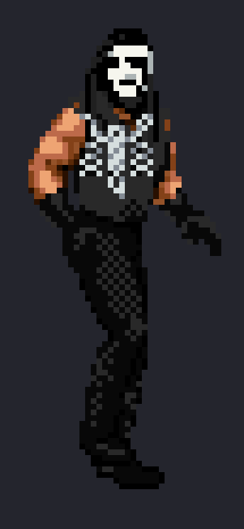
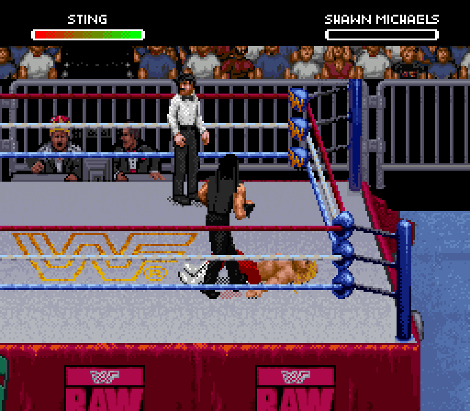
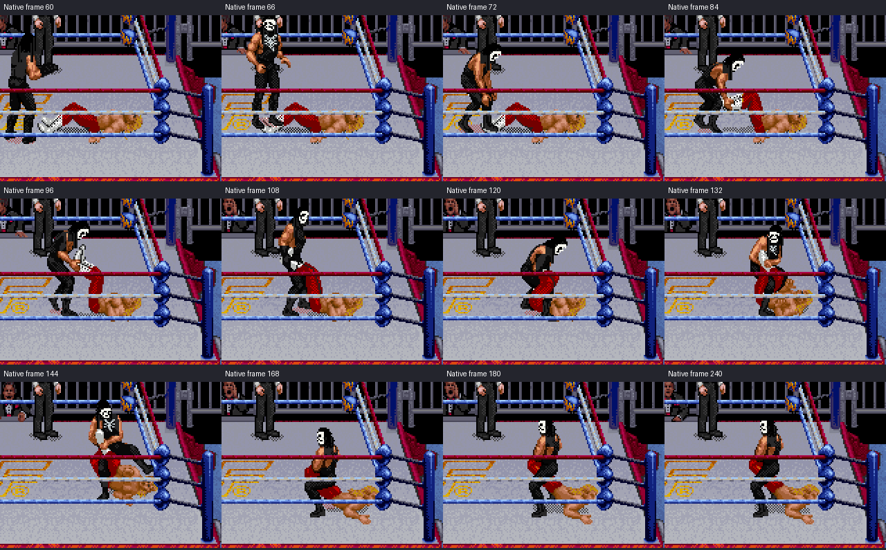
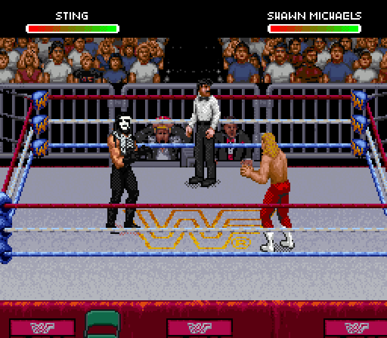
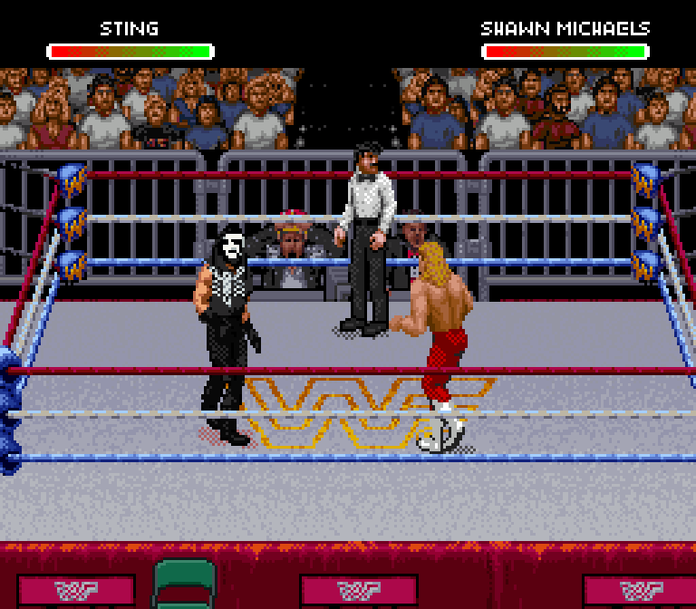

# Rebuilt Crow Sting — v0.13 candidate

This replaces the Doink sprite set with a donor-based Sting character. The
sleeveless body, native movement and flowing hair foundation come from
Undertaker's graphics. Crow face paint, hair shaping and scorpion artwork are
authored for Sting. The proportions, shading and animation remain in the game's
native pixel style. Doink's normal moves remain, with Bret's Sharpshooter assigned
as the Scorpion Deathlock.

**These images and GIFs are actual Snes9x captures of the exported ROM.**

## Native sprite close-up

The close-up extracts the captured sprite pixels and enlarges them with nearest
neighbor scaling. It preserves the game's geometry and colors.

## The full Deathlock stays Sting

The earlier version missed shared full-body heads, including heads stored in the
lower-body directory and the move's standing/crouching entry poses. This rebuild
authors those poses and gives **every tile** its own private replacement.

All 14 visible head drawings in this sequence contain Crow makeup. The recorded
native tile requests have **zero stock graphics fallbacks**. This checks the
entry and transition poses as well as the seated hold.

## Moving and wrestling

| Walking | Running / ropes |
| --- | --- |
|  |  |

| Giving an atomic drop | Taking a back suplex |
| --- | --- |
|  |  |

Additional controller replays all executed their observed move:

| Giving | Taking |
| --- | --- |
| [Back suplex](give-back-suplex.gif) | [Atomic drop](take-atomic-drop.gif) |
| [Samoan drop](give-samoan-drop.gif) | [Faceplant](take-faceplant.gif) |
| [Faceplant](give-faceplant.gif) | [Fallaway slam](take-fallaway-slam.gif) |
| [Vertical suplex](give-vertical-suplex.gif) | [Vertical suplex](take-vertical-suplex.gif) |

[Punch](punch.gif) · [Kick](kick.gif)

## Install the rebuild

[Download WrestleEdit v0.13](https://github.com/yourpalbones/WWF-Raw-Mod/raw/refs/heads/main/downloads/WrestleEdit-v0.13.zip).
Extract the ZIP, open **WrestleEdit.html**, load your latest mod, select the
**Doink / Sting slot**, then **Sprites → Rebuild Sting sprites → Save & play**.
Your Hall, Nash, Syxx, portraits, bios and songs are kept. The result is an
8 MiB ExHiROM tested in Snes9x. No ROM is included.

Older v0.12 Sting mods retain their previous previews until you click the rebuild.
Updating another wrestler also preserves the old Sting graphics; that path was
checked in the native emulator and remained pixel-exact.

The editor includes **101 captured full-body poses**, all pixel-exact against
native PPU snapshots, and **1,720 parsed pieces** for the rebuilt sprite set.
It registers 197 head drawings and also carries reviewed paint through exact
matching head tiles. Upper and lower tile namespaces are independent, allowing
18,936 privately owned tiles without crossing the engine's 14-bit tile limit.

## Remaining review

This is a rebuilt candidate for the first release, not an exhaustive visual
certification of every possible animation or matchup. Rare poses still need
review. Portrait/monitor photos remain separate assets. Mega Move reproduction
remains unverified on this edited base. The bat is not added as a weapon/move.

[Native replay inputs and actions](native-replays.json) ·
[Identity / ownership verification](identity-verification.json) ·
[Editor verification](editor-verification.json) ·
[Preview comparisons](native-previews.json) ·
[Older-mod compatibility](compatibility.json) ·
[Download package verification](package-verification.json)
