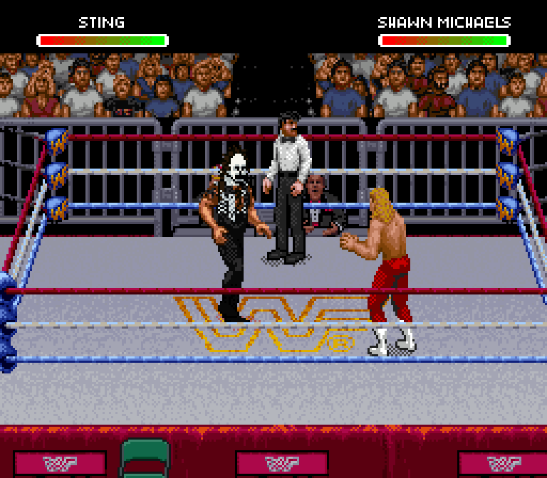
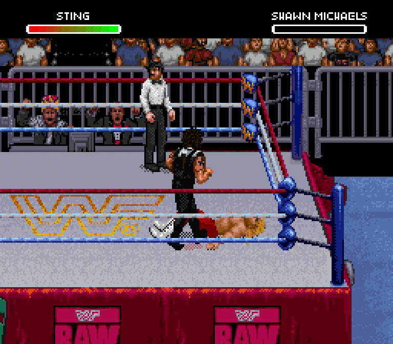
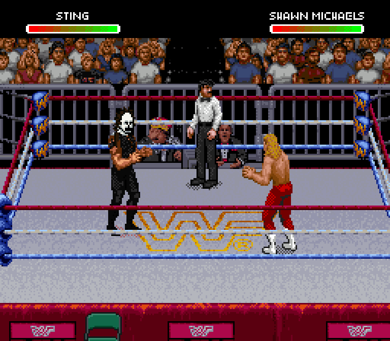
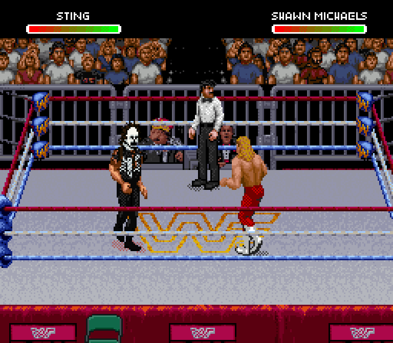

# Crow Sting in Doink's slot — first playable version

These are actual Snes9x captures of the exported ROM, using controller inputs.
The submitted reference gear is interpreted at the original game's pixel size:
white/black face paint, dark hair, a black sleeveless scorpion shirt, full black
tights and black boots. The body proportions and object animation remain native.

## Scorpion Deathlock

Doink's slot now uses Bret Hart's Sharpshooter entry, opponent reaction and
submission setup. This keeps Sting's character selector and private artwork.
Use **R near a downed opponent's legs while their health is red**.

## Movement and grapples

| Walking | Running / ropes |
| --- | --- |
|  |  |

| Giving an atomic drop | Taking a back suplex |
| --- | --- |
|  |  |

[Punch replay](punch.gif) · [Kick replay](kick.gif)

## Use the editor

[Download WrestleEdit v0.12](https://github.com/yourpalbones/WWF-Raw-Mod/raw/refs/heads/main/downloads/WrestleEdit-v0.12.zip).
Extract the ZIP, open **WrestleEdit.html**, load your latest ROM, choose **Doink**,
then **Sprites → Apply Sting reference gear → Save & play**.
The conversion updates the bio name, selection name artwork and health-bar name
to **STING**, and the bio finisher to **SCORPION DEATHLOCK**. Existing Hall, Nash,
Syxx, songs and other user edits are retained. The result is an 8 MiB ExHiROM
tested in Snes9x. No ROM is included in the download.

The editor exposes **1,720 structurally parsed frame pieces and 59 captured
full-body poses** for this slot. All 59 captured previews match native OAM/VRAM
pixels exactly. Export, reopen, PNG editing and project restoration passed offline.
The browser's native gear result also matches the Python builder byte for byte.

## Remaining work

This is a first playable art pass. Every animation has **not** been visually
reviewed. Hair silhouettes, rotated faces and scorpion placement still need
individual refinement. The main portrait and small monitor photo remain separate
assets and are not replaced by this gear button. The bat is not added as a move.

The recorded Doink Mega Move recipe did not reproduce its move in this modified
base. It also failed in a control with Doink's original finisher tables restored.
Mega Move behavior remains unverified; this page does not claim it passed.

[Controller replay evidence](native-replays.json) ·
[Editor verification](editor-verification.json) ·
[Preview verification](native-preview-verification.json) ·
[Four-pack build regression](four-pack-regression.json)
