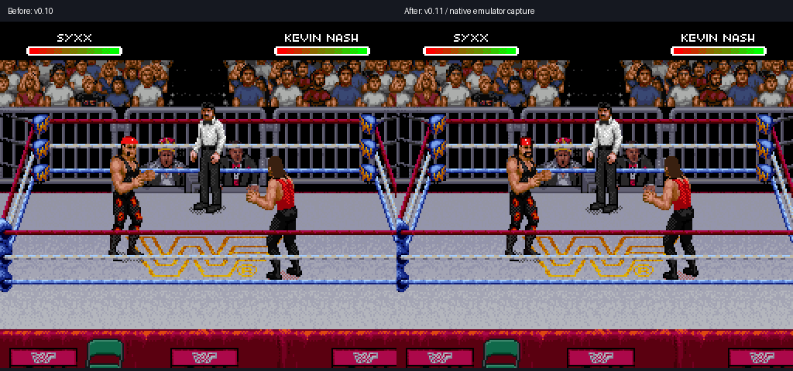
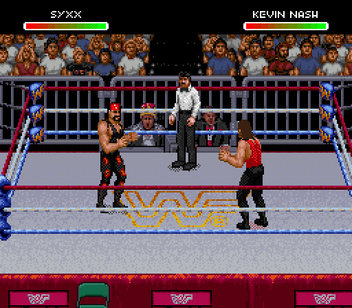
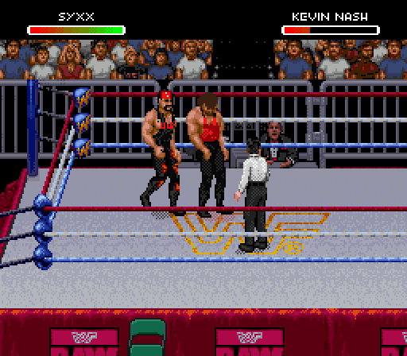
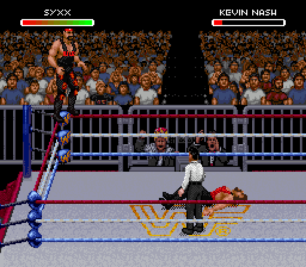
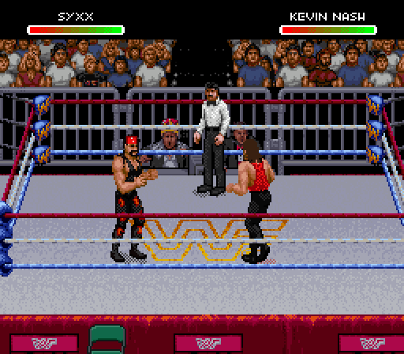

# Syxx head update: native gameplay proof

The v0.11 Syxx reference gear follows the nose, eyes and mouth marked by the
user in the [approved native face study](../syxx-head-study/README.md).
The moustache sits below the nose, with the beard around the mouth and jaw.
Separate native masks handle turned, tilted and folded head drawings. The
bandana stays attached to the registered head rather than following a body
centroid that can point at a raised arm.

[Download WrestleEdit v0.11](https://github.com/yourpalbones/WWF-Raw-Mod/raw/refs/heads/main/downloads/WrestleEdit-v0.11.zip).
Load your latest mod, choose the **1-2-3 Kid / Syxx** slot, open **Sprites**, apply
the reference gear, then save a playable ROM. Existing portraits, bios, names
and songs are preserved. v0.9/v0.10 mods retain their captured previews before
upgrading. The package contains the offline browser editor; no ROM is included.

## Movement and attacks

These GIFs use timed frames from native Snes9x controller replays. They are
running-game captures rather than a manually assembled sprite animation.

| Walking | Running and ropes |
| --- | --- |
|  |  |

| Punch | Kick |
| --- | --- |
|  |  |

## Finisher and Mega Move

| Top-rope finisher | Mega Move |
| --- | --- |
|  |  |

The native action words **608** and **586** were observed, respectively.

## Giving and taking grapple samples

| Giving an atomic drop | Taking a back suplex |
| --- | --- |
|  |  |

Ten controller recipes were replayed and their actual action words recorded.
The `give-back-suplex` recipe reached only tie-up states, so it is not counted
as a successful back-suplex demonstration. The grapple GIFs sample every 18
native frames; the other GIFs sample every six frames.

## Verification and remaining coverage

[Art checks](art-verification.json) confirm unchanged opaque masks across all
1,720 frame pieces and preservation of 1,247 protected visible feature pixels
in 269 registered head pieces. Nine registered pieces have an arm obscuring
the face; their covering arm receives no beard. Other face drawings still
need separate registration. The accepted original front-face mask is retained.

[Editor checks](verification.json) compare the browser presets with the native
build byte for byte, compare 384 editor poses with native OAM/VRAM, and verify
older-version upgrades, PNG/project editing, reopening, and 6 MiB bio exports.
Scott and Nash use their unchanged v0.10 capture fixtures for the pixel checks;
Syxx was replayed on the new ROM. [Music checks](music-verification.json) cover
all twelve custom theme slots; [profile checks](profile-verification.json)
cover monitor photos, name artwork, theme assignments and export behavior.
[Package checks](package-verification.json) verify the ZIP and offline
ROM load/export using the extracted HTML. Cloud Chromium blocks direct file
URLs, so that check served the HTML locally before disabling networking.

[Replay inputs and observed states](native-replays.json) provide the capture
details. This verifies the recorded cases, not every move, interruption,
opponent interaction or head drawing in the game. Full live coverage remains
unverified.
