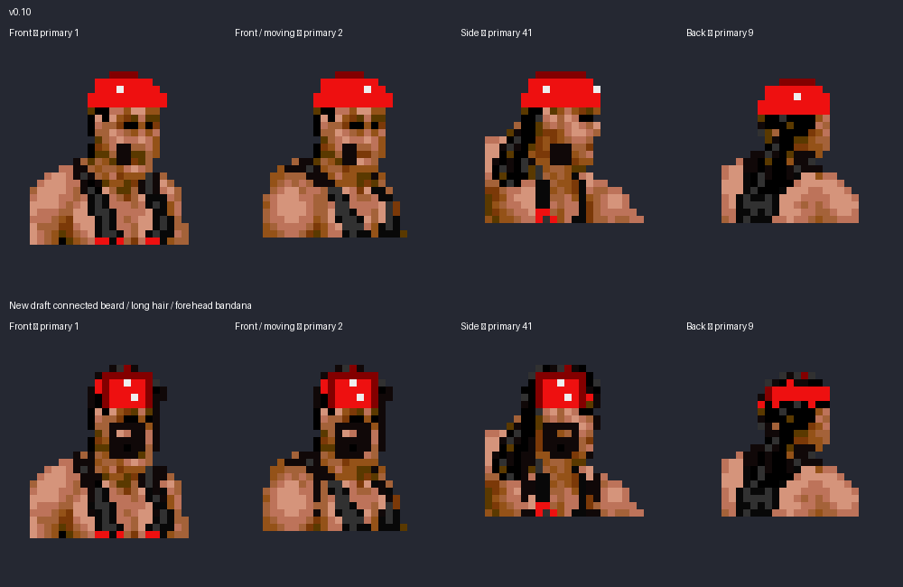

# Syxx head art study

Top: v0.10. Bottom: the new draft with a connected moustache/beard, longer dark strands, and a tall red forehead panel beneath the hair. These are decoded 4bpp ROM pixels in native sprite layouts, enlarged without smoothing. This is a sprite art study, not a gameplay screenshot or completed release.

The reference is the user's Syxx figure-package photograph: long wet hair framing the face and shoulders, a connected beard, and a tall bandana visible through the hair. The previous small chin patch did not depict that.

Shared special-move head pieces are being mapped as part of the same pass. Gameplay verification and the new editor release remain pending. The existing downloadable editor is still v0.10.
