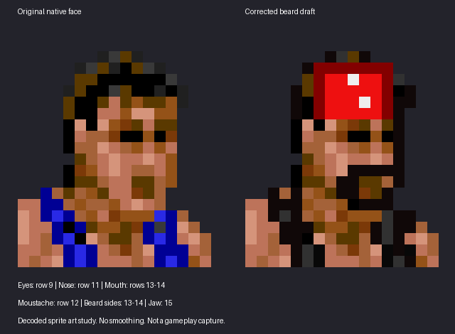
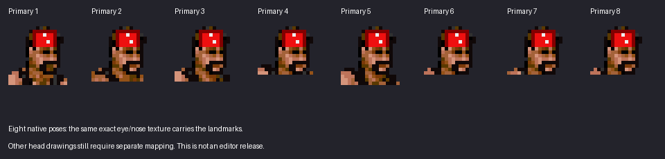

# Syxx head art study

The user marked the original sprite's eyes (row 9), nose (row 11), and mouth (rows 13–14). The corrected draft puts the moustache on row 12 and the beard around the mouth and lower jaw. The marked eyes, nose and mouth pixels remain unchanged. The jaw row below the mouth is inferred, not a separate user annotation.

Left: original game face. Right: corrected draft. These are decoded 4bpp pixels in native sprite layouts, enlarged without smoothing. This is a sprite art study, not a gameplay screenshot or completed release.

The same original brow/eye/nose texture matches **31 primary pieces exactly**, including translated and reflected poses. Facial landmarks transfer with those transforms. Other face drawings need separate anchors; they do not receive a guessed beard based on the hair's top edge.

[Corrected draft on the numbered grid](corrected-head-grid.png) uses the same row/column coordinates as the user's marked original.

The reference is the user's Syxx figure-package photograph: long wet hair framing the face and shoulders, a connected beard, and a tall bandana visible through the hair. The previous small chin patch did not depict that.

Shared special-move head pieces are being mapped as part of the same pass. Gameplay verification and the new editor release remain pending. The existing downloadable editor is still v0.10.

The [previous comparison](comparison.png) is retained as a rejected draft: its beard sat too high. The old crown-relative chin patch has been removed from the new drawing code.

[Original game head with numbered pixels](original-head-grid.png) is provided for landmark placement. Columns run left to right and rows top to bottom.
