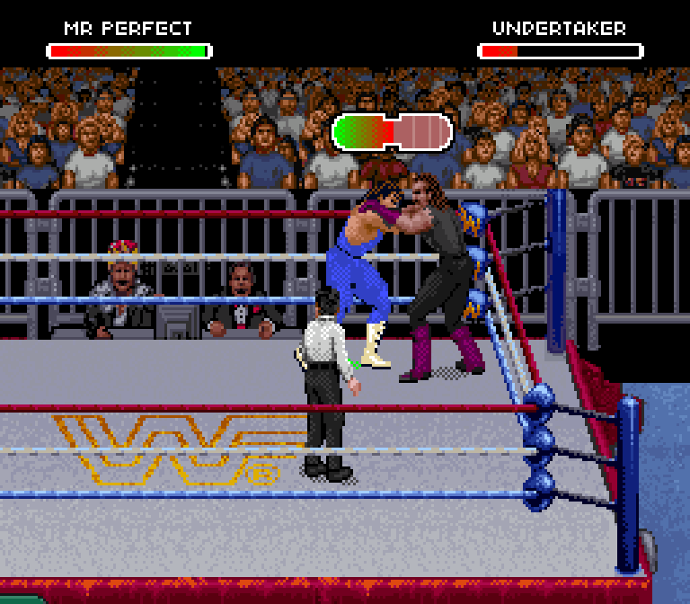

# Undertaker receiving the corrected Perfect-Plex

Independent Codex cold-boot replay of Claude PR #1 at `93d8e16`, using the same
browser export as the Bret check. Scenario: `undertaker-attacker-left-right-rope`.
The existing defect assertions passed; no emulator RAM edits were used.
This is a draft implementation, not a released editor update.

The GIF samples every fourth native frame at approximately normal speed,
enlarged 3x with nearest-neighbor scaling. The referee partly covers the pair.
Perfect's green shadow and bridge-to-pin remain unresolved. This capture does
not establish customized gear fidelity or full roster coverage.
